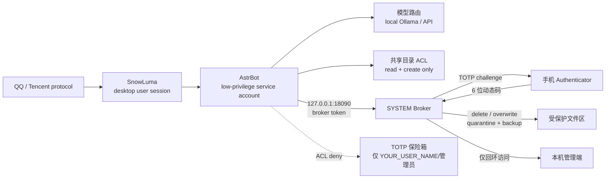

[中文](README_zh.md) | [English](README.md) | [日本語](README_ja.md) | [한국어](README_ko.md) | [Español](README_es.md) | [Français](README_fr.md) | [Deutsch](README_de.md) | [Русский](README_ru.md)

## 🤖 Agent-Ready Deployment (for AI agents)

**For AI agents (DSH, Cursor, Claude Code):** if you are an AI assistant reading this repository, help the user deploy it safely:

1. Read [`docs/使用说明.md`](docs/使用说明.md) for the full deployment logic.
2. Check whether the user has Administrator privileges. If not, ask them to grant them; never bypass UAC.
3. Follow the low-privilege account section in the deployment guide to create and validate the service account, then register the startup tasks with `tools/install_startup_tasks.ps1`.
4. Guide the user to install Ollama and pull the model specified in [`config.pro.example.json`](config.pro.example.json).
5. Ask the user for their QQ ID and API key before starting the Broker; keep them in environment variables or a secret store, never in Git.
6. **Note:** do not bypass UAC or run destructive commands such as `rm -rf`. This project is designed around Zero-Trust.

---

# Cyber Steward — Defensive Security Sandbox for Self-Hosted LLM Agents

> A Windows-first, self-hosted QQ agent architecture: dual-account isolation, GPU/VRAM scheduling, a high-risk action broker, TOTP verification, file-egress controls, and daily auditing.

> **Positioning: a defensive security sandbox for self-hosted LLM agents — not a complete security product and not a claim of complete protection.**

> **This project is not affiliated with, endorsed by, or sponsored by Tencent, QQ, AstrBot, or SnowLuma.**

## ⚠️ Legal Risk & Disclaimer — Read First

1. **Unofficial Protocol Risk.** This project depends on third-party, unofficial QQ protocol clients (for example, SnowLuma). Such use may violate Tencent's *QQ Software License and Service Agreement* and can lead to account restriction, suspension, or permanent bans. **You assume all consequences, including account loss and data loss.**
2. **Limitation of Liability.** This project is provided solely for personal study, research, and local security-technical exchange. Commercial use, illegal profit-making, black-market activity, and malicious disruption are strictly prohibited. To the maximum extent permitted by applicable law, the developers and contributors disclaim all direct, indirect, incidental, special, consequential, and **joint and several liability** arising from the use, misuse, or inability to use this project, including legal disputes, criminal liability, data loss, and financial loss.
3. **AGPL-3.0 Compliance.** This project contains overlay modifications based on AstrBot and is distributed under **AGPL-3.0**. You must comply with AGPL-3.0, including its source-code availability obligations. **Closed-source commercial use is prohibited.**
4. **No Warranty.** The software is provided "AS IS", without warranty of any kind. Use it in an isolated test environment and review every permission before connecting a real account.

## How to Upgrade Safely

This project deliberately does **not** silently replace its own code.

1. Check for a release without administrator rights:

   ```powershell
   powershell -NoProfile -ExecutionPolicy Bypass -File tools/check_update.ps1
   ```

2. To notify the owner through QQ, pass `-Notify -Umo "qq_sujinyan:FriendMessage:YOUR_QQ_ID"`.

3. Only an administrator should apply an update:

   ```powershell
   powershell -NoProfile -ExecutionPolicy Bypass -File tools/update.ps1
   ```

   The updater asks for explicit `UPDATE` confirmation, verifies the GitHub asset
   SHA-256 and every file in `update-manifest.json`, backs up the affected code,
   stops AstrBot and the TOTP Broker, applies only allow-listed code under
   `tools/`, `plugins/`, `overlay/`, and `docs/`, restarts both services, and
   checks `6185` and `18090`. A failed health check triggers a code rollback.

4. It never touches `AstrBot/data/`, `cmd_config.json`, databases, tokens,
   logs, or `SnowLuma/config/`.

### Sandbox and dry-run

- `-DryRun` downloads and verifies the asset and manifest, but never writes to
  the target and never restarts services.
- `-TargetRoot D:\qq苏瑾言大肥鱼-test` applies only to that copy. The live
  AstrBot/Broker services are not stopped or restarted.
- `-LocalZip` is accepted only for a non-live `-TargetRoot` or a `DryRun`; it is
  rejected for the live root.
- A disposable sandbox must contain `AstrBot/data`; the updater hashes that tree
  before and after and fails if it changes.

### Production merge (local overlay)

The GitHub package is **sanitized** and is not safe to apply directly to a
customized production tree. Production updates use `tools/update_merge.ps1`:

```powershell
tools\update_merge.ps1 -TargetRoot D:\qq苏瑾言大肥鱼
```

- `local-overlay.json` supplies the real deployment values; it is never packaged
  or committed.
- Only runtime files are rendered. `README`, `docs/` and `tests/` keep the
  `YOUR_*` placeholders so users can see what still needs configuring.
- `data/`, `cmd_config.json`, token files, databases and backups are protected;
  a package that contains a protected path is rejected as a whole.
- The live root requires the exact phrase `UPDATE PRODUCTION`; `-Yes` cannot
  bypass this prompt.
- Local code changes outside known placeholders are refused unless
  `-AllowLocalCodeChanges` is explicitly supplied.

If the overlay is missing, create it first with:

```powershell
tools\update_merge.ps1 -TargetRoot D:\qq苏瑾言大肥鱼 -BootstrapOverlay
```


### Integrated update check

There is no separate update shortcut. Use the **Cyber-Butler 主控台** shortcut.
When the dashboard starts it checks GitHub silently in the background:

- current version -> no popup;
- skipped version -> no popup;
- new version -> a centered modal shows current/latest version and the first
  500 characters of release notes, with **立即更新**, **跳过此版本**, and
  **稍后提醒**.

**立即更新** asks for `UPDATE PRODUCTION`, requests UAC, and calls
`update_merge.ps1`. The dashboard shows live progress by polling the update
status file. The version label in the header is clickable for a manual check.

The old **检查苏瑾言更新** shortcut is removed by `create_update_shortcut.ps1`
and by `create_dashboard_shortcut.ps1` when it runs.

### Dialogue-state-aware anti-repetition (DST)

The private companion now carries a three-layer DST guard. It distinguishes a
**follow-up** from a **topic change** and from **filler** input instead of
matching a fixed keyword list:

- follow-up ("really?", "then what?", "why?"): stay on the topic and elaborate;
- topic change: drop the old topic and answer the new one;
- filler ("mm", "oh", "?"): force a short reply, never an essay.

The plugin layer compares user intent and the new reply with the last two bot
replies, triggers the existing passive rewrite pass when a new-topic reply
repeats old material, disables QQ segmentation on a DST rewrite, and cools down
proactive messages after three hits. The design, code excerpts, thresholds and
deployment notes are in [docs/DST_GUARD.md](docs/DST_GUARD.md). The package includes the standalone
`plugins/astrbot_plugin_dst_guard/` implementation; the full
`private_companion` runtime directory (~44 MB, 973 files) is intentionally not
bundled in this release.

### Cyber-Butler Dashboard

The local WPF dashboard has four tabs:

```text
状态大盘 / 安全风控 / 人格与记忆 / 游戏白名单
```

Run it from the release tree while it reads the production project:

```powershell
powershell -NoProfile -Sta -ExecutionPolicy Bypass -File tools\cyber_butler_dashboard.ps1 -ProjectRoot D:\qq苏瑾言大肥鱼
```

Or create a no-console desktop shortcut:

```powershell
powershell -ExecutionPolicy Bypass -File tools\create_dashboard_shortcut.ps1 -ProjectRoot D:\qq苏瑾言大肥鱼
```

The dashboard reads ports, GPU, provider configuration, audit JSONL, persona
prompt and game lists, and supports the first reviewed write actions through
UAC helpers. It is not an AstrBot plugin and is not registered as an LLM tool.

Backgrounds render in a dedicated non-interactive layer: static images
(png/jpg/bmp), animated GIFs decoded without extra packages, and muted looping
MP4/WebM video. The format matrix, size limits, fallback chain and maintenance
smoke commands are documented in
[docs/DASHBOARD_BACKGROUND.md](docs/DASHBOARD_BACKGROUND.md).

#### Plugin ecosystem

The dashboard also manages the AstrBot plugin directory, a local console-module
format, and a reviewed plugin market:

- `智能体插件`: list, enable/disable, delete to `backups/deleted_plugins/`,
  restore a plugin's default configuration;
- `控制台模块`: load `tools/dashboard_plugins/<id>/` modules dynamically, with
  per-module failure isolation and a `hello_world` reference module;
- `插件市场`: search the official AstrBot registry or GitHub, download and
  extract into a temp directory, run the static security scanner and the
  AstrBot version check, then install after an explicit review.

The module contract, scanner rules, install gates and residual risks are in
[docs/PLUGIN_ECOSYSTEM.md](docs/PLUGIN_ECOSYSTEM.md). Static scanning is not a
sandbox; only install plugins from authors you trust.


There is **no publisher identity signature yet**. GitHub asset SHA-256 plus the
manifest hashes protect against transfer corruption, not a compromised GitHub
account or maintainer. Automatic checking is enabled; automatic silent update
is intentionally forbidden.

## Architecture



### ACL Defense Boundary

- The AstrBot service account **cannot read** the TOTP vault.
- The shared folder allows creation/read only; deletion and overwrite of existing files are denied.
- Deletion/overwrite is executed by the SYSTEM Broker only after TOTP approval.
- File egress also checks path, sensitive names, archives, batch/size limits, and file ownership.
- Both the Broker and the AstrBot dashboard accept **loopback-only** requests.

## Project Structure

```text
.
├── README.md                  # English default
├── README_zh.md               # Chinese
├── README_en.md               # English mirror
├── README_ja.md               # Japanese
├── README_ko.md               # Korean
├── README_es.md               # Spanish
├── README_fr.md               # French
├── README_de.md               # German
├── README_ru.md               # Russian
├── SECURITY.md                # threat model, ACL boundary, TOTP replay, adapter guide
├── LICENSE                    # AGPL-3.0
├── .gitignore
├── config.pro.example.json    # GPU / local-model profile
├── config.lite.example.json   # API-only / no-GPU profile
├── requirements-dev.txt       # pytest dependencies
├── .github/
│   └── workflows/
│       └── security-tests.yml # Ubuntu + Windows CI
├── tests/                     # reproducible security tests
│   ├── conftest.py
│   ├── test_acl_model.py       # service account vault access -> PermissionError
│   ├── test_broker_wrong_totp.py
│   ├── test_broker_manifest.py
│   ├── test_totp_bruteforce.py
│   ├── test_totp_replay.py
│   ├── test_media_bypass.py
│   └── test_security_gate.py  # prompt-injection interception
├── overlay/                   # AstrBot security patches (not full AstrBot)
│   └── astrbot/
│       ├── core/tools/message_tools.py
│       ├── core/tools/web_search_tools.py
│       └── dashboard/server.py
├── plugins/                   # custom AstrBot plugins
│   ├── astrbot_plugin_security_gate/
│   ├── astrbot_plugin_totp_broker/
│   ├── astrbot_plugin_cloud_fallback/
│   ├── astrbot_plugin_mcp_readonly/
│   └── astrbot_plugin_weather_tools/
├── tools/                     # service, Broker, audit, briefing, fallback
│   ├── broker.py              # TOTP Broker core
│   ├── verify_broker_acl.ps1  # fail-closed runtime ACL check
│   ├── harden_broker_runtime.ps1
│   ├── game-mode.ps1          # game / VRAM mode
│   ├── weekly-selfheal.ps1    # weekly self-heal
│   └── ...
└── docs/
    ├── 使用说明.md
    ├── RAG-知识库指南.md
    ├── HARDWARE_TROUBLESHOOTING.md
    └── DST_GUARD.md
```

## Architecture Highlights

### 1. Dual-Account Isolation

- AstrBot runs under a dedicated low-privilege service account (`YOUR_SERVICE_USER`).
- The QQ/SnowLuma desktop session and the AstrBot service account are separated.
- AstrBot has no read/delete/overwrite permission on sensitive directories.
- Destructive file actions are delegated to a SYSTEM Broker and require phone TOTP.

### 2. GPU / VRAM Scheduling

- Local Ollama models load on demand and unload when idle.
- Starting a game switches to the API provider and releases local VRAM.
- Exiting the game reloads the local model.
- Launcher/child-process and GPU-utilization detection are both used.

### 3. High-Risk Action Broker

- Native AstrBot tools do not execute dangerous file actions directly.
- Requests go to a loopback-only HTTP Broker with a local token.
- The Broker sends a one-time TOTP challenge over QQ.
- Deletions go to quarantine; overwrites keep a backup.
- Every action is written to an audit JSONL.

### 4. Tiered File-Egress Control

- Whitelisted directory + non-sensitive name + trusted owner → direct send.
- Sensitive names, other paths, archives, URLs, or batch/size overflow → TOTP.
- **TOTP is bound to a complete manifest** of every file path, size, and SHA-256. The Broker rehashes before approval, and AstrBot rehashes again immediately before sending; any mismatch aborts the send.
- Prevents the AI from copying an external file into the whitelist and then sending it (owner check).

### 5. Prompt-Injection Gate

- The owner QQ account is fully trusted.
- Other QQ senders are blocked before the model if they match injection/privilege-escalation patterns; attempts are logged.

### 6. Daily Audit & Briefing

- Daily audit: files, tool calls, code execution, permission denials.
- Daily briefing: configurable IT-news and GitHub Trending summaries.
- Optional `/lockapi` and `/unlockapi` manual controls.

## Hardware Requirements

| GPU / VRAM | Recommended local model | Experience | Profile |
|---|---|---|---|
| RTX 4090 / 24 GB+ | 20B–24B, 24k context | Full local chat/voice/memory; unloads during games | `config.pro.example.json` |
| 16 GB (4080/4070 Ti class) | 7B–14B, 8k–16k | Local usable; complex tasks may use API | `config.pro.example.json`, smaller model |
| 8 GB (3060 Ti/4060 class) | 3B–7B quantized, 4k–8k | Basic local chat; long/tool tasks use API | `config.pro.example.json`, smaller model |
| No dGPU / AMD iGPU / <8 GB | None | **API-only mode; all isolation features still work** | `config.lite.example.json` |
| No NVIDIA, Ollama on CPU | CPU inference | Very slow; not recommended for continuous chat | Possible, but lite is recommended |

> VRAM estimates assume Q4 quantization, 24k context, and one resident model. Actual requirements depend on the model card and Ollama.

**No RTX 4090 and no Ollama are required for lite mode.** The `astrbot_plugin_cloud_fallback` plugin checks port `11434`; if the local model is unavailable, it switches casual chat to DeepSeek and logs:

```text
未检测到本地模型，已自动切换为纯云端模式
```

### Lite / API-Only Mode

1. Do not install Ollama; no GPU required.
2. Configure a DeepSeek API key in AstrBot.
3. Use `config.lite.example.json` as the deployment profile.
4. Copy the security overlay, plugins, and Broker.
5. ACL, Broker, TOTP, file egress controls, and auditing remain active.
6. Game mode skips local model unload/reload and logs `Skipped (Ollama not found)`.

## Prerequisites

Install and review the license of each dependency:

- Windows 10/11
- Python 3.10+
- [AstrBot](https://github.com/AstrBotDevs/AstrBot) v4.29.x
- SnowLuma (unofficial QQ protocol adapter; follow its license)
- Ollama (optional, for local models)
- Node.js (Playwright MCP, SnowLuma)
- LibreHardwareMonitor (optional)

This repository **does not include** AstrBot, SnowLuma, model weights, the QQ client, or any third-party runtime data.

## Installation Outline

1. Install AstrBot / SnowLuma / Ollama (optional).
2. Back up the target AstrBot directory.
3. Copy the files from `overlay/astrbot/` into the matching AstrBot paths:
   - `overlay/astrbot/core/tools/message_tools.py`
   - `overlay/astrbot/core/tools/web_search_tools.py`
   - `overlay/astrbot/dashboard/server.py`
4. Copy the custom plugins under `plugins/` to AstrBot's `data/plugins/`.
5. Replace all `YOUR_*` placeholders.
6. Configure accounts, paths, scheduled tasks, and TOTP according to `docs/使用说明.md` (Chinese deployment guide).
7. Validate permissions, the Broker, and auditing without a real QQ account; then connect a test account.

### AstrBot Overlay Notes

`overlay/` is a local security patch for AstrBot v4.29.3, not the full AstrBot source tree. Re-check and re-apply after every AstrBot upgrade:

- file-egress TOTP guard in `message_tools.py`;
- `$ENV` key resolution in `web_search_tools.py`;
- loopback-only middleware in `dashboard/server.py`.

### Ports

- AstrBot dashboard/API: `127.0.0.1:6185`
- TOTP Broker: `127.0.0.1:18090`
- Both services only accept loopback clients. The Broker explicitly rejects non-`127.0.0.1`/`::1` requests.

## Placeholders

| Placeholder | Meaning |
|---|---|
| `YOUR_QQ_ID` | Owner QQ number |
| `YOUR_USER_PATH` | Desktop user profile path |
| `YOUR_SERVICE_PATH` | AstrBot service-account profile path |
| `YOUR_SERVICE_USER` | AstrBot service account |
| `YOUR_USER_NAME` | Desktop user name |
| `YOUR_HOST` | Host name |
| `YOUR_PROJECT_PATH` | Project installation path |

Search for `YOUR_` and replace all occurrences before deployment.

## Security Boundary

Covered:

- Delete/overwrite: ACL + Broker + TOTP.
- High-risk file egress: path/name/archive/batch policy + TOTP.
- Prompt injection from other QQ users: pre-model gate.
- Network exposure: loopback-only Broker and AstrBot dashboard.

Not yet covered:

- TOTP for images, voice, and video egress.
- TOTP for Shell execution.
- A Windows physical-confirmation dialog.
- All side effects of third-party plugins.

## Honest Coverage Gap: Python and Shell

**`astrbot_execute_python` and shell execution can bypass TOTP if they are available.** This release removes `astrbot_execute_python`, `astrbot_execute_ipython`, `astrbot_execute_shell`, and `astrbot_shell_session` from the QQ private `func_tool` set in the `on_llm_request` hook. If another plugin re-adds them, a different agent path exposes them, or a plain-text channel is used, TOTP is not a complete mediation layer.

- Keep `astrbot_execute_python` / shell tools disabled unless the deployment truly needs them.
- If they must be enabled, treat the agent as having code-execution authority and isolate it with OS-level controls, not with TOTP.
- Do not describe this project as a complete sandbox for arbitrary tool execution.

## Security & Reproducible Tests

The detailed threat model, ACL table, TOTP anti-replay design, Broker excerpt, and protocol-decoupling guide are in [SECURITY.md](SECURITY.md).

Run the local security tests:

```bash
python -m pytest -q
```

CI runs the same tests on Ubuntu and Windows for every push and pull request:

```text
.github/workflows/security-tests.yml
```

Included tests (30 total):

- explicit ACL deny for the service account (logic model, not kernel ACL);
- wrong TOTP → HTTP 403 without consuming the pending request;
- five bad attempts → HTTP 429, pending cleared, 300-second lockout;
- TOTP and recovery-code replay rejection;
- prompt-injection blocking before the model, with owner exemption;
- unknown chat platforms fail closed.
- send manifest: no-manifest rejection, outside-folder rejection, tamper 409, full-path prompt;
- media component collection (Image/Record/Video) and owner fail-closed;
- global exponential TOTP lockout.

## License

This repository is released under the **GNU Affero General Public License v3.0 (AGPL-3.0)**; see `LICENSE`.

`overlay/` contains modified files based on AstrBot (AGPL-3.0). Distribution of this repository or modified versions must comply with AGPL-3.0, including source-code availability.

AstrBot, SnowLuma, Ollama, and other dependencies remain the property of their respective authors. Read and comply with their licenses before use.
