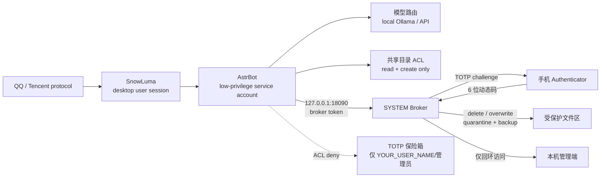

[中文](README_zh.md) | [English](README.md) | [日本語](README_ja.md) | [한국어](README_ko.md) | [Español](README_es.md) | [Français](README_fr.md) | [Deutsch](README_de.md) | [Русский](README_ru.md)

# Su Jinyan / Cyber Steward — Open-Source-Selbsthosting-Architektur

> Eine selbst gehostete Architektur für einen QQ-Agenten unter Windows: Trennung zweier Konten, GPU-/VRAM-Planung, Broker für risikoreiche Aktionen, TOTP-Verifikation, Datei-Egress-Kontrolle und tägliche Audits.

> **Dieses Projekt ist kein offizielles Projekt von Tencent, QQ, AstrBot oder SnowLuma und steht in keiner Verbindung, Zulassung oder Förderung durch diese.**

## ⚠️ Rechtlicher Hinweis und Haftungsausschluss (zuerst lesen)

1. **Risiko eines nicht offiziellen Protokolls**: Dieses Projekt verwendet **nicht offizielle** QQ-Protokollclients von Drittanbietern (z. B. SnowLuma). Diese Nutzung kann gegen die *QQ-Software-Lizenz- und Dienstvereinbarung* von Tencent verstoßen und zu Kontoeinschränkungen, Sperrung oder einer **dauerhaften Sperrung** führen. Der Nutzer trägt **alle Folgen**, einschließlich Kontoverlust und Datenverlust.
2. **Haftungsausschluss**: Dieses Projekt wird ausschließlich für persönliches Studium, Forschung und lokalen sicherheitstechnischen Austausch bereitgestellt. Kommerzielle Nutzung, illegale Gewinnerzielung, Schwarzmarkttätigkeiten und böswillige Sabotage sind streng verboten. Soweit gesetzlich zulässig, lehnen Entwickler und Mitwirkende **jegliche Haftung** ab, einschließlich der **gesamtschuldnerischen Haftung**, für direkte, indirekte, zufällige, besondere oder Folgeschäden aus der Nutzung, dem Missbrauch oder der Nichtnutzbarkeit dieses Projekts, einschließlich Rechtsstreitigkeiten, strafrechtlicher Verantwortung, Datenverlust und finanzieller Verluste.
3. **AGPL-3.0-Konformität**: Dieses Projekt enthält modifizierten Overlay-Code auf Basis von AstrBot und wird unter **AGPL-3.0** vertrieben. Sie müssen die AGPL-3.0 einschließlich der Pflicht zur Quellcodeverfügbarkeit einhalten. **Kommerzielle Nutzung in geschlossener Form ist unzulässig.**
4. **Keine Gewährleistung**: Die Software wird „WIE BESEHEN“ ohne jegliche Gewährleistung bereitgestellt. Verwenden Sie sie in einer isolierten Testumgebung und prüfen Sie alle Berechtigungen, bevor Sie ein echtes Konto verbinden.

## Architektur



## Kernmerkmale

### 1. Trennung zweier Konten

- AstrBot läuft unter einem dedizierten Dienstkonto mit geringen Rechten (`YOUR_SERVICE_USER`).
- Die QQ-/SnowLuma-Desktopsitzung ist vom AstrBot-Dienstkonto getrennt.
- AstrBot hat keine Lese-, Lösch- oder Überschreibrechte auf sensiblen Verzeichnissen.
- Destruktive Dateiaktionen werden an einen SYSTEM-Broker delegiert und erfordern ein TOTP vom Telefon.

### 2. GPU-/VRAM-Planung

- Lokale Ollama-Modelle werden bei Bedarf geladen und im Leerlauf entladen.
- Beim Spielstart wird auf den API-Provider umgeschaltet und lokaler VRAM freigegeben.
- Beim Spielende wird das lokale Modell erneut geladen.
- Launcher-/Kindprozess- und GPU-Auslastungserkennung werden kombiniert.

### 3. Broker für risikoreiche Aktionen

- Native AstrBot-Tools führen gefährliche Dateiaktionen nicht direkt aus.
- Anfragen gehen an einen lokalen HTTP-Broker mit Token und ausschließlich Loopback.
- Der Broker sendet eine einmalige TOTP-Aufforderung über QQ.
- Löschungen landen in Quarantäne; Überschreibungen behalten eine Sicherung.
- Alle Aktionen werden in einer Audit-JSONL protokolliert.

### 4. Abgestufte Datei-Egress-Kontrolle

- Freigegebenes Verzeichnis + unbedenklicher Name + vertrauenswürdiger Eigentümer → direkter Versand.
- Sensible Namen, andere Pfade, Archive, URLs oder Überschreitung von Anzahl/Größe → TOTP.
- Verhindert, dass die KI eine externe Datei in das freigegebene Verzeichnis kopiert und dann versendet (Eigentümerprüfung).

### 5. Prompt-Injection-Sperre

- Das QQ-Konto des Eigentümers wird vollständig vertraut.
- Andere QQ-Absender werden vor dem Modell blockiert, wenn sie typische Injection-/Rechteausweitungsmuster erfüllen; Versuche werden protokolliert.

### 6. Tägliches Audit und Briefing

- Tägliches Audit: Dateien, Tool-Aufrufe, Codeausführung, Berechtigungsverweigerungen.
- Tägliches Briefing: konfigurierbare IT-Nachrichten und GitHub-Trending-Zusammenfassungen.
- Optionale manuelle Steuerung `/lockapi` / `/unlockapi`.

## Hardwareanforderungen

| GPU / VRAM | Empfohlenes lokales Modell | Erfahrung | Profil |
|---|---|---|---|
| RTX 4090 / 24 GB+ | 20B–24B, 24k Kontext | Vollständige lokale Erfahrung; Entladung im Spiel | `config.pro.example.json` |
| 16 GB (4080/4070 Ti) | 7B–14B, 8k–16k | Lokal nutzbar; komplexe Aufgaben über API | `config.pro.example.json`, kleineres Modell |
| 8 GB (3060 Ti/4060) | 3B–7B quantisiert, 4k–8k | Einfacher lokaler Chat; lange Aufgaben über API | `config.pro.example.json`, kleineres Modell |
| Keine dedizierte GPU / AMD-iGPU / <8 GB | Kein lokales Modell | **Nur-API-Modus; alle Isolationsfunktionen bleiben aktiv** | `config.lite.example.json` |
| Kein NVIDIA, Ollama auf CPU | CPU-Inferenz | Sehr langsam; für Dauerchat nicht empfohlen | Möglich, aber Lite empfohlen |

> VRAM-Schätzungen basieren auf Q4-Quantisierung, 24k-Kontext und einem residenten Modell. Die tatsächlichen Anforderungen hängen von der Modellkarte und Ollama ab.

**Für den Lite-Modus sind weder eine RTX 4090 noch Ollama erforderlich.** `astrbot_plugin_cloud_fallback` prüft Port `11434`; ist das lokale Modell nicht verfügbar, wird der Chat auf DeepSeek umgeschaltet und protokolliert:

```text
未检测到本地模型，已自动切换为纯云端模式
```

### Lite-/Nur-API-Modus

1. Ollama nicht installieren; keine GPU erforderlich.
2. DeepSeek-API-Schlüssel in AstrBot konfigurieren.
3. `config.lite.example.json` als Bereitstellungsprofil verwenden.
4. Sicherheits-Overlay, Plugins und Broker kopieren.
5. ACL, Broker, TOTP, Datei-Egress und Audit bleiben aktiv.
6. Der Spielmodus überspringt lokales Entladen/Laden und protokolliert `Skipped (Ollama not found)`.

## Voraussetzungen

Installieren und prüfen Sie die Lizenz jeder Abhängigkeit:

- Windows 10/11
- Python 3.10+
- [AstrBot](https://github.com/AstrBotDevs/AstrBot) v4.29.x
- SnowLuma (nicht offizieller QQ-Protokolladapter; Lizenz beachten)
- Ollama (optional, lokale Modelle)
- Node.js (Playwright MCP, SnowLuma)
- LibreHardwareMonitor (optional)

Dieses Repository **enthält nicht** AstrBot, SnowLuma, Modellgewichte, den QQ-Client oder Laufzeitdaten Dritter.

## Installation (Überblick)

1. AstrBot / SnowLuma / Ollama (optional) installieren.
2. Ziel-AstrBot-Verzeichnis sichern.
3. Dateien aus `overlay/astrbot/` an die entsprechenden AstrBot-Pfade kopieren:
   - `overlay/astrbot/core/tools/message_tools.py`
   - `overlay/astrbot/core/tools/web_search_tools.py`
   - `overlay/astrbot/dashboard/server.py`
4. Benutzerdefinierte Plugins aus `plugins/` nach `data/plugins/` von AstrBot kopieren.
5. Alle `YOUR_*`-Platzhalter ersetzen.
6. Konten, Pfade, Aufgaben und TOTP gemäß `docs/使用说明.md` (chinesischer Leitfaden) konfigurieren.
7. Berechtigungen, Broker und Audit ohne echtes QQ-Konto prüfen; danach ein Testkonto verbinden.

### Hinweise zum AstrBot-Overlay

`overlay/` ist ein lokaler Sicherheitspatch für AstrBot v4.29.3, nicht der vollständige AstrBot-Quellcode. Nach jedem Upgrade prüfen und erneut anwenden:

- Datei-Egress-TOTP-Schutz in `message_tools.py`;
- `$ENV`-Schlüsselauflösung in `web_search_tools.py`;
- Loopback-only-Middleware in `dashboard/server.py`.

### Ports

- AstrBot Dashboard/API: `127.0.0.1:6185`
- TOTP-Broker: `127.0.0.1:18090`
- Beide Dienste akzeptieren nur Loopback. Der Broker lehnt Anfragen außerhalb von `127.0.0.1`/`::1` ausdrücklich ab.

## Platzhalter

| Platzhalter | Bedeutung |
|---|---|
| `YOUR_QQ_ID` | QQ-Nummer des Eigentümers |
| `YOUR_USER_PATH` | Profilpfad des Desktop-Benutzers |
| `YOUR_SERVICE_PATH` | Profilpfad des AstrBot-Dienstkontos |
| `YOUR_SERVICE_USER` | AstrBot-Ausführungskonto |
| `YOUR_USER_NAME` | Desktop-Benutzername |
| `YOUR_HOST` | Hostname |
| `YOUR_PROJECT_PATH` | Projektinstallationspfad |

Suchen Sie nach `YOUR_` und ersetzen Sie vor der Bereitstellung alle Vorkommen.

## Sicherheitsgrenzen

Abgedeckt:

- Löschen/Überschreiben: ACL + Broker + TOTP.
- Risikoreicher Datei-Egress: Pfad/Name/Archiv/Stapel + TOTP.
- Prompt-Injection anderer QQ-Nutzer: Vor-Modell-Sperre.
- Netzwerkexposition: Broker und AstrBot-Dashboard nur Loopback.

Noch nicht abgedeckt:

- Gleichwertiges TOTP für Bild-, Sprach- und Video-Egress.
- Gleichwertiges TOTP für Shell-Ausführung.
- Physischer Windows-Bestätigungsdialog.
- Alle Nebenwirkungen von Drittanbieter-Plugins.

## Lizenz

Dieses Repository wird unter der **GNU Affero General Public License v3.0 (AGPL-3.0)** veröffentlicht; siehe `LICENSE`.

`overlay/` enthält modifizierte Dateien auf Basis von AstrBot (AGPL-3.0). Die Verteilung dieses Repositories oder modifizierter Versionen muss die AGPL-3.0 einschließlich der Quellcodeverfügbarkeit einhalten.

AstrBot, SnowLuma, Ollama und andere Abhängigkeiten verbleiben bei ihren jeweiligen Autoren. Lesen und beachten Sie deren Lizenzen vor der Nutzung.
