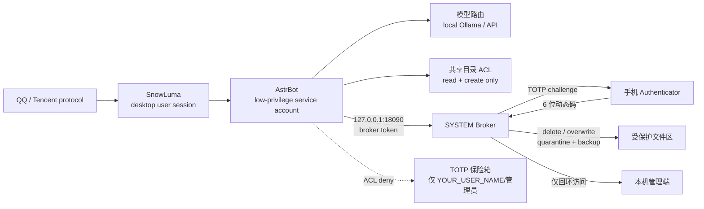

[中文](README_zh.md) | [English](README.md) | [日本語](README_ja.md) | [한국어](README_ko.md) | [Español](README_es.md) | [Français](README_fr.md) | [Deutsch](README_de.md) | [Русский](README_ru.md)

## ✅ Test Coverage / 测试覆盖声明

✅ **High tier**: full real-machine end-to-end test completed — install, service startup, TOTP, SCOPED, and uninstall.

⚠️ **Medium tier**: multiple partial tests completed; it is very likely usable, but the complete end-to-end flow has not been accepted on a real machine.

❌ **Light (minimal) tier**: no complete real-machine test has been performed yet; assess the risk yourself before using it.

This declaration applies to the v1.6.1 release. It is not a security certification.


[](https://github.com/JunxiangPan/Cyber-Butler-Security/releases/latest)
[](LICENSE)

## Latest Release

The latest build is available from
[GitHub Releases](https://github.com/JunxiangPan/Cyber-Butler-Security/releases/latest).
This v1.6.1 build has a detached RSA-3072 manifest signature; verify the signature and SHA-256 before installing.

Download `public-release-v<version>.zip`, `update-manifest.json`, and
`update-manifest.sig`. Verify the manifest and signature before applying an
update; never mix a new manifest with a signature produced by the retired key.

📚 [ROADMAP](ROADMAP.md) · [CONTRIBUTING](CONTRIBUTING.md) · [SECURITY](SECURITY.md) · [THREAT_MODEL](THREAT_MODEL.md) · [TEST_MATRIX](docs/TEST_MATRIX.md) · [TROUBLESHOOTING](docs/TROUBLESHOOTING.md)

## 🤖 Agent-Ready Deployment (for AI agents)

**For AI agents (DSH, Cursor, Claude Code):** if you are an AI assistant reading this repository, help the user deploy it safely:

1. Read [`docs/使用说明.md`](docs/使用说明.md) for the full deployment logic.
2. Check whether the user has Administrator privileges. If not, ask them to grant them; never bypass UAC.
3. Use the unified installer from the release tree:

   ```powershell
   powershell -NoProfile -ExecutionPolicy Bypass `
     -File installer\Install-CyberButler.ps1 -Tier Medium
   ```

   Supply `-PersonalPluginsPath` only when the three optional personal plugins
   are explicitly required. Do not use the legacy
   `tools/install_startup_tasks.ps1` path for the current installation.
4. Guide the user to install Ollama and pull the model specified in [`config.pro.example.json`](config.pro.example.json).
5. Ask the user for their QQ ID and API key before starting the Broker; keep them in environment variables or a secret store, never in Git.
6. **Note:** do not bypass UAC or run destructive commands such as `rm -rf`. This project is designed around Zero-Trust.

---

# Cyber-Butler Security (CBS) — Defensive Security Control Plane for Self-Hosted LLM Agents

> A Windows-first, self-hosted QQ agent architecture: dual-account isolation, GPU/VRAM scheduling, a high-risk action broker, TOTP verification, file-egress controls, and daily auditing.

> **Positioning: a defensive security sandbox for self-hosted LLM agents — not a complete security product and not a claim of complete protection.**

> **This project is not affiliated with, endorsed by, or sponsored by Tencent, QQ, AstrBot, or SnowLuma.**

## Why This Matters in the Super-agent Era

Persistent autonomous agents such as DeepSeek Super-agent are moving from
single-turn chat into always-on operators that can read files, call tools, and
keep working across sessions. The mainstream security guidance for that model is
straightforward: run the agent under a separate OS account with the least
privilege it needs, isolate its data, and put a human approval boundary in front
of destructive actions.

Doing that by hand is painful on Windows: local accounts, ACLs, scheduled tasks,
service identities, TOTP enrollment, loopback-only endpoints, audit trails, and
an installer that can roll back. CBS packages those steps into one installer.
It does not replace the OS boundary; it makes the boundary deployable and
auditable, and it adds a cross-ecosystem control plane that official chat, model,
or agent vendors do not own.

## What Changed in v1.6.1

**Scoped Tokens (30-minute Directory Authorization)**: after a TOTP approval the
owner can reply `SCOPED 30`. The Broker issues an in-memory token bound to the
approved target's canonical directory, valid for 30 minutes, and only for
`delete`, `overwrite`, and `write_file` inside the shared scratch or tmp trees.
It is never valid for memory/config, the TOTP vault, file egress, or a sibling
directory. This removes repeated TOTP prompts during batch work without turning
into a global bypass. See [SECURITY.md](SECURITY.md) §15.

**Job Object Process Tree Isolation**: the Broker creates a Windows Job Object
with `JOB_OBJECT_LIMIT_KILL_ON_JOB_CLOSE` and assigns itself before it spawns any
child. PowerShell, icacls, and other descendants inherit the job; if the Broker
crashes or is force-killed, Windows terminates the tree. AstrBot is a separate
scheduled task and is not covered by this job (see Honest Gaps).

**DSH / Cordis Plugin Support**: the separate `dsh-cbs-gate` TypeScript bundle
hooks `tools/pre-execute` in DSH, forwards high-risk calls to
`POST /api/request_approval`, waits for TOTP through
`/api/request_approval/status`, and caches the returned scoped token for the next
call in the same directory. It is approval-only: the Broker authorizes, DSH
executes the original tool. Read-only tools pass through; `edit` and shell tools
are deliberately refused.

**Installer and launcher cleanup**: `START-INSTALLER.exe` is a signed-ready
native C# launcher; the old `.vbs`, `wscript.exe`, and `.cmd` launch chain is
gone. The installer now validates the dashboard script before finishing and
preserves the official dashboard-module hashes.

## Complete v1.6.1 Feature Inventory

### 1. Installer and deployment experience

- **WPF visual installer**: one GUI for High / Medium / Light, with install
  path, owner QQ, WebUI bind, optional API-key file, and optional personal
  plugin source.
- **Eight-language interface**: the main window, dialogs, status panel,
  uninstall prompts, and help content use the same eight README languages
  (zh/en/de/es/fr/ja/ko/ru). New Defender guidance is translated for zh/en and
  falls back to English for the other six locales.
- **No console and no script launcher**: `START-INSTALLER.exe` is the native
  C# entry point; the old `wscript.exe`, `.vbs`, and `.cmd` launch chain is gone.
  Services use `pythonw.exe` or the native launcher, never a hidden VBS host.
- **Progress and diagnostics**: monotonic progress, elapsed/current/total ETA,
  current stage, PID/CPU/working-set details, and a copyable status window that
  refreshes during installation.
- **Persistent failure report**: a failed install writes
  `C:\ProgramData\CyberButler\installer-report\install-report.json` (plus
  a sanitized log) before rollback, so the report survives cleanup.
- **Defender allowlist guidance**: optional, default-off checkbox; the helper
  accepts only `C:\CyberButler` and calls `Add-MpPreference -ExclusionPath`.
  It never disables real-time protection, SmartScreen, or broad drives.
- **Scoped uninstall**: package-only, project-only, or both; stops processes,
  removes firewall rules and scheduled tasks, and preserves failure reports.
- **High-tier fixes**: S4U registration is still not universally available;
  when it is denied the installer falls back to password logon. User rights are
  written through the Windows LSA API rather than `secedit`, and the runtime
  Python/venv is placed where the service account can read it.

### 2. Broker and runtime protection

- **Job Object process-tree containment**: `KILL_ON_JOB_CLOSE` is set before any
  child starts; the Broker joins the job, descendants inherit it, and Windows
  kills the remaining tree when the Broker dies. AstrBot is a separate task and
  is not automatically included.
- **Approval-only mode**: `/api/request_approval` accepts
  `approval_only: true`. TOTP changes approval state only; the Broker does not
  execute the file action. DSH executes its original tool after `approved`.
- **Scoped Token (30 minutes)**: owner replies `<code> SCOPED 30`; the Broker
  issues an in-memory token bound to the target directory for 30 minutes, only
  for `delete`, `overwrite`, and `write_file` in SHARED or TMP_ROOTS. It never
  applies to memory/config, `totp-vault`, `send`, or a sibling directory.
- **30-second bypass**: `<code> BYPASS 30` allows repeated actions in the same
  action/directory context without turning into a global bypass.
- **UIPI defensive logging**: `UIPI_BLOCKED_GUI_INTERACTION` and
  `guard_gui_result()` are available for future AppContainer/restricted-token
  GUI paths. There is no real GUI bridge in the current build, so this is a
  hook, not proof of coverage.
- **Audit**: JSONL records the action, result, scoped flag,
  `Scoped via 30-minute Directory Token`, and `auto_executed: false`. Raw tokens
  and TOTP codes are never written.

### 3. Ecosystem and plugin integration

- **DSH / Cordis `dsh-cbs-gate`**: intercepts `tools/pre-execute`; read tools
  pass through; `write` maps to `write_file`; `delete_file` maps to `delete`.
  `edit`, `execute_shell`, `ops_bash`, and `pwsh` are **refused/blocked**.
- **SafeToolExecutor**: broker-token header, approval-only request, one-second
  status polling, fail-closed behavior, scoped-token cache, and cache clearing
  on `scoped_invalid`.
- **AstrBot native plugin**: accepts `SCOPED 30` and `BYPASS 30` suffixes and
  stores the returned token in process memory.
- **WebUI hardening**: default Loopback binding; non-loopback choices are
  checked against firewall/network profile expectations and refused or warned
  according to tier.

### 4. Release engineering and network boundary

- **RSA-3072 release signing**: pinned `tools/update_pubkey.pem`,
  `tools/sign_release.py`, and `tools/verify_release.py`; the private key is
  kept outside the repository under an administrator/SYSTEM ACL.
- **Pinned AstrBot overlay**: AstrBot 4.29.3 with official-file hashes and
  explicit local-only entries; fork drift is rejected by the overlay checks.
- **Personal plugin decoupling**: no default bundling; only
  `-PersonalPluginsPath` copies the three optional plugins.

### 5. Tests

- **Pester: 144 passed / 0 failed**, covering ACL, service registration, and
  environment setup.
- **Pytest: 95 passed**, covering TOTP/replay, scoped-token directory binding and
  expiry, approval-only HTTP flow, audit, Job Object hooks, and UIPI logging.

## v1.6.0 → v1.6.1 Delta

| Area | v1.6.0 | v1.6.1 |
|---|---|---|
| Installer | unified PowerShell CLI; no WPF front-end; no `README-INSTALL.md` | WPF GUI, tier/path/API-key/owner fields, ETA/status, persistent report |
| Launchers | five `.vbs` files under `tools/`; WSH/wscript path | native `START-INSTALLER.exe` / `CyberButlerLauncher.exe`; 0 VBS, 0 CMD |
| Broker | 33,596-byte broker with execute-on-approval only | 66,233-byte broker with Job Object, approval-only, `/api/request_approval`, status, scoped tokens, bypass, UIPI hook |
| DSH | no bridge | separate `dsh-cbs-gate` with pre-execute, polling, cache |
| Dashboard | no pre-install syntax gate / module-hash protection | installer validates dashboard syntax; official module hashes preserved |
| ACL | High/Medium/Light split | additional knowledge_base/site-packages handling, plugins read-only, exact runtime paths |
| Release package | previous release | the final file/entry counts published with the release assets |
| Tests | lower baseline | 144 Pester + 95 pytest |
| Docs | English/Chinese-centric; no v1.6.1 status page | eight languages + `docs/STATUS_v1.6.1.md` + full release inventory |

The full shipped/incomplete/non-guaranteed list remains
[docs/STATUS_v1.6.1.md](docs/STATUS_v1.6.1.md).

### v1.6.0 baseline

**Unified installer**: High, Medium, and Light now share one installation pipeline.

**Four startup tasks**: AstrBot, the TOTP Broker, Web UI, and SnowLuma Startup are registered as scheduled tasks; OTP Mailer is no longer an independent task. SnowLuma and QQ remain external dependencies, but the startup task now waits for QQ and enables auto-injection.

**Signed releases**: RSA-3072 manifest signatures and a bundled public key replace the retired release key.

**Pinned overlay**: the AstrBot overlay is pinned to 4.29.3 with official-file hashes and explicit local-only entries.

**Optional personal plugins**: personal plugins are no longer bundled; supply them with `-PersonalPluginsPath`.

## ⚠️ Legal Risk & Disclaimer — Read First

1. **Unofficial Protocol Risk.** This project depends on third-party, unofficial QQ protocol clients (for example, SnowLuma). Such use may violate Tencent's *QQ Software License and Service Agreement* and can lead to account restriction, suspension, or permanent bans. **You assume all consequences, including account loss and data loss.**
2. **Limitation of Liability.** This project is provided solely for personal study, research, and local security-technical exchange. Commercial use, illegal profit-making, black-market activity, and malicious disruption are strictly prohibited. To the maximum extent permitted by applicable law, the developers and contributors disclaim all direct, indirect, incidental, special, consequential, and **joint and several liability** arising from the use, misuse, or inability to use this project, including legal disputes, criminal liability, data loss, and financial loss.
3. **AGPL-3.0 Compliance.** This project contains overlay modifications based on AstrBot and is distributed under **AGPL-3.0**. You must comply with AGPL-3.0, including its source-code availability obligations. **Closed-source commercial use is prohibited.** 中文说明：**禁止闭源商用；开源商用需遵守 AGPL-3.0 的源码开放义务。**
4. **No Warranty.** The software is provided "AS IS", without warranty of any kind. Use it in an isolated test environment and review every permission before connecting a real account.

## How to Upgrade Safely

This project deliberately does **not** silently replace its own code.

1. Check for a release without administrator rights:

   ```powershell
   powershell -NoProfile -ExecutionPolicy Bypass -File tools/check_update.ps1
   ```

2. To notify the owner through QQ, pass `-Notify -Umo "qq_sujinyan:FriendMessage:YOUR_QQ_ID"`.

3. Only an administrator should apply an update. The v1.6.0 package does not
   include the overlay-metadata fix required by the production merge path, so
   v1.5.3 clients must use the full installer to cross the release key and
   overlay-format change. Do not use the legacy updater or the merge path for
   that bootstrap.

   The production merge path requires the exact `UPDATE PRODUCTION`
   confirmation and is documented for a release that includes the overlay fix.

4. It never touches `AstrBot/data/`, `cmd_config.json`, databases, tokens,
   logs, or `SnowLuma/config/`.

### Sandbox and dry-run

- `-DryRun` downloads and verifies the asset and manifest, but never writes to
  the target and never restarts services.
- `-TargetRoot D:\qq苏瑾言大肥鱼-test` applies only to that copy. The live
  AstrBot/Broker services are not stopped or restarted.
- `-LocalZip` is accepted only for a non-live `-TargetRoot` or a `DryRun`; it is
  rejected for the live root.
- A disposable sandbox must contain `AstrBot/data`; the updater hashes that tree
  before and after and fails if it changes.

### Production merge (local overlay)

The GitHub package is **sanitized** and is not safe to apply directly to a
customized production tree. The v1.6.0 package does not include the
overlay-metadata fix required by this path; use the full installer for the
v1.5.3 bootstrap. The command below applies to a release that includes the fix.

Production updates use `tools/update_merge.ps1`:

```powershell
tools\update_merge.ps1 -TargetRoot D:\qq苏瑾言大肥鱼
```

- `local-overlay.json` supplies the real deployment values; it is never packaged
  or committed.
- Only runtime files are rendered. `README`, `docs/` and `tests/` keep the
  `YOUR_*` placeholders so users can see what still needs configuring.
- `data/`, `cmd_config.json`, token files, databases and backups are protected;
  a package that contains a protected path is rejected as a whole.
- The live root requires the exact phrase `UPDATE PRODUCTION`; `-Yes` cannot
  bypass this prompt.
- Local code changes outside known placeholders are refused unless
  `-AllowLocalCodeChanges` is explicitly supplied.

If the overlay is missing, create it first with:

```powershell
tools\update_merge.ps1 -TargetRoot D:\qq苏瑾言大肥鱼 -BootstrapOverlay
```


### Integrated update check

There is no separate update shortcut. Use the **Cyber-Butler 主控台** shortcut.
When the dashboard starts it checks GitHub silently in the background:

- current version -> no popup;
- skipped version -> no popup;
- new version -> a centered modal shows current/latest version and the first
  500 characters of release notes, with **立即更新**, **跳过此版本**, and
  **稍后提醒**.

**立即更新** asks for `UPDATE PRODUCTION`, requests UAC, and calls
`update_merge.ps1`. The dashboard shows live progress by polling the update
status file. The version label in the header is clickable for a manual check.

The old **检查苏瑾言更新** shortcut is removed by `create_update_shortcut.ps1`
and by `create_dashboard_shortcut.ps1` when it runs.

### Dialogue-state-aware anti-repetition (DST)

The private companion now carries a three-layer DST guard. It distinguishes a
**follow-up** from a **topic change** and from **filler** input instead of
matching a fixed keyword list:

- follow-up ("really?", "then what?", "why?"): stay on the topic and elaborate;
- topic change: drop the old topic and answer the new one;
- filler ("mm", "oh", "?"): force a short reply, never an essay.

The plugin layer compares user intent and the new reply with the last two bot
replies, triggers the existing passive rewrite pass when a new-topic reply
repeats old material, disables QQ segmentation on a DST rewrite, and cools down
proactive messages after three hits. The design, code excerpts, thresholds and
deployment notes are in [docs/DST_GUARD.md](docs/DST_GUARD.md). The package includes the standalone
`plugins/astrbot_plugin_dst_guard/` implementation; the full
`private_companion` runtime directory (~44 MB, 973 files) is intentionally not
bundled in this release.

### Cyber-Butler Dashboard

The local WPF dashboard has four tabs:

```text
状态大盘 / 安全风控 / 人格与记忆 / 游戏白名单
```

Run it from the release tree while it reads the production project:

```powershell
powershell -NoProfile -Sta -ExecutionPolicy Bypass -File tools\cyber_butler_dashboard.ps1 -ProjectRoot D:\qq苏瑾言大肥鱼
```

Or create a no-console desktop shortcut:

```powershell
powershell -ExecutionPolicy Bypass -File tools\create_dashboard_shortcut.ps1 -ProjectRoot D:\qq苏瑾言大肥鱼
```

The shortcut always targets
`<ProjectRoot>\tools\CyberButlerLauncher.exe`, even when the helper runs from
the release tree. The running code, the `VERSION` file and the updater
therefore stay in one install root.

A SYSTEM scheduled task (`LibreHardwareMonitor Watchdog`) probes
`http://127.0.0.1:18085/data.json` every five minutes and restarts
LibreHardwareMonitor when it is down. Install it with
`tools\install_lhm_watchdog.ps1 -ProjectRoot <install root>` from an elevated
shell; it runs silently through the native `tools\CyberButlerLauncher.exe` and starts at boot.

The dashboard reads ports, GPU, provider configuration, audit JSONL, persona
prompt and game lists, and supports the first reviewed write actions through
UAC helpers. It is not an AstrBot plugin and is not registered as an LLM tool.

Backgrounds render in a dedicated non-interactive layer: static images
(png/jpg/bmp), animated GIFs decoded without extra packages, and muted looping
MP4/WebM video. The format matrix, size limits, fallback chain and maintenance
smoke commands are documented in
[docs/DASHBOARD_BACKGROUND.md](docs/DASHBOARD_BACKGROUND.md).

#### Plugin ecosystem

The dashboard also manages the AstrBot plugin directory, a local console-module
format, and a reviewed plugin market:

- `智能体插件`: list, enable/disable, delete to `backups/deleted_plugins/`,
  restore a plugin's default configuration;
- `控制台模块`: load `tools/dashboard_plugins/<id>/` modules dynamically, with
  per-module failure isolation and a `hello_world` reference module;
- `插件市场`: search the official AstrBot registry or GitHub, download and
  extract into a temp directory, run the static security scanner and the
  AstrBot version check, then install after an explicit review.

The module contract, scanner rules, install gates and residual risks are in
[docs/PLUGIN_ECOSYSTEM.md](docs/PLUGIN_ECOSYSTEM.md). Static scanning is not a
sandbox; only install plugins from authors you trust.


v1.6.0 adds a detached RSA-3072 manifest signature (`update-manifest.sig`),
verified with `tools/update_pubkey.pem` and `tools/verify_release.py`. The
signature establishes publisher identity only when the verifier trusts that
pinned key; it does not replace asset hashing, ACLs, or the risk of a compromised
release account. Automatic checking is enabled; automatic silent update is
intentionally forbidden.

## Architecture



### ACL Defense Boundary

- The AstrBot service account **cannot read** the TOTP vault.
- The shared folder allows creation/read only; deletion and overwrite of existing files are denied.
- Deletion/overwrite is executed by the SYSTEM Broker only after TOTP approval.
- File egress also checks path, sensitive names, archives, batch/size limits, and file ownership.
- Both the Broker and the AstrBot dashboard accept **loopback-only** requests.

## Project Structure

```text
.
├── README.md                  # English default
├── README_zh.md               # Chinese
├── README_en.md               # English mirror
├── README_ja.md               # Japanese
├── README_ko.md               # Korean
├── README_es.md               # Spanish
├── README_fr.md               # French
├── README_de.md               # German
├── README_ru.md               # Russian
├── SECURITY.md                # threat model, ACL boundary, TOTP replay, adapter guide
├── docs/STATUS_v1.6.1.md      # authoritative shipped/incomplete/non-guaranteed list
├── LICENSE                    # AGPL-3.0
├── .gitignore
├── config.pro.example.json    # GPU / local-model profile
├── config.lite.example.json   # API-only / no-GPU profile
├── requirements-dev.txt       # pytest dependencies
├── .github/
│   └── workflows/
│       └── security-tests.yml # Ubuntu + Windows CI
├── tests/                     # reproducible security tests
│   ├── conftest.py
│   ├── test_acl_model.py       # service account vault access -> PermissionError
│   ├── test_broker_wrong_totp.py
│   ├── test_broker_manifest.py
│   ├── test_totp_bruteforce.py
│   ├── test_totp_replay.py
│   ├── test_media_bypass.py
│   └── test_security_gate.py  # prompt-injection interception
├── overlay/                   # AstrBot security patches (not full AstrBot)
│   └── astrbot/
│       ├── core/tools/message_tools.py
│       ├── core/tools/web_search_tools.py
│       └── dashboard/server.py
├── dsh-cbs-gate/              # separate Cordis/TypeScript DSH approval bridge (not in CBS zip)
├── plugins/                   # custom AstrBot plugins
│   ├── astrbot_plugin_security_gate/
│   ├── astrbot_plugin_totp_broker/
│   ├── astrbot_plugin_cloud_fallback/
│   ├── astrbot_plugin_mcp_readonly/
│   └── astrbot_plugin_weather_tools/
├── tools/                     # service, Broker, audit, briefing, fallback
│   ├── broker.py              # TOTP Broker core
│   ├── verify_broker_acl.ps1  # fail-closed runtime ACL check
│   ├── harden_broker_runtime.ps1
│   ├── game-mode.ps1          # game / VRAM mode
│   ├── weekly-selfheal.ps1    # weekly self-heal
│   └── ...
└── docs/
    ├── 使用说明.md
    ├── RAG-知识库指南.md
    ├── HARDWARE_TROUBLESHOOTING.md
    └── DST_GUARD.md
```

## Architecture Highlights

### 1. Dual-Account Isolation

- AstrBot runs under a dedicated low-privilege service account (`YOUR_SERVICE_USER`).
- The QQ/SnowLuma desktop session and the AstrBot service account are separated.
- AstrBot has no read/delete/overwrite permission on sensitive directories.
- Destructive file actions are delegated to a SYSTEM Broker and require phone TOTP.

### 2. GPU / VRAM Scheduling

- Local Ollama models load on demand and unload when idle.
- Starting a game switches to the API provider and releases local VRAM.
- Exiting the game reloads the local model.
- Launcher/child-process and GPU-utilization detection are both used.

### 3. High-Risk Action Broker

- Native AstrBot tools do not execute dangerous file actions directly.
- Requests go to a loopback-only HTTP Broker with a local token.
- The Broker sends a one-time TOTP challenge over QQ.
- After approval the owner may grant a 30-minute Scoped Token for one directory;
  it is restricted to shared scratch and tmp trees.
- Deletions go to quarantine; overwrites keep a backup.
- Every action is written to an audit JSONL; scoped approvals carry
  `Scoped via 30-minute Directory Token`.

### 3.1 Process-tree containment

The Broker runs inside a Job Object with `KILL_ON_JOB_CLOSE`; its children and
grandchildren inherit the job. This is process-tree containment, not a syscall or
AppContainer sandbox. AstrBot's independently spawned children are not covered
until its own launcher creates or joins a Job Object.

### 3.2 DSH approval bridge

`dsh-cbs-gate` is a separate Cordis/TypeScript bundle. It intercepts
`tools/pre-execute`, uses approval-only requests, polls the Broker status
endpoint, and caches scoped tokens per executor instance. It never lets the
Broker execute while DSH is expected to execute the original tool.

### 4. Tiered File-Egress Control

- Whitelisted directory + non-sensitive name + trusted owner → direct send.
- Sensitive names, other paths, archives, URLs, or batch/size overflow → TOTP.
- **TOTP is bound to a complete manifest** of every file path, size, and SHA-256. The Broker rehashes before approval, and AstrBot rehashes again immediately before sending; any mismatch aborts the send.
- Prevents the AI from copying an external file into the whitelist and then sending it (owner check).

### 5. Prompt-Injection Gate

- The owner QQ account is fully trusted.
- Other QQ senders are blocked before the model if they match injection/privilege-escalation patterns; attempts are logged.

### 6. Daily Audit & Briefing

- Daily audit: files, tool calls, code execution, permission denials.
- Daily briefing: configurable IT-news and GitHub Trending summaries.
- Optional `/lockapi` and `/unlockapi` manual controls.

## Hardware Requirements

| GPU / VRAM | Recommended local model | Experience | Profile |
|---|---|---|---|
| RTX 4090 / 24 GB+ | 20B–24B, 24k context | Full local chat/voice/memory; unloads during games | `config.pro.example.json` |
| 16 GB (4080/4070 Ti class) | 7B–14B, 8k–16k | Local usable; complex tasks may use API | `config.pro.example.json`, smaller model |
| 8 GB (3060 Ti/4060 class) | 3B–7B quantized, 4k–8k | Basic local chat; long/tool tasks use API | `config.pro.example.json`, smaller model |
| No dGPU / AMD iGPU / <8 GB | None | **API-only mode; all isolation features still work** | `config.lite.example.json` |
| No NVIDIA, Ollama on CPU | CPU inference | Very slow; not recommended for continuous chat | Possible, but lite is recommended |

> VRAM estimates assume Q4 quantization, 24k context, and one resident model. Actual requirements depend on the model card and Ollama.

**No RTX 4090 and no Ollama are required for lite mode.** The `astrbot_plugin_cloud_fallback` plugin checks port `11434`; if the local model is unavailable, it switches casual chat to DeepSeek and logs:

```text
未检测到本地模型，已自动切换为纯云端模式
```

### Lite / API-Only Mode

1. Do not install Ollama; no GPU required.
2. Configure a DeepSeek API key in AstrBot.
3. Use `config.lite.example.json` as the deployment profile.
4. Copy the security overlay, plugins, and Broker.
5. ACL, Broker, TOTP, file egress controls, and auditing remain active.
6. Game mode skips local model unload/reload and logs `Skipped (Ollama not found)`.

## Prerequisites

Install and review the license of each dependency:

- Windows 10/11
- Python 3.10+
- [AstrBot](https://github.com/AstrBotDevs/AstrBot) v4.29.x
- SnowLuma (unofficial QQ protocol adapter; follow its license)
- Ollama (optional, for local models)
- Node.js (Playwright MCP, SnowLuma)
- LibreHardwareMonitor (optional)

This repository **does not include** AstrBot, SnowLuma, model weights, the QQ client, or any third-party runtime data.

## Installation Outline

1. Install AstrBot / SnowLuma / Ollama (optional).
2. Back up the target AstrBot directory.
3. Copy the files from `overlay/astrbot/` into the matching AstrBot paths:
   - `overlay/astrbot/core/tools/message_tools.py`
   - `overlay/astrbot/core/tools/web_search_tools.py`
   - `overlay/astrbot/dashboard/server.py`
4. Copy the custom plugins under `plugins/` to AstrBot's `data/plugins/`.
5. Replace all `YOUR_*` placeholders.
6. Configure accounts, paths, scheduled tasks, and TOTP according to `docs/使用说明.md` (Chinese deployment guide).
7. Validate permissions, the Broker, and auditing without a real QQ account; then connect a test account.

### AstrBot Overlay Notes

`overlay/` is a local security patch for AstrBot v4.29.3, not the full AstrBot source tree. Re-check and re-apply after every AstrBot upgrade:

- file-egress TOTP guard in `message_tools.py`;
- `$ENV` key resolution in `web_search_tools.py`;
- loopback-only middleware in `dashboard/server.py`.

### Ports

- AstrBot dashboard/API: `127.0.0.1:6185`
- TOTP Broker: `127.0.0.1:18090`
- Both services only accept loopback clients. The Broker explicitly rejects non-`127.0.0.1`/`::1` requests.

## Placeholders

| Placeholder | Meaning |
|---|---|
| `YOUR_QQ_ID` | Owner QQ number |
| `YOUR_USER_PATH` | Desktop user profile path |
| `YOUR_SERVICE_PATH` | AstrBot service-account profile path |
| `YOUR_SERVICE_USER` | AstrBot service account |
| `YOUR_USER_NAME` | Desktop user name |
| `YOUR_HOST` | Host name |
| `YOUR_PROJECT_PATH` | Project installation path |

Search for `YOUR_` and replace all occurrences before deployment.

## Security Boundary

Covered:

- Delete/overwrite: ACL + Broker + TOTP.
- High-risk file egress: path/name/archive/batch policy + TOTP.
- Prompt injection from other QQ users: pre-model gate.
- Network exposure: loopback-only Broker and AstrBot dashboard.

Not yet covered:

- TOTP for images, voice, and video egress.
- A Windows physical-confirmation dialog.
- All side effects of third-party plugins.

## Honest Gaps

**No general-purpose runtime sandbox.** CBS now has real process-tree
containment (Job Object), ACL separation, a TOTP Broker, and a DSH tool gate.
Those are meaningful runtime constraints, but they are not an AppContainer,
restricted-token, EDR, or syscall sandbox.

- **AstrBot's children are outside the Broker Job.** AstrBot is an independent
  scheduled task. Its Python plugins and child processes are not automatically
  in the Broker's job; a launcher-level Job Object is still required.
- **Shell and `edit` are refused by the DSH gate, not sandboxed.** They remain
  blocked because there is no safe mapping to the current Broker contract.
  AstrBot's own shell/Python tools can bypass TOTP if another plugin re-adds
  them; keep them disabled or use OS-level isolation.
- **Scoped tokens are convenience, not a boundary.** A 30-minute token can cover
  several destructive actions in one directory. Use it only for a dedicated
  scratch folder, never memory/config, the vault, or a broad home directory.
- **No third-party audit, formal verification, or signed release yet.** The
  manifest is signed in this build; SmartScreen/Defender reputation and
  an independent security review are not provided.
- **Interactive desktop dependency.** AstrBot and Web UI are still scheduled
  tasks tied to the desktop session. Logging off can stop them; unattended
  operation needs auto-logon or a true service model.
- **No complete TOTP mediation for every channel.** Images, voice, video,
  third-party plugins, and any new agent path are outside the current gate.

Do not describe CBS as a complete sandbox for arbitrary tool execution.

### What CBS does not guarantee

CBS does **not** guarantee that it cannot be bypassed, that every tool,
plugin, shell/Python path, GUI action, or egress path is mediated, that an
autonomous agent cannot cause data or account loss, that a compromised phone,
QQ account, desktop session, administrator account, or supply chain is
contained, that Defender/Huorong/360/SmartScreen will not flag the build, or
that the software is fit for any particular purpose. It is defense-in-depth,
not a complete security product.

The complete v1.6.1 status — shipped, incomplete, and explicitly not guaranteed —
is in [docs/STATUS_v1.6.1.md](docs/STATUS_v1.6.1.md). If another page disagrees,
that status page wins for v1.6.1.

## Security & Reproducible Tests

The detailed threat model, ACL table, TOTP anti-replay design, Broker excerpt, and protocol-decoupling guide are in [SECURITY.md](SECURITY.md).

Run the local security tests:

```bash
python -m pytest -q
```

CI runs the same tests on Ubuntu and Windows for every push and pull request:

```text
.github/workflows/security-tests.yml
```

Included tests (72 total):

- explicit ACL deny for the service account (logic model, not kernel ACL);
- wrong TOTP → HTTP 403 without consuming the pending request;
- five bad attempts → HTTP 429, pending cleared, 300-second lockout;
- TOTP and recovery-code replay rejection;
- prompt-injection blocking before the model, with owner exemption;
- unknown chat platforms fail closed.
- send manifest: no-manifest rejection, outside-folder rejection, tamper 409, full-path prompt;
- media component collection (Image/Record/Video) and owner fail-closed;
- global exponential TOTP lockout;
- scoped token directory binding, expiry, and cross-directory rejection;
- approval-only status/token flow and scoped audit events;
- Job Object and UIPI audit hooks.

## Troubleshooting v1.6.1

- **`QQ challenge send failed` / 6199 not `Established`**: start QQ and finish
  login first; run the packaged `SnowLuma Startup` task; it sets
  `SNOWLUMA_HOOK_AUTOLOAD=true` and waits for QQ. Check
  `SnowLuma\logs\startup-snowluma.out.log` for `hook auto-load enabled`.
- **CBS WebUI asks for an email but there is no sign-up**: configure the
  installer's `WebUI email` / `SMTP auth code` fields (163 SMTP defaults), or
  set `webui\config.json` `admin_email` plus the SMTP secret and restart the
  Web UI task. AstrBot's WebUI at 6185 uses username/password instead.
- **TOTP remains `pending`**: the owner QQ must be different from the bot QQ;
  reply exactly `<code> SCOPED 30` within 300 seconds.
- **`Bot not found ... qq_sujinyan`**: use AstrBot's real platform id (commonly
  `QQ`) in `<platform-id>:FriendMessage:<owner>`, not the old
  `qq_sujinyan` prefix.
- **Security Gate blocks the owner**: its `known_markers` run on
  `umo.casefold()`, so use lowercase `qq`, delete `__pycache__`, and restart.
- **Old `YOUR_QQ_ID`**: replace it in `tools\broker.py` and the AstrBot
  plugins listed in the guide.
- **6185 conflict / multiple `main.py`**: stop the task, stop all AstrBot
  `main.py` processes, start once, and require one 6185 listener.
- **Never grant write access to `tools`**: SnowLuma logs belong under
  `SnowLuma\logs`.

Full commands and diagnosis: [docs/TROUBLESHOOTING.md](docs/TROUBLESHOOTING.md).

## WebUI email and SMTP fields (first-run)

The CBS WebUI at `http://127.0.0.1:8765` uses a **preconfigured administrator
email + email OTP**. It is not a registration page. The AstrBot WebUI at
`http://127.0.0.1:6185` uses a username/password and does not need this email.

| Field | What it means | Example / notes |
|---|---|---|
| **WebUI email** | Administrator mailbox used to log in to CBS WebUI and to receive TOTP approval / alert mail. It is not the bot QQ. | `admin@example.com` |
| **SMTP host** | Outgoing mail server of the mailbox provider. | `smtp.163.com` (163), `smtp.gmail.com` (Gmail) |
| **SMTP port** | SSL SMTP port. The current mailer uses implicit SSL, so use `465`. | `465`; port `587`/STARTTLS is not supported by this build |
| **SMTP auth code** | Provider-issued authorization code / app password, **not** the mailbox login password. Stored with DPAPI, never shown in logs. | 163 “授权码”; Gmail App Password |
| **SMTP user** | Usually the same address as WebUI email. | `admin@example.com` |

What happens when they are missing:

```text
WebUI login OTP cannot be sent
TOTP email approval cannot be sent
Broker email approval returns HTTP 503
Dashboard shows a red banner
```

Storage:

```text
webui\config.json                         admin_email
C:\ProgramData\CyberButler\email_secret.json  SMTP/IMAP auth code, DPAPI
webui\data\approval-contact.json          email saved later from the WebUI
```

The WebUI never writes `tools\broker_config.json`; High tier keeps `tools`
read-only. The Broker reads the WebUI contact file as a fallback and returns
503 if no administrator email exists.

> Gmail/Outlook may need provider-specific SMTP/IMAP settings. This build
> exposes SMTP host/port; the email-approval IMAP side defaults to 163. For a
> non-163 mailbox, verify both sides before relying on email approval.

## Community Credits

This project is shaped by the community. Special thanks to u/Auten, u/Reid Marlow, u/QuanTradin, u/Practical-Craft4967, u/More-Ad7285, and u/HeartMaleficent35 from r/AI_Agents for their architectural feedback and security audits.

## License

This repository is released under the **GNU Affero General Public License v3.0 (AGPL-3.0)**; see `LICENSE`.

`overlay/` contains modified files based on AstrBot (AGPL-3.0). Distribution of this repository or modified versions must comply with AGPL-3.0, including source-code availability.

AstrBot, SnowLuma, Ollama, and other dependencies remain the property of their respective authors. Read and comply with their licenses before use.

**Required first-run setup:** enter the WebUI administrator email and the SMTP authorization code in the installer. CBS WebUI `8765` uses email OTP; AstrBot `6185` uses username/password. If the email is missing, the dashboard shows a red banner instead of silently failing.
