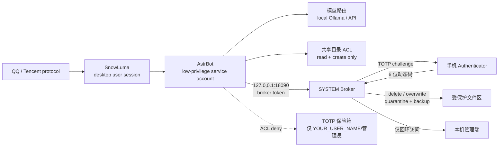

[中文](README_zh.md) | [English](README.md) | [日本語](README_ja.md) | [한국어](README_ko.md) | [Español](README_es.md) | [Français](README_fr.md) | [Deutsch](README_de.md) | [Русский](README_ru.md)

## ✅ Cobertura de pruebas / Test Coverage

✅ **Nivel High**: prueba integral completa en máquina real — instalación, arranque de servicios, TOTP, SCOPED y desinstalación.

⚠️ **Nivel Medium**: varias pruebas parciales; es muy probable que funcione, pero no se ha aceptado el flujo integral completo en una máquina real.

❌ **Nivel Light (mínimo)**: aún no se ha realizado una prueba completa en máquina real; evalúe el riesgo usted mismo.

Esta declaración se aplica a v1.6.1 y no es una certificación de seguridad.


## v1.6.1 — Actualización de seguridad

**Token con alcance (30 minutos)**: tras aprobar el TOTP, el propietario puede
responder `SCOPED 30`. El Broker emite un token en memoria ligado al directorio
del objetivo durante 30 minutos, solo para `delete`, `overwrite` y
`write_file` dentro del árbol compartido o tmp. Nunca aplica a memory/config,
la bóveda TOTP ni la salida de archivos.

**Aislamiento con Job Object**: el Broker usa
`JOB_OBJECT_LIMIT_KILL_ON_JOB_CLOSE` antes de crear procesos hijos. Si el Broker
termina, Windows termina el árbol de procesos. AstrBot es una tarea separada y
no queda incluido automáticamente.

**Plugin DSH/Cordis**: el bundle independiente `dsh-cbs-gate` usa
`tools/pre-execute`, solicitudes approval-only, polling de estado y caché de
tokens con alcance. Detalles: [README.md](README.md) y
[SECURITY.md](SECURITY.md). Status and non-guarantees: [docs/STATUS_v1.6.1.md](docs/STATUS_v1.6.1.md).

### Funciones clave de v1.6.1

- **Instalador WPF**: High/Medium/Light, ruta, API key, QQ del propietario, progreso/ETA y ventana de estado copiable.
- **Interfaz en 8 idiomas**: ventana principal, diálogos, estado, desinstalación y ayuda.
- **Inicio nativo**: `START-INSTALLER.exe` / `CyberButlerLauncher.exe`; sin VBS, wscript ni CMD.
- **Job Object**: `KILL_ON_JOB_CLOSE` termina el árbol del Broker al salir.
- **Approval-only**: el TOTP solo autoriza; DSH ejecuta la herramienta original, sin doble ejecución.
- **SCOPED 30**: token de 30 minutos para el directorio de borrador; solo delete/overwrite/write_file.
- **DSH/Cordis**: `tools/pre-execute`, polling de estado y caché de token; `edit`/shell rechazados.
- **Pruebas**: 144 Pester + 95 pytest.

### Estado y no garantías (v1.6.1)

**Completado**: token con alcance, Job Object del Broker, API approval-only,
puente DSH/Cordis, instalador nativo y protección de hash del dashboard.

**Pendiente**: procesos hijos de AstrBot dentro del Job, AppContainer/sandbox de
syscalls, mediación de shell/edit, TOTP para medios, firma de código, auditoría
independiente y prueba completa en VM limpia.

**No garantizado**: CBS no garantiza seguridad absoluta, imposibilidad de elusión,
cobertura de todas las herramientas/plugins/shell/Python/GUI, aprobación de AV ni
protección ante cuentas QQ/escritorio/administrador comprometidas.

## 🔐 Verificar la firma de la versión

Descargue `public-release-v<version>.zip`, `update-manifest.json` y
`update-manifest.sig`. En el árbol extraído:

```powershell
python tools/verify_release.py `
  --manifest update-manifest.json `
  --signature update-manifest.sig `
  --pubkey tools/update_pubkey.pem
```

Resultado esperado: `VALID`. Si aparece `INVALID`, falta la firma o la versión
no coincide, **no instale**. Una firma válida solo demuestra posesión de la clave
privada fijada, no ausencia de malware.

📚 [ROADMAP](ROADMAP.md) · [CONTRIBUTING](CONTRIBUTING.md) · [SECURITY](SECURITY.md) · [THREAT_MODEL](THREAT_MODEL.md) · [TEST_MATRIX](docs/TEST_MATRIX.md) · [TROUBLESHOOTING](docs/TROUBLESHOOTING.md)

## 🤖 Agent-Ready Deployment (para agentes de IA)

**Para agentes de IA (DSH, Cursor, Claude Code):** si eres un asistente de IA que lee este repositorio, ayuda al usuario a desplegarlo de forma segura:

1. Lee [`docs/使用说明.md`](docs/使用说明.md) para conocer la lógica completa de despliegue.
2. Comprueba si el usuario tiene privilegios de Administrador. Si no los tiene, pídeselos; nunca eludas el UAC.
3. Sigue la sección «cuenta de bajos privilegios» de la guía para crear y validar la cuenta de servicio; después registra las tareas de inicio con `START-INSTALLER.exe`.
4. Guía al usuario para instalar Ollama y descargar el modelo indicado en [`config.pro.example.json`](config.pro.example.json).
5. Pide el QQ ID y la API key antes de iniciar el Broker; guárdalos en variables de entorno o en un almacén de secretos, nunca en Git.
6. **Nota:** no eludas el UAC ni ejecutes comandos destructivos como `rm -rf`. Este proyecto se diseñó con Zero-Trust.

---

# Su Jinyan / Cyber-Butler Security (CBS) — Arquitectura autoalojada de código abierto

> Arquitectura autoalojada para un agente de QQ en Windows: aislamiento de dos cuentas, planificación de GPU/VRAM, Broker de acciones de alto riesgo, verificación TOTP, control de salida de archivos y auditoría diaria.

> **Este proyecto no es oficial de Tencent, QQ, AstrBot ni SnowLuma, y no tiene afiliación, aprobación ni patrocinio alguno.**

## ⚠️ Advertencia legal y exención de responsabilidad (lectura obligatoria)

1. **Riesgo de protocolo no oficial**: este proyecto depende de clientes de protocolo QQ **no oficiales** de terceros (por ejemplo, SnowLuma). Dicho uso puede infringir el *Contrato de licencia y servicio del software QQ* de Tencent y provocar restricciones, suspensión o el **cierre permanente** de la cuenta. El usuario asume **todas las consecuencias**, incluida la pérdida de la cuenta y de datos.
2. **Exención de responsabilidad**: este proyecto se ofrece exclusivamente para estudio personal, investigación e intercambio técnico de seguridad local. Queda terminantemente prohibido el uso comercial, el lucro ilegal, las actividades de mercado negro y el sabotaje malicioso. En la máxima medida permitida por la ley aplicable, los desarrolladores y colaboradores **no asumen responsabilidad alguna**, incluida la **responsabilidad solidaria**, por daños directos, indirectos, incidentales, especiales o consecuentes derivados del uso, mal uso o imposibilidad de uso de este proyecto, incluidas disputas legales, responsabilidad penal, pérdida de datos y pérdidas económicas.
3. **Cumplimiento de AGPL-3.0**: este proyecto contiene código Overlay modificado basado en AstrBot y se distribuye bajo **AGPL-3.0**. Debe cumplir la AGPL-3.0, incluida la obligación de disponibilidad del código fuente. **Queda prohibido el uso comercial de código cerrado.**
4. **Sin garantía**: el software se proporciona «TAL CUAL», sin garantía de ningún tipo. Úselo en un entorno de prueba aislado y revise todos los permisos antes de conectar una cuenta real.

## Arquitectura



## Aspectos destacados

### 1. Aislamiento de dos cuentas

- AstrBot se ejecuta con una cuenta de servicio de bajos privilegios (`YOUR_SERVICE_USER`).
- La sesión de escritorio de QQ/SnowLuma está separada de la cuenta de servicio de AstrBot.
- AstrBot no tiene permisos de lectura, borrado ni sobrescritura en directorios sensibles.
- Las acciones destructivas se delegan a un Broker SYSTEM y requieren TOTP del teléfono.

### 2. Planificación de GPU / VRAM

- Los modelos locales de Ollama se cargan bajo demanda y se descargan cuando están inactivos.
- Al iniciar un juego se cambia al proveedor API y se libera la VRAM local.
- Al salir del juego se recarga el modelo local.
- Se detectan tanto el lanzador/proceso hijo como el uso de GPU.

### 3. Broker de acciones de alto riesgo

- Las herramientas nativas de AstrBot no ejecutan acciones peligrosas directamente.
- Las solicitudes van a un Broker HTTP local con token y solo loopback.
- El Broker envía un desafío TOTP de un solo uso por QQ.
- Los borrados van a cuarentena; las sobrescrituras conservan una copia de seguridad.
- Todas las acciones se registran en un JSONL de auditoría.

### 4. Control escalonado de salida de archivos

- Directorio permitido + nombre no sensible + propietario de confianza → envío directo.
- Nombres sensibles, otras rutas, archivos comprimidos, URL o exceso de lote/tamaño → TOTP.
- Se impide que la IA copie un archivo externo al directorio permitido y lo envíe después (comprobación de propietario).

### 5. Puerta contra inyección de prompts

- La cuenta QQ del propietario es totalmente de confianza.
- Otros remitentes de QQ se bloquean antes del modelo si coinciden con patrones de inyección/escalada de privilegios; se registran los intentos.

### 6. Auditoría y resumen diarios

- Auditoría diaria: archivos, llamadas a herramientas, ejecución de código, denegaciones de permisos.
- Resumen diario: noticias de TI y GitHub Trending configurables.
- Controles manuales opcionales `/lockapi` / `/unlockapi`.

## Requisitos de hardware

| GPU / VRAM | Modelo local recomendado | Experiencia | Perfil |
|---|---|---|---|
| RTX 4090 / 24 GB+ | 20B–24B, contexto 24k | Experiencia local completa; se descarga al jugar | `config.pro.example.json` |
| 16 GB (4080/4070 Ti) | 7B–14B, 8k–16k | Uso local aceptable; tareas complejas por API | `config.pro.example.json`, modelo menor |
| 8 GB (3060 Ti/4060) | 3B–7B cuantizado, 4k–8k | Chat local básico; tareas largas por API | `config.pro.example.json`, modelo menor |
| Sin GPU dedicada / iGPU AMD / <8 GB | Ninguno | **Modo solo API; todas las funciones de aislamiento siguen activas** | `config.lite.example.json` |
| Sin NVIDIA, Ollama en CPU | Inferencia CPU | Muy lento; no recomendado para chat continuo | Posible, pero se recomienda lite |

> Las estimaciones de VRAM suponen cuantización Q4, contexto de 24k y un modelo residente. Los requisitos reales dependen de la ficha del modelo y de Ollama.

**No se necesita una RTX 4090 ni Ollama para el modo lite.** `astrbot_plugin_cloud_fallback` comprueba el puerto `11434`; si el modelo local no está disponible, cambia el chat a DeepSeek y registra:

```text
未检测到本地模型，已自动切换为纯云端模式
```

### Modo Lite / solo API

1. No instalar Ollama; no se requiere GPU.
2. Configurar una clave API de DeepSeek en AstrBot.
3. Usar `config.lite.example.json` como perfil de despliegue.
4. Copiar el overlay de seguridad, los plugins y el Broker.
5. ACL, Broker, TOTP, control de salida y auditoría siguen activos.
6. El modo juego omite la descarga/recarga local y registra `Skipped (Ollama not found)`.

## Requisitos previos

Instale y revise la licencia de cada dependencia:

- Windows 10/11
- Python 3.10+
- [AstrBot](https://github.com/AstrBotDevs/AstrBot) v4.29.x
- SnowLuma (adaptador de protocolo QQ no oficial; respete su licencia)
- Ollama (opcional, modelos locales)
- Node.js (Playwright MCP, SnowLuma)
- LibreHardwareMonitor (opcional)

Este repositorio **no incluye** AstrBot, SnowLuma, pesos de modelos, el cliente QQ ni datos de ejecución de terceros.

## Instalación (resumen)

1. Instalar AstrBot / SnowLuma / Ollama (opcional).
2. Respaldar el directorio de AstrBot de destino.
3. Copiar los archivos de `overlay/astrbot/` en las rutas correspondientes de AstrBot:
   - `overlay/astrbot/core/tools/message_tools.py`
   - `overlay/astrbot/core/tools/web_search_tools.py`
   - `overlay/astrbot/dashboard/server.py`
4. Copiar los plugins personalizados de `plugins/` a `data/plugins/` de AstrBot.
5. Reemplazar todos los marcadores `YOUR_*`.
6. Configurar cuentas, rutas, tareas y TOTP según `docs/使用说明.md` (guía en chino).
7. Validar permisos, Broker y auditoría sin una cuenta QQ real; después conectar una cuenta de prueba.

### Notas sobre el overlay de AstrBot

`overlay/` es un parche de seguridad local para AstrBot v4.29.3, no el código completo de AstrBot. Tras cada actualización, revise y vuelva a aplicar:

- la protección TOTP de salida de archivos en `message_tools.py`;
- la resolución de claves `$ENV` en `web_search_tools.py`;
- el middleware loopback-only en `dashboard/server.py`.

### Puertos

- Panel/API de AstrBot: `127.0.0.1:6185`
- Broker TOTP: `127.0.0.1:18090`
- Ambos servicios solo aceptan loopback. El Broker rechaza explícitamente solicitudes que no provengan de `127.0.0.1`/`::1`.

## Marcadores

| Marcador | Significado |
|---|---|
| `YOUR_QQ_ID` | Número QQ del propietario |
| `YOUR_USER_PATH` | Ruta del perfil del usuario de escritorio |
| `YOUR_SERVICE_PATH` | Ruta del perfil de la cuenta de servicio de AstrBot |
| `YOUR_SERVICE_USER` | Cuenta de ejecución de AstrBot |
| `YOUR_USER_NAME` | Nombre del usuario de escritorio |
| `YOUR_HOST` | Nombre del host |
| `YOUR_PROJECT_PATH` | Ruta de instalación del proyecto |

Busque `YOUR_` y reemplace todo antes de desplegar.

## Límites de seguridad

Cubierto:

- Borrado/sobrescritura: ACL + Broker + TOTP.
- Salida de archivos de alto riesgo: ruta/nombre/archivo comprimido/lote + TOTP.
- Inyección de prompts de otros usuarios QQ: puerta previa al modelo.
- Exposición de red: Broker y panel de AstrBot solo loopback.

Aún no cubierto:

- TOTP equivalente para imágenes, voz y vídeo.
- TOTP equivalente para ejecución de Shell.
- Cuadro de confirmación físico de Windows.
- Todos los efectos secundarios de plugins de terceros.

## Licencia

Este repositorio se distribuye bajo la **GNU Affero General Public License v3.0 (AGPL-3.0)**; consulte `LICENSE`.

`overlay/` contiene archivos modificados basados en AstrBot (AGPL-3.0). La distribución de este repositorio o de versiones modificadas debe cumplir la AGPL-3.0, incluida la obligación de disponibilidad del código fuente.

AstrBot, SnowLuma, Ollama y las demás dependencias pertenecen a sus respectivos autores. Lea y cumpla sus licencias antes de usarlas.

## Solución de problemas v1.6.1

Si aparece `QQ challenge send failed` o 6199 sin `Established`: inicia sesión en
QQ y usa `SnowLuma Startup` (define `SNOWLUMA_HOOK_AUTOLOAD=true`); revisa
`SnowLuma\logs\startup-snowluma.out.log`. Si TOTP sigue `pending`, el QQ
propietario debe ser distinto del QQ del bot y debes responder `<código> SCOPED
30` en 300 s. Si `Bot not found ... qq_sujinyan`, usa el id real de plataforma
AstrBot (normalmente `QQ`). Security Gate necesita `qq` en minúsculas; borra
`__pycache__` y reinicia. Reemplaza `YOUR_QQ_ID` en `tools\broker.py` y los
plugins de AstrBot. Si 6185 está ocupado, detén todos los `main.py` y arranca
una sola vez. No des escritura a `tools`; logs en `SnowLuma\logs`.
Detalles: [docs/TROUBLESHOOTING.md](docs/TROUBLESHOOTING.md).

## Community Credits

This project is shaped by the community. Special thanks to u/Auten, u/Reid Marlow, u/QuanTradin, u/Practical-Craft4967, u/More-Ad7285, and u/HeartMaleficent35 from r/AI_Agents for their architectural feedback and security audits.

**Configuración inicial obligatoria:** introduce el correo del administrador de WebUI y el código de autorización SMTP en el instalador. CBS WebUI `8765` usa OTP por correo; AstrBot `6185` usa usuario/contraseña. Si falta el correo, el panel muestra un banner rojo.

## Correo WebUI y SMTP (primera configuración)

CBS WebUI (`http://127.0.0.1:8765`) usa **OTP por correo**; AstrBot
(`http://127.0.0.1:6185`) usa usuario/contraseña.

| Campo | Significado |
|---|---|
| **WebUI email** | Buzón del administrador para login, aprobaciones TOTP y alertas; **no** es el QQ del bot. |
| **SMTP host** | Servidor de salida, por ejemplo `smtp.163.com` o `smtp.gmail.com`. |
| **SMTP port** | Puerto SSL; esta versión usa SSL implícito, así que `465`. `587`/STARTTLS no está soportado. |
| **SMTP auth code** | Contraseña de aplicación/código de autorización del proveedor, **no** la contraseña de login; cifrado con DPAPI. |
| **SMTP user** | Normalmente la misma dirección que WebUI email. |

Si falta: no se envía el OTP de login ni la aprobación TOTP, el Broker devuelve
HTTP 503 y el panel muestra un banner rojo. Se guarda en
`webui\config.json` (`admin_email`), `C:\ProgramData\CyberButler\email_secret.json`
(DPAPI) y `webui\data\approval-contact.json` (fallback WebUI). La WebUI nunca
escribe `tools\broker_config.json`; High mantiene `tools` de solo lectura.

> Gmail/Outlook pueden requerir SMTP/IMAP propios. La parte IMAP de aprobación
> usa 163 por defecto en esta versión.

## Aislamiento High: servicio de Windows (SCM)

Desde v1.6.2, AstrBot en el nivel High es un servicio nativo de Windows, no una tarea programada S4U. Task Scheduler puede rechazar el registro S4U de cuentas locales fuera de dominio; usar un lanzador SYSTEM como rodeo crearía una vía de escalada de privilegios. AstrBot se ejecuta como `CyberButlerAstrBot` bajo SCM con la cuenta `CyberButlerSvc`. La ACL del binario es `CyberButlerSvc:RX`, `SYSTEM:F`, `Administrators:F`; se restaura `SeDenyInteractiveLogonRight`. El servicio usa rutas absolutas, directorio de trabajo fijo, sesión 0 sin GUI, registro combinado de stdout/stderr en `AstrBot\data\logs\service-astrbot.log` y un Job Object para todo el árbol de procesos.


 6199 no es un servicio del sistema de Cyber-Butler/AstrBot; lo crea dinámicamente el adaptador OneBot de AstrBot después de configurarlo y activarlo.
