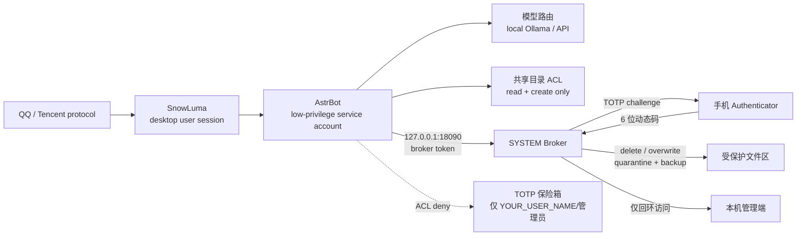

[中文](README_zh.md) | [English](README.md) | [日本語](README_ja.md) | [한국어](README_ko.md) | [Español](README_es.md) | [Français](README_fr.md) | [Deutsch](README_de.md) | [Русский](README_ru.md)

# Su Jinyan / Cyber Steward — Arquitectura autoalojada de código abierto

> Arquitectura autoalojada para un agente de QQ en Windows: aislamiento de dos cuentas, planificación de GPU/VRAM, Broker de acciones de alto riesgo, verificación TOTP, control de salida de archivos y auditoría diaria.

> **Este proyecto no es oficial de Tencent, QQ, AstrBot ni SnowLuma, y no tiene afiliación, aprobación ni patrocinio alguno.**

## ⚠️ Advertencia legal y exención de responsabilidad (lectura obligatoria)

1. **Riesgo de protocolo no oficial**: este proyecto depende de clientes de protocolo QQ **no oficiales** de terceros (por ejemplo, SnowLuma). Dicho uso puede infringir el *Contrato de licencia y servicio del software QQ* de Tencent y provocar restricciones, suspensión o el **cierre permanente** de la cuenta. El usuario asume **todas las consecuencias**, incluida la pérdida de la cuenta y de datos.
2. **Exención de responsabilidad**: este proyecto se ofrece exclusivamente para estudio personal, investigación e intercambio técnico de seguridad local. Queda terminantemente prohibido el uso comercial, el lucro ilegal, las actividades de mercado negro y el sabotaje malicioso. En la máxima medida permitida por la ley aplicable, los desarrolladores y colaboradores **no asumen responsabilidad alguna**, incluida la **responsabilidad solidaria**, por daños directos, indirectos, incidentales, especiales o consecuentes derivados del uso, mal uso o imposibilidad de uso de este proyecto, incluidas disputas legales, responsabilidad penal, pérdida de datos y pérdidas económicas.
3. **Cumplimiento de AGPL-3.0**: este proyecto contiene código Overlay modificado basado en AstrBot y se distribuye bajo **AGPL-3.0**. Debe cumplir la AGPL-3.0, incluida la obligación de disponibilidad del código fuente. **Queda prohibido el uso comercial de código cerrado.**
4. **Sin garantía**: el software se proporciona «TAL CUAL», sin garantía de ningún tipo. Úselo en un entorno de prueba aislado y revise todos los permisos antes de conectar una cuenta real.

## Arquitectura



## Aspectos destacados

### 1. Aislamiento de dos cuentas

- AstrBot se ejecuta con una cuenta de servicio de bajos privilegios (`YOUR_SERVICE_USER`).
- La sesión de escritorio de QQ/SnowLuma está separada de la cuenta de servicio de AstrBot.
- AstrBot no tiene permisos de lectura, borrado ni sobrescritura en directorios sensibles.
- Las acciones destructivas se delegan a un Broker SYSTEM y requieren TOTP del teléfono.

### 2. Planificación de GPU / VRAM

- Los modelos locales de Ollama se cargan bajo demanda y se descargan cuando están inactivos.
- Al iniciar un juego se cambia al proveedor API y se libera la VRAM local.
- Al salir del juego se recarga el modelo local.
- Se detectan tanto el lanzador/proceso hijo como el uso de GPU.

### 3. Broker de acciones de alto riesgo

- Las herramientas nativas de AstrBot no ejecutan acciones peligrosas directamente.
- Las solicitudes van a un Broker HTTP local con token y solo loopback.
- El Broker envía un desafío TOTP de un solo uso por QQ.
- Los borrados van a cuarentena; las sobrescrituras conservan una copia de seguridad.
- Todas las acciones se registran en un JSONL de auditoría.

### 4. Control escalonado de salida de archivos

- Directorio permitido + nombre no sensible + propietario de confianza → envío directo.
- Nombres sensibles, otras rutas, archivos comprimidos, URL o exceso de lote/tamaño → TOTP.
- Se impide que la IA copie un archivo externo al directorio permitido y lo envíe después (comprobación de propietario).

### 5. Puerta contra inyección de prompts

- La cuenta QQ del propietario es totalmente de confianza.
- Otros remitentes de QQ se bloquean antes del modelo si coinciden con patrones de inyección/escalada de privilegios; se registran los intentos.

### 6. Auditoría y resumen diarios

- Auditoría diaria: archivos, llamadas a herramientas, ejecución de código, denegaciones de permisos.
- Resumen diario: noticias de TI y GitHub Trending configurables.
- Controles manuales opcionales `/lockapi` / `/unlockapi`.

## Requisitos de hardware

| GPU / VRAM | Modelo local recomendado | Experiencia | Perfil |
|---|---|---|---|
| RTX 4090 / 24 GB+ | 20B–24B, contexto 24k | Experiencia local completa; se descarga al jugar | `config.pro.example.json` |
| 16 GB (4080/4070 Ti) | 7B–14B, 8k–16k | Uso local aceptable; tareas complejas por API | `config.pro.example.json`, modelo menor |
| 8 GB (3060 Ti/4060) | 3B–7B cuantizado, 4k–8k | Chat local básico; tareas largas por API | `config.pro.example.json`, modelo menor |
| Sin GPU dedicada / iGPU AMD / <8 GB | Ninguno | **Modo solo API; todas las funciones de aislamiento siguen activas** | `config.lite.example.json` |
| Sin NVIDIA, Ollama en CPU | Inferencia CPU | Muy lento; no recomendado para chat continuo | Posible, pero se recomienda lite |

> Las estimaciones de VRAM suponen cuantización Q4, contexto de 24k y un modelo residente. Los requisitos reales dependen de la ficha del modelo y de Ollama.

**No se necesita una RTX 4090 ni Ollama para el modo lite.** `astrbot_plugin_cloud_fallback` comprueba el puerto `11434`; si el modelo local no está disponible, cambia el chat a DeepSeek y registra:

```text
未检测到本地模型，已自动切换为纯云端模式
```

### Modo Lite / solo API

1. No instalar Ollama; no se requiere GPU.
2. Configurar una clave API de DeepSeek en AstrBot.
3. Usar `config.lite.example.json` como perfil de despliegue.
4. Copiar el overlay de seguridad, los plugins y el Broker.
5. ACL, Broker, TOTP, control de salida y auditoría siguen activos.
6. El modo juego omite la descarga/recarga local y registra `Skipped (Ollama not found)`.

## Requisitos previos

Instale y revise la licencia de cada dependencia:

- Windows 10/11
- Python 3.10+
- [AstrBot](https://github.com/AstrBotDevs/AstrBot) v4.29.x
- SnowLuma (adaptador de protocolo QQ no oficial; respete su licencia)
- Ollama (opcional, modelos locales)
- Node.js (Playwright MCP, SnowLuma)
- LibreHardwareMonitor (opcional)

Este repositorio **no incluye** AstrBot, SnowLuma, pesos de modelos, el cliente QQ ni datos de ejecución de terceros.

## Instalación (resumen)

1. Instalar AstrBot / SnowLuma / Ollama (opcional).
2. Respaldar el directorio de AstrBot de destino.
3. Copiar los archivos de `overlay/astrbot/` en las rutas correspondientes de AstrBot:
   - `overlay/astrbot/core/tools/message_tools.py`
   - `overlay/astrbot/core/tools/web_search_tools.py`
   - `overlay/astrbot/dashboard/server.py`
4. Copiar los plugins personalizados de `plugins/` a `data/plugins/` de AstrBot.
5. Reemplazar todos los marcadores `YOUR_*`.
6. Configurar cuentas, rutas, tareas y TOTP según `docs/使用说明.md` (guía en chino).
7. Validar permisos, Broker y auditoría sin una cuenta QQ real; después conectar una cuenta de prueba.

### Notas sobre el overlay de AstrBot

`overlay/` es un parche de seguridad local para AstrBot v4.29.3, no el código completo de AstrBot. Tras cada actualización, revise y vuelva a aplicar:

- la protección TOTP de salida de archivos en `message_tools.py`;
- la resolución de claves `$ENV` en `web_search_tools.py`;
- el middleware loopback-only en `dashboard/server.py`.

### Puertos

- Panel/API de AstrBot: `127.0.0.1:6185`
- Broker TOTP: `127.0.0.1:18090`
- Ambos servicios solo aceptan loopback. El Broker rechaza explícitamente solicitudes que no provengan de `127.0.0.1`/`::1`.

## Marcadores

| Marcador | Significado |
|---|---|
| `YOUR_QQ_ID` | Número QQ del propietario |
| `YOUR_USER_PATH` | Ruta del perfil del usuario de escritorio |
| `YOUR_SERVICE_PATH` | Ruta del perfil de la cuenta de servicio de AstrBot |
| `YOUR_SERVICE_USER` | Cuenta de ejecución de AstrBot |
| `YOUR_USER_NAME` | Nombre del usuario de escritorio |
| `YOUR_HOST` | Nombre del host |
| `YOUR_PROJECT_PATH` | Ruta de instalación del proyecto |

Busque `YOUR_` y reemplace todo antes de desplegar.

## Límites de seguridad

Cubierto:

- Borrado/sobrescritura: ACL + Broker + TOTP.
- Salida de archivos de alto riesgo: ruta/nombre/archivo comprimido/lote + TOTP.
- Inyección de prompts de otros usuarios QQ: puerta previa al modelo.
- Exposición de red: Broker y panel de AstrBot solo loopback.

Aún no cubierto:

- TOTP equivalente para imágenes, voz y vídeo.
- TOTP equivalente para ejecución de Shell.
- Cuadro de confirmación físico de Windows.
- Todos los efectos secundarios de plugins de terceros.

## Licencia

Este repositorio se distribuye bajo la **GNU Affero General Public License v3.0 (AGPL-3.0)**; consulte `LICENSE`.

`overlay/` contiene archivos modificados basados en AstrBot (AGPL-3.0). La distribución de este repositorio o de versiones modificadas debe cumplir la AGPL-3.0, incluida la obligación de disponibilidad del código fuente.

AstrBot, SnowLuma, Ollama y las demás dependencias pertenecen a sus respectivos autores. Lea y cumpla sus licencias antes de usarlas.
