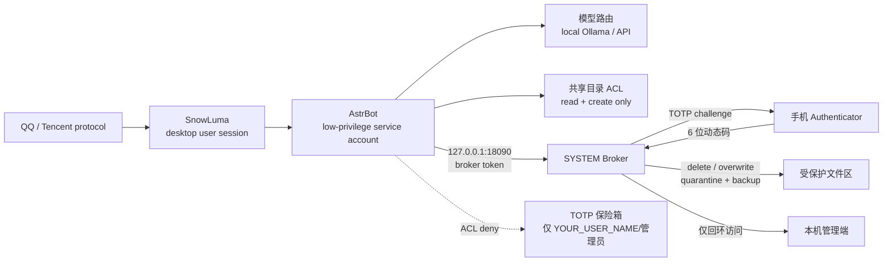

[中文](README_zh.md) | [English](README.md) | [日本語](README_ja.md) | [한국어](README_ko.md) | [Español](README_es.md) | [Français](README_fr.md) | [Deutsch](README_de.md) | [Русский](README_ru.md)

## 🤖 Agent-Ready Deployment (pour agents IA)

**Aux agents IA (DSH, Cursor, Claude Code) :** si vous êtes un assistant IA qui lit ce dépôt, aidez l’utilisateur à le déployer en toute sécurité :

1. Lisez [`docs/使用说明.md`](docs/使用说明.md) pour comprendre toute la logique de déploiement.
2. Vérifiez si l’utilisateur dispose des privilèges Administrateur. Sinon, demandez-les-lui ; ne contournez jamais l’UAC.
3. Suivez la section « compte à faibles privilèges » du guide pour créer et valider le compte de service, puis enregistrez les tâches de démarrage avec `tools/install_startup_tasks.ps1`.
4. Guidez l’utilisateur pour installer Ollama et télécharger le modèle indiqué dans [`config.pro.example.json`](config.pro.example.json).
5. Demandez le QQ ID et la clé API avant de démarrer le Broker ; conservez-les dans des variables d’environnement ou un coffre de secrets, jamais dans Git.
6. **Remarque :** ne contournez pas l’UAC et n’exécutez pas de commandes destructrices comme `rm -rf`. Ce projet est conçu selon le principe Zero-Trust.

---

# Su Jinyan / Cyber Steward — Architecture auto-hébergée open source

> Architecture auto-hébergée pour un agent QQ sous Windows : isolation de deux comptes, ordonnancement GPU/VRAM, Broker d'actions à haut risque, vérification TOTP, contrôle des envois de fichiers et audit quotidien.

> **Ce projet n'est ni officiel ni affilié à Tencent, QQ, AstrBot ou SnowLuma ; il ne bénéficie d'aucune approbation ni parrainage.**

## ⚠️ Avertissement juridique et exonération de responsabilité (à lire en priorité)

1. **Risque lié à un protocole non officiel** : ce projet dépend de clients de protocole QQ **non officiels** fournis par des tiers (par exemple SnowLuma). Cet usage peut enfreindre le *Contrat de licence et de service du logiciel QQ* de Tencent et entraîner une restriction, une suspension ou un **bannissement définitif** du compte. L'utilisateur assume **toutes les conséquences**, y compris la perte du compte et des données.
2. **Exonération de responsabilité** : ce projet est fourni uniquement à des fins d'étude personnelle, de recherche et d'échange technique local en sécurité. Toute utilisation commerciale, tout profit illégal, toute activité de marché noir et tout sabotage malveillant sont strictement interdits. Dans la mesure maximale permise par le droit applicable, les développeurs et contributeurs **déclinent toute responsabilité**, y compris la **responsabilité solidaire**, pour les dommages directs, indirects, accessoires, spéciaux ou consécutifs résultant de l'utilisation, du mauvais usage ou de l'impossibilité d'utiliser ce projet, notamment les litiges juridiques, la responsabilité pénale, la perte de données et les pertes financières.
3. **Conformité AGPL-3.0** : ce projet contient du code Overlay modifié basé sur AstrBot et est distribué sous **AGPL-3.0**. Vous devez respecter l'AGPL-3.0, y compris l'obligation de mise à disposition du code source. **L'utilisation commerciale en code fermé est interdite.**
4. **Aucune garantie** : le logiciel est fourni « EN L'ÉTAT », sans garantie d'aucune sorte. Utilisez-le dans un environnement de test isolé et vérifiez toutes les permissions avant de connecter un compte réel.

## Architecture



## Points clés

### 1. Isolation de deux comptes

- AstrBot s'exécute sous un compte de service à faibles privilèges (`YOUR_SERVICE_USER`).
- La session de bureau QQ/SnowLuma est séparée du compte de service AstrBot.
- AstrBot n'a aucun droit de lecture, de suppression ou d'écrasement sur les répertoires sensibles.
- Les actions destructrices sont déléguées à un Broker SYSTEM et exigent un TOTP téléphonique.

### 2. Ordonnancement GPU / VRAM

- Les modèles Ollama locaux sont chargés à la demande et déchargés lorsqu'ils sont inactifs.
- Le lancement d'un jeu bascule vers le fournisseur API et libère la VRAM locale.
- La sortie du jeu recharge le modèle local.
- Détection du lanceur/processus enfant et de l'utilisation GPU.

### 3. Broker d'actions à haut risque

- Les outils natifs d'AstrBot n'exécutent pas directement les actions dangereuses.
- Les demandes passent par un Broker HTTP local, à token et limité à la boucle locale.
- Le Broker envoie un défi TOTP à usage unique via QQ.
- Les suppressions vont en quarantaine ; les écrasements conservent une sauvegarde.
- Toutes les actions sont consignées dans un JSONL d'audit.

### 4. Contrôle gradué des envois de fichiers

- Répertoire autorisé + nom non sensible + propriétaire de confiance → envoi direct.
- Noms sensibles, autres chemins, archives, URL ou dépassement de lot/taille → TOTP.
- Empêche l'IA de copier un fichier externe dans le répertoire autorisé puis de l'envoyer (contrôle du propriétaire).

### 5. Barrière anti-injection de prompt

- Le compte QQ du propriétaire est entièrement fiable.
- Les autres expéditeurs QQ sont bloqués avant le modèle s'ils correspondent à des motifs d'injection/élévation de privilèges ; les tentatives sont journalisées.

### 6. Audit et briefing quotidiens

- Audit quotidien : fichiers, appels d'outils, exécution de code, refus de permission.
- Briefing quotidien : actualités IT et GitHub Trending configurables.
- Contrôles manuels optionnels `/lockapi` / `/unlockapi`.

## Configuration matérielle

| GPU / VRAM | Modèle local recommandé | Expérience | Profil |
|---|---|---|---|
| RTX 4090 / 24 Go+ | 20B–24B, contexte 24k | Expérience locale complète ; déchargement en jeu | `config.pro.example.json` |
| 16 Go (4080/4070 Ti) | 7B–14B, 8k–16k | Local utilisable ; tâches complexes via API | `config.pro.example.json`, modèle réduit |
| 8 Go (3060 Ti/4060) | 3B–7B quantifié, 4k–8k | Chat local basique ; tâches longues via API | `config.pro.example.json`, modèle réduit |
| Pas de GPU dédié / iGPU AMD / <8 Go | Aucun | **Mode API uniquement ; toutes les fonctions d'isolation restent actives** | `config.lite.example.json` |
| Pas de NVIDIA, Ollama sur CPU | Inférence CPU | Très lent ; déconseillé pour un chat continu | Possible, mais lite recommandé |

> Les estimations de VRAM supposent une quantification Q4, un contexte de 24k et un seul modèle résident. Les besoins réels dépendent de la fiche du modèle et d'Ollama.

**Aucune RTX 4090 ni Ollama n'est nécessaire en mode lite.** `astrbot_plugin_cloud_fallback` vérifie le port `11434` ; si le modèle local est indisponible, il bascule le chat vers DeepSeek et journalise :

```text
未检测到本地模型，已自动切换为纯云端模式
```

### Mode Lite / API uniquement

1. Ne pas installer Ollama ; aucun GPU requis.
2. Configurer une clé API DeepSeek dans AstrBot.
3. Utiliser `config.lite.example.json` comme profil de déploiement.
4. Copier l'overlay de sécurité, les plugins et le Broker.
5. ACL, Broker, TOTP, contrôle des envois et audit restent actifs.
6. Le mode jeu ignore le déchargement/rechargement local et journalise `Skipped (Ollama not found)`.

## Prérequis

Installez et vérifiez la licence de chaque dépendance :

- Windows 10/11
- Python 3.10+
- [AstrBot](https://github.com/AstrBotDevs/AstrBot) v4.29.x
- SnowLuma (adaptateur de protocole QQ non officiel ; respectez sa licence)
- Ollama (facultatif, modèles locaux)
- Node.js (Playwright MCP, SnowLuma)
- LibreHardwareMonitor (facultatif)

Ce dépôt **ne contient pas** AstrBot, SnowLuma, les poids de modèles, le client QQ ni les données d'exécution de tiers.

## Installation (résumé)

1. Installer AstrBot / SnowLuma / Ollama (facultatif).
2. Sauvegarder le répertoire AstrBot cible.
3. Copier les fichiers de `overlay/astrbot/` aux chemins AstrBot correspondants :
   - `overlay/astrbot/core/tools/message_tools.py`
   - `overlay/astrbot/core/tools/web_search_tools.py`
   - `overlay/astrbot/dashboard/server.py`
4. Copier les plugins personnalisés de `plugins/` vers `data/plugins/` d'AstrBot.
5. Remplacer tous les espaces réservés `YOUR_*`.
6. Configurer comptes, chemins, tâches et TOTP selon `docs/使用说明.md` (guide en chinois).
7. Valider permissions, Broker et audit sans compte QQ réel, puis connecter un compte de test.

### Notes sur l'overlay AstrBot

`overlay/` est un correctif de sécurité local pour AstrBot v4.29.3, pas le code source complet d'AstrBot. Après chaque mise à jour, vérifiez et réappliquez :

- la protection TOTP d'envoi de fichiers dans `message_tools.py` ;
- la résolution des clés `$ENV` dans `web_search_tools.py` ;
- le middleware loopback-only dans `dashboard/server.py`.

### Ports

- Tableau de bord/API AstrBot : `127.0.0.1:6185`
- Broker TOTP : `127.0.0.1:18090`
- Les deux services n'acceptent que la boucle locale. Le Broker refuse explicitement les requêtes hors `127.0.0.1`/`::1`.

## Espaces réservés

| Espace réservé | Signification |
|---|---|
| `YOUR_QQ_ID` | Numéro QQ du propriétaire |
| `YOUR_USER_PATH` | Chemin du profil utilisateur de bureau |
| `YOUR_SERVICE_PATH` | Chemin du profil du compte de service AstrBot |
| `YOUR_SERVICE_USER` | Compte d'exécution AstrBot |
| `YOUR_USER_NAME` | Nom de l'utilisateur de bureau |
| `YOUR_HOST` | Nom de l'hôte |
| `YOUR_PROJECT_PATH` | Chemin d'installation du projet |

Recherchez `YOUR_` et remplacez toutes les occurrences avant le déploiement.

## Limites de sécurité

Couvert :

- Suppression/écrasement : ACL + Broker + TOTP.
- Envoi de fichiers à haut risque : chemin/nom/archive/lot + TOTP.
- Injection de prompt d'autres utilisateurs QQ : barrière pré-modèle.
- Exposition réseau : Broker et tableau de bord AstrBot en loopback uniquement.

Non couvert :

- TOTP équivalent pour images, voix et vidéo.
- TOTP équivalent pour l'exécution Shell.
- Boîte de confirmation physique Windows.
- Tous les effets secondaires des plugins tiers.

## Licence

Ce dépôt est distribué sous **GNU Affero General Public License v3.0 (AGPL-3.0)** ; voir `LICENSE`.

`overlay/` contient des fichiers modifiés basés sur AstrBot (AGPL-3.0). La distribution de ce dépôt ou de versions modifiées doit respecter l'AGPL-3.0, y compris l'obligation de mise à disposition du code source.

AstrBot, SnowLuma, Ollama et les autres dépendances appartiennent à leurs auteurs respectifs. Lisez et respectez leurs licences avant utilisation.
