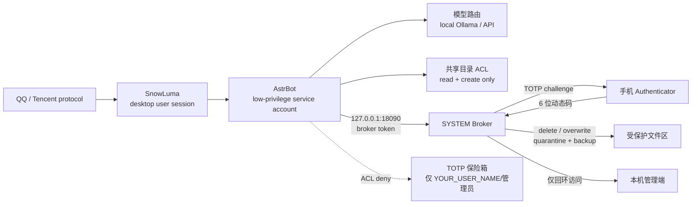

[中文](README_zh.md) | [English](README.md) | [日本語](README_ja.md) | [한국어](README_ko.md) | [Español](README_es.md) | [Français](README_fr.md) | [Deutsch](README_de.md) | [Русский](README_ru.md)

# 수진옌 / 사이버 스튜어드 — 오픈소스 자체 호스팅 아키텍처

> Windows에서 실행되는 QQ 에이전트용 자체 호스팅 아키텍처입니다. 이중 계정 격리, GPU/VRAM 스케줄링, 고위험 작업 Broker, TOTP 인증, 파일 전송 제어, 일일 감사를 제공합니다.

> **이 프로젝트는 Tencent, QQ, AstrBot, SnowLuma의 공식 프로젝트가 아니며, 어떤 제휴·승인·후원 관계도 없습니다.**

## ⚠️ 법적 위험 및 면책 고지(반드시 읽기)

1. **비공식 프로토콜 위험**: 이 프로젝트는 SnowLuma 등 제3자가 제공하는 **비공식** QQ 프로토콜 클라이언트에 의존합니다. 이러한 사용은 Tencent의 「QQ 소프트웨어 라이선스 및 서비스 계약」을 위반할 수 있으며, 계정 제한, 정지 또는 **영구 정지**로 이어질 수 있습니다. 사용자는 계정 상실과 데이터 손실을 포함한 **모든 결과를 스스로 부담**합니다.
2. **책임 면제**: 이 프로젝트는 개인 학습, 연구, 로컬 보안 기술 교류 목적으로만 제공됩니다. 상업적 사용, 불법 이익 추구, 블랙마켓 활동, 악의적 파괴 행위를 엄격히 금지합니다. 관련 법령이 허용하는 최대 범위에서 개발자와 기여자는 본 프로젝트의 사용, 오용 또는 사용 불능으로 인한 직접·간접·부수적·특별·결과적 손해 및 **연대 책임**을 포함한 모든 책임을 지지 않습니다. 여기에는 법적 분쟁, 형사 책임, 데이터 손실, 경제적 손실이 포함됩니다.
3. **AGPL-3.0 준수**: 이 프로젝트에는 AstrBot 기반 Overlay 수정 코드가 포함되어 있으며 **AGPL-3.0**으로 배포됩니다. 소스 코드 제공 의무를 포함한 AGPL-3.0 조건을 준수해야 합니다. **폐쇄 소스 상업적 사용은 금지됩니다.**
4. **무보증**: 이 소프트웨어는 "있는 그대로(AS IS)" 제공되며 명시적·묵시적 보증을 하지 않습니다. 실제 계정 연결 전에 격리된 테스트 환경에서 모든 권한을 검토하십시오.

## 아키텍처



## 핵심 특징

### 1. 이중 계정 격리

- AstrBot은 전용 저권한 서비스 계정(`YOUR_SERVICE_USER`)으로 실행됩니다.
- QQ/SnowLuma 데스크톱 세션과 AstrBot 서비스 계정을 분리합니다.
- AstrBot은 민감한 디렉터리에 대한 읽기·삭제·덮어쓰기 권한이 없습니다.
- 파괴적 파일 작업은 SYSTEM Broker에 위임하며 휴대폰 TOTP를 필수로 합니다.

### 2. GPU / VRAM 스케줄링

- 로컬 Ollama 모델을 필요할 때 로드하고 유휴 시 해제합니다.
- 게임 시작 시 API provider로 전환하고 로컬 VRAM을 해제합니다.
- 게임 종료 시 로컬 모델을 다시 로드합니다.
- 런처/자식 프로세스와 GPU 사용률을 함께 감지합니다.

### 3. 고위험 작업 Broker

- 네이티브 AstrBot 도구는 위험한 파일 작업을 직접 실행하지 않습니다.
- 루프백 전용 HTTP와 로컬 토큰으로 Broker에 요청합니다.
- Broker가 QQ로 일회용 TOTP 챌린지를 보냅니다.
- 삭제는 격리 영역으로 이동하고, 덮어쓰기는 이전 버전을 백업합니다.
- 모든 작업은 감사 JSONL에 기록됩니다.

### 4. 파일 전송 단계별 제어

- 화이트리스트 디렉터리 + 비민감 파일명 + 신뢰 가능한 소유자 → 직접 전송.
- 민감한 이름, 외부 경로, 압축 파일, URL, 건수/용량 초과 → TOTP.
- AI가 외부 파일을 화이트리스트로 복사한 뒤 전송하는 우회를 소유자 검사로 차단합니다.

### 5. 프롬프트 인젝션 게이트

- 소유자 QQ는 완전히 신뢰합니다.
- 다른 QQ 사용자가 전형적인 인젝션/권한 상승 패턴과 일치하면 모델 진입 전에 차단하고 기록합니다.

### 6. 일일 감사 및 브리핑

- 일일 감사: 파일 수, 도구 호출, 코드 실행, 권한 거부.
- 일일 브리핑: 설정 가능한 IT 뉴스와 GitHub Trending 요약.
- 선택적 `/lockapi` / `/unlockapi` 수동 제어.

## 하드웨어 요구 사항

| GPU / VRAM | 권장 로컬 모델 | 경험 | 프로필 |
|---|---|---|---|
| RTX 4090 / 24GB+ | 20B–24B, 24k 컨텍스트 | 로컬 대화·음성·기억 완전; 게임 시 자동 해제 | `config.pro.example.json` |
| 16GB (4080/4070Ti급) | 7B–14B, 8k–16k | 로컬 사용 가능; 복잡한 작업은 API 권장 | `config.pro.example.json`, 모델 축소 |
| 8GB (3060Ti/4060급) | 3B–7B 양자화, 4k–8k | 기본 로컬 대화; 장문/도구 작업은 API 권장 | `config.pro.example.json`, 모델 축소 |
| 외장 GPU 없음 / AMD 내장 GPU / 8GB 미만 | 로컬 모델 없음 | **API 전용 모드; 모든 격리 기능 사용 가능** | `config.lite.example.json` |
| NVIDIA 없음, Ollama CPU 실행 | CPU 추론 | 매우 느림; 상시 대화 비권장 | 가능하지만 lite 권장 |

> VRAM은 Q4 양자화, 24k 컨텍스트, 단일 모델 상주 기준의 추정치입니다. 실제 요구 사항은 모델 카드와 Ollama에 따라 달라집니다.

**RTX 4090과 Ollama가 없어도 lite 모드로 사용할 수 있습니다.** `astrbot_plugin_cloud_fallback`이 포트 `11434`를 확인하고, 로컬 모델을 사용할 수 없으면 대화를 DeepSeek로 전환하며 다음 경고를 기록합니다.

```text
未检测到本地模型，已自动切换为纯云端模式
```

### Lite / API 전용 모드

1. Ollama를 설치하지 않습니다. GPU가 필요 없습니다.
2. AstrBot에 DeepSeek API 키를 설정합니다.
3. `config.lite.example.json`을 배포 프로필로 사용합니다.
4. 보안 Overlay, 플러그인, Broker를 복사합니다.
5. ACL, Broker, TOTP, 파일 전송 제어, 감사 기능은 모두 유지됩니다.
6. 게임 모드는 로컬 모델 해제/재로드를 생략하고 `Skipped (Ollama not found)`를 기록합니다.

## 사전 요구 사항

각 종속성을 설치하고 라이선스를 확인하십시오.

- Windows 10/11
- Python 3.10+
- [AstrBot](https://github.com/AstrBotDevs/AstrBot) v4.29.x
- SnowLuma(비공식 QQ 프로토콜 어댑터; 라이선스 준수)
- Ollama(선택; 로컬 모델용)
- Node.js(Playwright MCP, SnowLuma)
- LibreHardwareMonitor(선택)

이 저장소에는 AstrBot, SnowLuma, 모델 가중치, QQ 클라이언트 또는 제3자 런타임 데이터가 **포함되지 않습니다**.

## 설치 개요

1. AstrBot / SnowLuma / Ollama(선택)를 설치합니다.
2. 대상 AstrBot 디렉터리를 백업합니다.
3. `overlay/astrbot/`의 파일을 대응하는 AstrBot 경로로 복사합니다.
   - `overlay/astrbot/core/tools/message_tools.py`
   - `overlay/astrbot/core/tools/web_search_tools.py`
   - `overlay/astrbot/dashboard/server.py`
4. `plugins/`의 사용자 플러그인을 AstrBot의 `data/plugins/`로 복사합니다.
5. 모든 `YOUR_*` 자리 표시자를 자신의 값으로 바꿉니다.
6. `docs/使用说明.md`(중국어 배포 가이드)에 따라 계정, 경로, 작업, TOTP를 설정합니다.
7. 실제 QQ 계정 연결 전에 격리 환경에서 권한, Broker, 감사를 검증합니다.

### AstrBot Overlay 참고

`overlay/`는 AstrBot v4.29.3용 로컬 보안 패치이며 전체 AstrBot 소스가 아닙니다. 업그레이드 후 다음을 다시 확인하고 적용해야 합니다.

- `message_tools.py`의 파일 전송 TOTP 가드;
- `web_search_tools.py`의 `$ENV` 키 해석;
- `dashboard/server.py`의 loopback-only 미들웨어.

### 포트

- AstrBot dashboard/API: `127.0.0.1:6185`
- TOTP Broker: `127.0.0.1:18090`
- 두 서비스 모두 루프백만 허용합니다. Broker는 `127.0.0.1`/`::1` 이외의 요청을 명시적으로 거부합니다.

## 자리 표시자

| 자리 표시자 | 의미 |
|---|---|
| `YOUR_QQ_ID` | 소유자 QQ 번호 |
| `YOUR_USER_PATH` | 데스크톱 사용자 프로필 경로 |
| `YOUR_SERVICE_PATH` | AstrBot 서비스 계정 프로필 경로 |
| `YOUR_SERVICE_USER` | AstrBot 실행 계정 |
| `YOUR_USER_NAME` | 데스크톱 사용자 이름 |
| `YOUR_HOST` | 호스트 이름 |
| `YOUR_PROJECT_PATH` | 프로젝트 설치 경로 |

배포 전에 `YOUR_`를 검색하여 모두 바꾸십시오.

## 보안 경계

지원됨:

- 삭제/덮어쓰기: ACL + Broker + TOTP.
- 고위험 파일 전송: 경로/민감 이름/압축/건수 정책 + TOTP.
- 다른 QQ 사용자의 프롬프트 인젝션: 모델 전 게이트.
- 네트워크 노출: Broker와 AstrBot dashboard의 loopback 제한.

아직 미지원:

- 이미지·음성·동영상 전송의 동일 TOTP.
- Shell 실행의 동일 TOTP.
- Windows 물리 확인 대화상자.
- 제3자 플러그인 자체의 모든 부작용.

## 라이선스

이 저장소는 **GNU Affero General Public License v3.0(AGPL-3.0)** 으로 배포되며 `LICENSE`를 참조하십시오.

`overlay/`에는 AstrBot(AGPL-3.0) 기반 수정 파일이 포함되어 있습니다. 이 저장소 또는 수정 버전을 배포할 때는 소스 코드 제공 의무를 포함한 AGPL-3.0을 준수해야 합니다.

AstrBot, SnowLuma, Ollama 및 기타 종속 프로젝트는 각 저작자에게 귀속됩니다. 사용 전에 각 라이선스를 확인하십시오.
