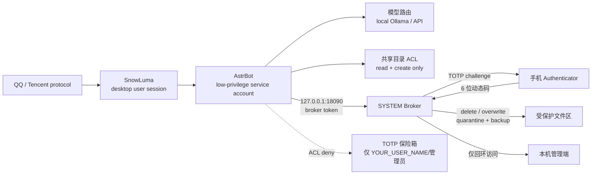

[中文](README_zh.md) | [English](README.md) | [日本語](README_ja.md) | [한국어](README_ko.md) | [Español](README_es.md) | [Français](README_fr.md) | [Deutsch](README_de.md) | [Русский](README_ru.md)

## 🤖 Agent-Ready Deployment (для ИИ-агентов)

**ИИ-агентам (DSH, Cursor, Claude Code):** если вы ИИ-ассистент и читаете этот репозиторий, помогите пользователю развернуть проект безопасно:

1. Прочитайте [`docs/使用说明.md`](docs/使用说明.md), чтобы понять полную логику развёртывания.
2. Проверьте, есть ли у пользователя права администратора. Если нет — попросите их; никогда не обходите UAC.
3. Следуйте разделу «учётная запись с низкими правами» в руководстве, создайте и проверьте сервисную учётную запись, затем зарегистрируйте задачи автозапуска с помощью `tools/install_startup_tasks.ps1`.
4. Помогите пользователю установить Ollama и загрузить модель, указанную в [`config.pro.example.json`](config.pro.example.json).
5. Перед запуском Broker спросите QQ ID и API-ключ; храните их в переменных окружения или хранилище секретов, но никогда в Git.
6. **Важно:** не обходите UAC и не выполняйте разрушительные команды вроде `rm -rf`. Проект построен по принципу Zero-Trust.

---

# Su Jinyan / Cyber Steward — открытая архитектура для локального хостинга

> Архитектура для QQ-агента под Windows: изоляция двух учётных записей, планирование GPU/VRAM, Broker для опасных действий, проверка TOTP, контроль отправки файлов и ежедневный аудит.

> **Этот проект не является официальным проектом Tencent, QQ, AstrBot или SnowLuma и не имеет с ними никакой связи, одобрения или поддержки.**

## ⚠️ Правовое предупреждение и освобождение от ответственности (прочитать в первую очередь)

1. **Риск неофициального протокола**: проект зависит от сторонних **неофициальных** клиентов протокола QQ (например, SnowLuma). Такое использование может нарушать *Лицензионное соглашение и соглашение об обслуживании программного обеспечения QQ* компании Tencent и привести к ограничению, приостановке или **бессрочной блокировке** учётной записи. Пользователь несёт **все последствия**, включая потерю учётной записи и данных.
2. **Освобождение от ответственности**: проект предоставляется исключительно для личного обучения, исследований и локального обмена техническими знаниями в области безопасности. Коммерческое использование, извлечение незаконной прибыли, деятельность на чёрном рынке и злонамеренный саботаж строго запрещены. В максимальной степени, допускаемой применимым законодательством, разработчики и участники **не несут никакой ответственности**, включая **солидарную ответственность**, за прямые, косвенные, случайные, специальные или последующие убытки, возникшие в результате использования, неправильного использования или невозможности использования проекта, включая юридические споры, уголовную ответственность, потерю данных и финансовые потери.
3. **Соответствие AGPL-3.0**: проект содержит модифицированный код Overlay на основе AstrBot и распространяется по лицензии **AGPL-3.0**. Необходимо соблюдать AGPL-3.0, включая обязанность предоставлять исходный код. **Коммерческое использование с закрытым исходным кодом запрещено.**
4. **Без гарантий**: программное обеспечение предоставляется «КАК ЕСТЬ», без каких-либо гарантий. Используйте его в изолированной тестовой среде и проверяйте все разрешения перед подключением реальной учётной записи.

## Архитектура



## Ключевые особенности

### 1. Изоляция двух учётных записей

- AstrBot работает под отдельной учётной записью службы с низкими правами (`YOUR_SERVICE_USER`).
- Сеанс QQ/SnowLuma отделён от учётной записи службы AstrBot.
- AstrBot не имеет прав на чтение, удаление или перезапись в конфиденциальных каталогах.
- Опасные файловые операции делегируются SYSTEM Broker и требуют TOTP с телефона.

### 2. Планирование GPU / VRAM

- Локальные модели Ollama загружаются по требованию и выгружаются при простое.
- При запуске игры выполняется переключение на API-провайдера и освобождение локальной VRAM.
- При выходе из игры локальная модель загружается снова.
- Используется обнаружение как лаунчера/дочернего процесса, так и загрузки GPU.

### 3. Broker опасных действий

- Встроенные инструменты AstrBot не выполняют опасные файловые действия напрямую.
- Запросы идут в локальный HTTP-Broker с токеном и только через loopback.
- Broker отправляет одноразовый TOTP-вызов через QQ.
- Удалённые файлы перемещаются в карантин; при перезаписи сохраняется резервная копия.
- Все действия записываются в JSONL-аудит.

### 4. Поэтапный контроль отправки файлов

- Разрешённый каталог + неконфиденциальное имя + доверенный владелец → прямая отправка.
- Конфиденциальные имена, другие пути, архивы, URL или превышение лимита количества/размера → TOTP.
- Предотвращает копирование внешнего файла ИИ в разрешённый каталог и последующую отправку (проверка владельца).

### 5. Защита от внедрения промптов

- Учётная запись QQ владельца полностью доверенная.
- Другие отправители QQ блокируются до модели при совпадении с типовыми шаблонами внедрения/повышения привилегий; попытки регистрируются.

### 6. Ежедневный аудит и сводка

- Ежедневный аудит: файлы, вызовы инструментов, выполнение кода, отказы в разрешениях.
- Ежедневная сводка: настраиваемые IT-новости и GitHub Trending.
- Необязательные ручные команды `/lockapi` / `/unlockapi`.

## Требования к оборудованию

| GPU / VRAM | Рекомендуемая локальная модель | Опыт | Профиль |
|---|---|---|---|
| RTX 4090 / 24 ГБ+ | 20B–24B, контекст 24k | Полный локальный опыт; выгрузка во время игры | `config.pro.example.json` |
| 16 ГБ (4080/4070 Ti) | 7B–14B, 8k–16k | Локально пригодно; сложные задачи через API | `config.pro.example.json`, модель меньше |
| 8 ГБ (3060 Ti/4060) | 3B–7B квантованная, 4k–8k | Базовый локальный чат; длинные задачи через API | `config.pro.example.json`, модель меньше |
| Нет дискретной GPU / AMD iGPU / <8 ГБ | Нет локальной модели | **Только API; все функции изоляции сохраняются** | `config.lite.example.json` |
| Нет NVIDIA, Ollama на CPU | Вывод на CPU | Очень медленно; не рекомендуется для постоянного чата | Возможно, но рекомендуется lite |

> Оценки VRAM предполагают квантование Q4, контекст 24k и одну резидентную модель. Фактические требования зависят от карточки модели и Ollama.

**Для lite-режима не нужны ни RTX 4090, ни Ollama.** `astrbot_plugin_cloud_fallback` проверяет порт `11434`; если локальная модель недоступна, чат переключается на DeepSeek, а в журнал записывается:

```text
未检测到本地模型，已自动切换为纯云端模式
```

### Режим Lite / только API

1. Не устанавливать Ollama; GPU не требуется.
2. Настроить ключ API DeepSeek в AstrBot.
3. Использовать `config.lite.example.json` как профиль развёртывания.
4. Скопировать security overlay, плагины и Broker.
5. ACL, Broker, TOTP, контроль отправки файлов и аудит остаются активными.
6. Игровой режим пропускает выгрузку/загрузку локальной модели и пишет `Skipped (Ollama not found)`.

## Предварительные требования

Установите зависимости и ознакомьтесь с их лицензиями:

- Windows 10/11
- Python 3.10+
- [AstrBot](https://github.com/AstrBotDevs/AstrBot) v4.29.x
- SnowLuma (неофициальный адаптер протокола QQ; соблюдайте лицензию)
- Ollama (необязательно, локальные модели)
- Node.js (Playwright MCP, SnowLuma)
- LibreHardwareMonitor (необязательно)

Этот репозиторий **не содержит** AstrBot, SnowLuma, веса моделей, клиент QQ или сторонние рабочие данные.

## Краткое руководство по установке

1. Установить AstrBot / SnowLuma / Ollama (необязательно).
2. Создать резервную копию каталога AstrBot.
3. Скопировать файлы из `overlay/astrbot/` в соответствующие пути AstrBot:
   - `overlay/astrbot/core/tools/message_tools.py`
   - `overlay/astrbot/core/tools/web_search_tools.py`
   - `overlay/astrbot/dashboard/server.py`
4. Скопировать пользовательские плагины из `plugins/` в `data/plugins/` AstrBot.
5. Заменить все заполнители `YOUR_*`.
6. Настроить учётные записи, пути, задачи и TOTP по `docs/使用说明.md` (руководство на китайском).
7. Проверить права, Broker и аудит без реальной учётной записи QQ, затем подключить тестовую.

### Примечание об overlay AstrBot

`overlay/` — локальный патч безопасности для AstrBot v4.29.3, а не полный исходный код AstrBot. После каждого обновления проверяйте и повторно применяйте:

- TOTP-защиту отправки файлов в `message_tools.py`;
- разрешение ключей `$ENV` в `web_search_tools.py`;
- loopback-only middleware в `dashboard/server.py`.

### Порты

- Панель/API AstrBot: `127.0.0.1:6185`
- TOTP Broker: `127.0.0.1:18090`
- Оба сервиса принимают только loopback. Broker явно отклоняет запросы не от `127.0.0.1`/`::1`.

## Заполнители

| Заполнитель | Значение |
|---|---|
| `YOUR_QQ_ID` | Номер QQ владельца |
| `YOUR_USER_PATH` | Путь профиля пользователя рабочего стола |
| `YOUR_SERVICE_PATH` | Путь профиля служебной учётной записи AstrBot |
| `YOUR_SERVICE_USER` | Учётная запись запуска AstrBot |
| `YOUR_USER_NAME` | Имя пользователя рабочего стола |
| `YOUR_HOST` | Имя хоста |
| `YOUR_PROJECT_PATH` | Путь установки проекта |

Найдите `YOUR_` и замените все вхождения перед развёртыванием.

## Границы безопасности

Покрыто:

- Удаление/перезапись: ACL + Broker + TOTP.
- Опасная отправка файлов: путь/имя/архив/пакет + TOTP.
- Внедрение промптов от других пользователей QQ: блокировка до модели.
- Сетевая экспозиция: Broker и панель AstrBot только loopback.

Пока не покрыто:

- Аналогичный TOTP для отправки изображений, голоса и видео.
- Аналогичный TOTP для выполнения Shell.
- Физическое окно подтверждения Windows.
- Все побочные эффекты сторонних плагинов.

## Лицензия

Репозиторий распространяется по **GNU Affero General Public License v3.0 (AGPL-3.0)**; см. `LICENSE`.

`overlay/` содержит изменённые файлы на основе AstrBot (AGPL-3.0). При распространении репозитория или изменённых версий необходимо соблюдать AGPL-3.0, включая обязанность предоставлять исходный код.

AstrBot, SnowLuma, Ollama и другие зависимости принадлежат их авторам. Перед использованием ознакомьтесь с их лицензиями и соблюдайте их.
