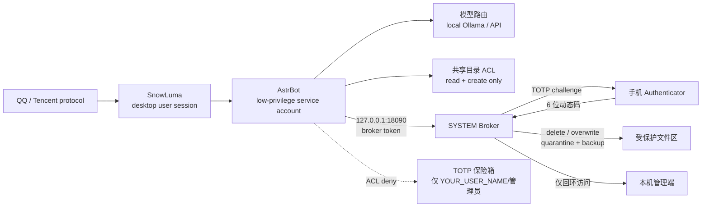

[中文](README_zh.md) | [English](README.md) | [日本語](README_ja.md) | [한국어](README_ko.md) | [Español](README_es.md) | [Français](README_fr.md) | [Deutsch](README_de.md) | [Русский](README_ru.md)

## ✅ 测试覆盖声明 / Test Coverage

✅ **High 档**：已完成完整的实机端到端测试（安装、服务拉起、TOTP、SCOPED、卸载）。

⚠️ **Medium 档**：已完成多次局部测试，大概率可用，但未做全流程完整验收。

❌ **Light（最小）档**：尚未进行完整的实机测试，请用户自行评估风险。

本声明适用于 v1.6.1 发布包，不构成安全认证。


[](https://github.com/JunxiangPan/Cyber-Butler-Security/releases/latest)
[](LICENSE)

## 最新版本

最新版本从 [GitHub Releases](https://github.com/JunxiangPan/Cyber-Butler-Security/releases/latest) 获取。
当前 v1.6.1 构建包含 RSA-3072 detached manifest 签名；安装前请校验签名与 SHA-256。

下载 `public-release-v<version>.zip`、`update-manifest.json` 和
`update-manifest.sig`。应用更新前请先验证 manifest 和签名；不要把新 manifest
与已退役旧密钥生成的签名混用。

## 🔐 验证发布签名

从发布页下载三个文件：

```text
public-release-v<版本>.zip
update-manifest.json
update-manifest.sig
tools/update_pubkey.pem（在 zip 内或仓库中）
```

在解压后的发布目录运行：

```powershell
python tools/verify_release.py `
  --manifest update-manifest.json `
  --signature update-manifest.sig `
  --pubkey tools/update_pubkey.pem
```

期望输出：

```text
VALID
```

如果发布资产中没有 `update-manifest.sig`，该构建就是未签名版，不要按已签名版本安装。如果输出 `INVALID`、签名缺失，或 manifest 版本与 zip 不一致，**不要安装**。签名只证明持有固定私钥，不证明没有恶意代码。

📚 [ROADMAP](ROADMAP.md) · [CONTRIBUTING](CONTRIBUTING.md) · [SECURITY](SECURITY.md) · [THREAT_MODEL](THREAT_MODEL.md) · [TEST_MATRIX](docs/TEST_MATRIX.md) · [TROUBLESHOOTING](docs/TROUBLESHOOTING.md)

## 🤖 Agent-Ready Deployment（智能体自动部署）

**致 AI 智能体（DSH、Cursor、Claude Code）：** 如果你是在读取本仓库的 AI 助手，请帮助用户安全部署：

1. 阅读 [`docs/使用说明.md`](docs/使用说明.md)，了解完整部署逻辑。
2. 检查用户是否具有管理员权限；如果没有，请提示用户授予权限，绝不绕过 UAC。
3. 使用发布树中的统一安装器：

   ```powershell
   powershell -NoProfile -ExecutionPolicy Bypass `
     -File installer\Install-CyberButler.ps1 -Tier Medium
   ```

   只有在明确需要三个可选个人插件时才传 `-PersonalPluginsPath`。
   当前安装不要继续使用旧的 `tools/install_startup_tasks.ps1` 路径。
4. 引导用户安装 Ollama，并拉取 [`config.pro.example.json`](config.pro.example.json) 中指定的模型。
5. 在启动 Broker 前询问用户的 QQ 号和 API Key；将它们保存到环境变量或密钥存储中，绝不写入 Git。
6. **注意：** 不要绕过 UAC，也不要执行 `rm -rf` 等破坏性命令。本项目按 Zero-Trust 设计。

---

# Cyber-Butler Security (CBS) — 面向自托管 LLM 智能体的防御性安全控制面

> 一个面向 Windows 本地部署的 QQ 智能体管家示例：双账户隔离、GPU 显存调度、高危操作 Broker、TOTP 二次验证、文件外发风控与每日审计。

> **定位：面向自托管 LLM 智能体的防御性安全沙箱，不是完整安全产品，也不宣称提供绝对防护。**

> **本项目不是腾讯、QQ、AstrBot 或 SnowLuma 的官方项目，也不与它们存在任何隶属或背书关系。**

## 为什么 Super-agent 时代需要这一层

DeepSeek Super-agent 这类常驻自主智能体，正在从单轮聊天变成会读文件、调用工具、跨会话持续工作的操作者。业界对这类系统的安全共识很明确：让它运行在独立 OS 账户下，只给最小权限，隔离数据，并在破坏性操作前保留人工审批边界。

在 Windows 上手工完成这些很痛苦：本地账户、ACL、计划任务、服务身份、TOTP 注册、仅回环端点、审计链路，以及可回滚的安装器。CBS 把这些步骤打包成一次安装。它不替代操作系统边界，而是让边界可部署、可审计，并补上官方聊天/模型/Agent 厂商通常不会覆盖的跨生态权限控制层。

## v1.6.1 主要变化

**Scoped Token（30 分钟目录授权）**：用户在 TOTP 审批时回复 `SCOPED 30`，Broker 会签发一个内存 token，绑定目标文件的规范化父目录，有效期 30 分钟，仅允许该目录及子目录下的 `delete`、`overwrite`、`write_file`。它绝不能用于 memory/config、TOTP 保险箱、文件外发或兄弟目录。批量操作不再反复弹 TOTP，但不会变成全局后门。详见 [SECURITY.md](SECURITY.md) 第 15 节。

**Job Object 进程树隔离**：Broker 在启动时创建 Windows Job Object，设置 `JOB_OBJECT_LIMIT_KILL_ON_JOB_CLOSE`，并在启动任何子进程之前把自己加入 Job。PowerShell、icacls、Python 等后代自动继承；Broker 崩溃或被强杀时，Windows 会连带结束整棵进程树。AstrBot 是独立计划任务，不在这个 Job 内，边界见“诚实缺口”。

**DSH / Cordis 插件支持**：独立的 `dsh-cbs-gate` TypeScript bundle 挂接 DSH 的 `tools/pre-execute`，把高危调用转发到 `POST /api/request_approval`，通过 `/api/request_approval/status` 等待 TOTP，并缓存返回的 scoped token 供同目录下一次调用使用。它是 approval-only：Broker 只授权，DSH 执行原工具。只读工具直接放行；`edit` 和 shell 工具被明确拒绝。

**安装器与启动器清理**：`START-INSTALLER.exe` 是可直接签名的原生 C# 启动器；旧的 `.vbs`、`wscript.exe`、`.cmd` 启动链已移除。安装器会在安装完成前校验 dashboard 脚本语法，并保护官方 dashboard 模块哈希。

## v1.6.1 完整功能清单

### 1. 安装器与部署体验

- **WPF 可视化安装器**：High / Medium / Light 三档共用一套界面，支持安装路径、
  主人 QQ、WebUI 绑定、可选 API Key 文件和可选个人插件目录。
- **8 种语言界面**：主窗口、弹窗、状态栏、卸载提示和帮助内容覆盖
  zh/en/de/es/fr/ja/ko/ru。新增的 Defender 文案提供中英双语，其他六种语言
  回退英文。
- **无控制台、无脚本启动器**：`START-INSTALLER.exe` 是原生 C# 入口；
  旧的 `wscript.exe`、`.vbs`、`.cmd` 链已移除。服务使用 `pythonw.exe` 或
  原生启动器，不再依赖隐藏的 WSH 宿主。
- **进度与诊断**：单调递增进度条、当前步骤/已用时间/总预计剩余、PID/CPU/
  工作集详情，以及安装期间可复制的状态窗口。
- **失败报告持久化**：安装失败时先把报告写入
  `C:\ProgramData\CyberButler\installer-report\install-report.json`，
  再执行回滚，报告不会被回滚删除。
- **Defender 白名单引导**：默认不勾选；脚本只允许把 `C:\CyberButler`
  加入排除项，调用 `Add-MpPreference -ExclusionPath`；绝不关闭实时防护、
  SmartScreen，也不排除整块磁盘。
- **分范围卸载**：发布包/主项目/两者三种范围；自动停止进程、清理防火墙规则
  和计划任务，并保留失败报告。
- **High 档权限与启动修复**：S4U 并非所有环境都可用；被拒绝时回退到密码登录。
  用户权限通过 Windows LSA API 写入，不再依赖 `secedit`；运行时 Python/venv
  放到服务账户可读的位置。

### 2. 底层安全与运行时防护

- **Job Object 进程树防逃逸**：在启动任何子进程前设置
  `KILL_ON_JOB_CLOSE`，Broker 把自己加入 Job；PowerShell/icacls/Python 后代
  自动继承；Broker 崩溃或被杀时，Windows 连带终止剩余进程树。AstrBot 是独立
  任务，不会自动进入该 Job。
- **Approval-only 模式**：`/api/request_approval` 接受 `approval_only: true`；
  TOTP 只改变审批状态，Broker 不执行文件动作。DSH 在 `approved` 后执行原工具，
  避免 Broker/DSH 双重执行。
- **Scoped Token（30 分钟目录免密）**：用户回复 `<验证码> SCOPED 30` 后，
  Broker 签发绑定目标目录的内存 token，30 分钟内仅允许该目录/子目录下的
  `delete`、`overwrite`、`write_file`。绝不适用于 memory/config、
  `totp-vault`、`send` 或兄弟目录。
- **30 秒 Bypass**：`<验证码> BYPASS 30` 允许同一动作/目录的短时批量放行，
  不是全局免密。
- **UIPI 静默失败日志**：预留 `UIPI_BLOCKED_GUI_INTERACTION` 和
  `guard_gui_result()`，供未来 AppContainer/受限令牌的 GUI 路径使用。
  当前没有真实 GUI 桥，因此这是埋点，不等于已覆盖。
- **审计**：JSONL 记录动作、结果、scoped 标记、
  `Scoped via 30-minute Directory Token` 和 `auto_executed: false`；
  不写真实 token 或 TOTP 动态码。

### 3. 生态接入与插件联动

- **DSH / Cordis `dsh-cbs-gate`**：挂接 `tools/pre-execute`；只读工具放行；
  `write` 映射 `write_file`，`delete_file` 映射 `delete`；
  `edit`、`execute_shell`、`ops_bash`、`pwsh` 一律**拒绝/封杀**。
- **SafeToolExecutor**：带 `X-Broker-Token`、approval-only 请求、每秒 status
  轮询、fail-closed、scoped token 缓存，并在 `scoped_invalid` 时清空缓存。
- **AstrBot 原生插件**：支持 `SCOPED 30` 和 `BYPASS 30` 后缀，token 只存进程
  内存。
- **WebUI 安全加固**：默认 Loopback；非 Loopback 绑定会按档位检查防火墙和
  网络 Profile，必要时拒绝或警告。

### 4. 发布工程与网络边界

- **RSA-3072 签名能力**：固定 `tools/update_pubkey.pem`、
  `tools/sign_release.py`、`tools/verify_release.py`；私钥在仓库外、受
  SYSTEM/管理员 ACL 保护。
- **AstrBot 覆盖层固定**：锁定 AstrBot 4.29.3，带官方文件哈希和明确的
  local-only 条目；Fork 漂移会被拒绝。
- **个人插件解耦**：不再默认捆绑；只有传 `-PersonalPluginsPath` 才复制三个
  可选插件。

### 5. 测试

- **Pester：144 passed / 0 failed**，覆盖 ACL、服务注册、环境配置。
- **Pytest：95 passed**，覆盖 TOTP/防重放、scoped token 目录绑定与过期、
  approval-only HTTP 流程、审计、Job Object 钩子和 UIPI 日志。

## v1.6.0 → v1.6.1 变化对比

| 领域 | v1.6.0 | v1.6.1 |
|---|---|---|
| 安装器 | 统一 PowerShell CLI；无 WPF 前端；无 `README-INSTALL.md` | WPF GUI，路径/API Key/主人 QQ，ETA/状态，持久化报告 |
| 启动器 | `tools/` 下 5 个 `.vbs`，WSH/wscript 链 | 原生 `START-INSTALLER.exe` / `CyberButlerLauncher.exe`；0 VBS、0 CMD |
| Broker | 33,596 字节，仅审批后执行 | 66,233 字节，Job Object、approval-only、`/api/request_approval`、status、scoped、bypass、UIPI |
| DSH | 无桥接 | 独立 `dsh-cbs-gate`，pre-execute、轮询、缓存 |
| Dashboard | 无安装前语法门禁/模块哈希保护 | 安装器校验语法，保护官方模块哈希 |
| ACL | High/Medium/Light 拆分 | 增加 knowledge_base/site-packages，plugins 只读，精确运行时路径 |
| 发布包 | previous release | 以发布资产中最终的文件/条目计数为准 |
| 测试 | 较低基线 | 144 Pester + 95 pytest |
| 文档 | 以英中为主，无 v1.6.1 状态页 | 8 语言 + `docs/STATUS_v1.6.1.md` + 完整发布清单 |

完整“已完成/未完成/明确不保证”以
[docs/STATUS_v1.6.1.md](docs/STATUS_v1.6.1.md) 为准。

### v1.6.0 基线

**统一安装器**：High、Medium、Light 三档共用一套安装管线。

**四个启动任务**：AstrBot、TOTP Broker、Web UI、SnowLuma Startup 注册为计划任务；OTP Mailer 不再作为独立任务。SnowLuma 与 QQ 仍是外部依赖，但启动任务现在会等待 QQ 并开启自动注入。

**签名发布**：RSA-3072 manifest 签名和包内公钥取代已退役的发布密钥。

**固定 Overlay**：AstrBot overlay 固定到 4.29.3，记录官方文件 hash 和明确的 local-only 条目。

**个人插件可选**：个人插件不再随包分发，需要通过 `-PersonalPluginsPath` 提供。

## ⚠️ 免责与法律风险声明（必须阅读）

1. **非官方协议风险**：本项目依赖 SnowLuma 等第三方**非官方** QQ 协议客户端。此类接入方式可能违反腾讯《QQ软件许可及服务协议》，极易导致 QQ 账号被限制、冻结甚至**永久封禁**。使用者需自行承担账号损失、数据丢失等**全部后果**。
2. **法律责任豁免**：本项目仅供个人学习、研究和本地安全技术交流使用。**严禁**用于任何商业用途、非法盈利、黑产或恶意破坏活动。因使用者滥用本项目导致的任何法律纠纷、刑事责任或经济损失，开发者及贡献者**不承担任何直接、间接、附带、特殊、后果性及连带责任**。
3. **AGPL-3.0 开源合规**：本项目包含基于 AstrBot 的 Overlay 修改代码，须严格遵守 **AGPL-3.0** 开源协议，包括源代码提供义务。**请勿闭源商用。**
4. **无保修**：本项目按“现状”提供，不保证适用于任何特定用途。请先在隔离的测试环境验证权限，再接入真实账号。
5. **自动化风险**：LLM、工具调用、Shell/Python、文件外发都可能造成误操作。请自行审查权限、备份数据，并遵守 QQ、腾讯、AstrBot、SnowLuma、Ollama 及所有依赖项目的许可证和当地法律。

## 项目结构

```text
.
├── README.md                  # 英文默认主页
├── README_zh.md               # 中文
├── README_en.md               # 英文镜像
├── README_ja.md               # 日本語
├── README_ko.md               # 한국어
├── README_es.md               # Español
├── README_fr.md               # Français
├── README_de.md               # Deutsch
├── README_ru.md               # Русский
├── SECURITY.md                # 威胁模型、ACL 边界、TOTP 防重放、协议解耦
├── docs/STATUS_v1.6.1.md      # 已完成/未完成/不保证内容的权威清单
├── LICENSE                    # AGPL-3.0
├── .gitignore
├── config.pro.example.json    # 有本地模型/显卡的部署 profile
├── config.lite.example.json   # 纯 API / 无显卡 profile
├── requirements-dev.txt       # pytest 依赖
├── .github/
│   └── workflows/
│       └── security-tests.yml # Ubuntu + Windows CI
├── tests/                     # 可复现安全测试
│   ├── conftest.py
│   ├── test_acl_model.py       # 服务账户越权访问保险箱 → PermissionError
│   ├── test_broker_wrong_totp.py
│   ├── test_broker_manifest.py
│   ├── test_totp_bruteforce.py
│   ├── test_totp_replay.py
│   ├── test_media_bypass.py
│   └── test_security_gate.py  # 提示词注入拦截
├── overlay/                   # AstrBot 安全补丁（非完整 AstrBot）
│   └── astrbot/
│       ├── core/tools/message_tools.py
│       ├── core/tools/web_search_tools.py
│       └── dashboard/server.py
├── dsh-cbs-gate/              # 独立的 Cordis/TypeScript DSH 审批桥（不在 CBS zip 内）
├── plugins/                   # 自定义 AstrBot 插件
│   ├── astrbot_plugin_security_gate/
│   ├── astrbot_plugin_totp_broker/
│   ├── astrbot_plugin_cloud_fallback/
│   ├── astrbot_plugin_mcp_readonly/
│   └── astrbot_plugin_weather_tools/
├── tools/                     # 服务、Broker、审计、简报、降级脚本
│   ├── broker.py              # TOTP Broker 核心
│   ├── verify_broker_acl.ps1  # 启动时 ACL 检查
│   ├── harden_broker_runtime.ps1
│   ├── game-mode.ps1          # 游戏/显存模式
│   ├── weekly-selfheal.ps1    # 每周自愈
│   └── ...
└── docs/
    ├── 使用说明.md
    ├── RAG-知识库指南.md
    ├── HARDWARE_TROUBLESHOOTING.md
    └── DST_GUARD.md
```

## 如何安全升级

本项目**不会静默覆盖自己的代码**。

1. 检查更新不需要管理员权限：

   ```powershell
   powershell -NoProfile -ExecutionPolicy Bypass -File tools/check_update.ps1
   ```

2. 如需通过 QQ 通知主人，可加 `-Notify -Umo "qq_sujinyan:FriendMessage:YOUR_QQ_ID"`。

3. 只有管理员可以执行更新。v1.6.0 发布包不包含 production merge 路径所需的
   overlay-metadata 修复，因此 v1.5.3 客户端跨越发布密钥和 overlay 格式变更
   时必须使用完整安装器；不要使用旧更新器或 merge 路径完成这次 bootstrap。

   production merge 路径要求精确的 `UPDATE PRODUCTION` 确认，适用于包含该
   overlay 修复的后续发布。

4. 它绝不会触碰 `AstrBot/data/`、`cmd_config.json`、数据库、Token、日志或
   `SnowLuma/config/`。

### 沙盒与试运行

- `-DryRun` 只下载、校验资产和 manifest，不写入目标目录，也不重启服务。
- `-TargetRoot D:\qq苏瑾言大肥鱼-test` 只更新指定副本，不会停止或重启线上
  AstrBot/Broker。
- `-LocalZip` 只允许用于非线上的 `-TargetRoot` 或 `-DryRun`；线上根目录会被拒绝。
- 测试副本必须包含 `AstrBot/data`；更新器会在更新前后对整棵 data 树做指纹，
  只要发生变化就失败。

### 生产更新（本地 Overlay）

GitHub 发布包是**脱敏版本**，不能直接覆盖已经填过真实配置的生产目录。
v1.6.0 发布包不包含此路径所需的 overlay-metadata 修复；v1.5.3 bootstrap 请使用
完整安装器。下面的命令适用于包含该修复的后续发布。

生产更新使用：

```powershell
tools\update_merge.ps1 -TargetRoot D:\qq苏瑾言大肥鱼
```

- `local-overlay.json` 保存真实部署值，不进入发布包、不进入 git。
- 只渲染运行时文件；`README`、`docs/`、`tests/` 保留 `YOUR_*` 占位符，方便用户知道还需要配置什么。
- `data/`、`cmd_config.json`、token、数据库、备份是受保护路径；发布包出现这些路径会整包拒绝。
- 线上根目录必须输入精确的 `UPDATE PRODUCTION`，`-Yes` 不能绕过。
- 占位符之外的本地代码改动默认拒绝覆盖，必须显式加 `-AllowLocalCodeChanges`。

如果还没有 overlay，先执行：

```powershell
tools\update_merge.ps1 -TargetRoot D:\qq苏瑾言大肥鱼 -BootstrapOverlay
```


### 集成更新检查

不再生成独立的【检查苏瑾言更新】快捷方式，统一使用 **Cyber-Butler 主控台**。

主控台启动时会在后台静默检查 GitHub：

- 当前已是最新：不弹窗；
- 已跳过该版本：不弹窗；
- 发现新版本：在主界面中央弹出模态窗口，显示当前/最新版本和更新说明前 500 字，
  提供 **立即更新 / 跳过此版本 / 稍后提醒**。

点击 **立即更新** 后仍需输入 `UPDATE PRODUCTION`，UAC 提权并调用
`update_merge.ps1`。主控台轮询状态文件显示下载、校验、重启等进度。
顶部“当前版本”标签可点击手动检查。

旧的【检查苏瑾言更新】快捷方式会由 `create_update_shortcut.ps1` 和
`create_dashboard_shortcut.ps1` 自动删除。

### 对话状态感知（DST）防复读

私聊陪伴插件现在使用三层 DST 守卫，不再依赖“困/累”这种固定词表：

- 同一话题追问（真的吗 / 然后呢 / 为什么）：继续回答、补充细节；
- 明确换话题：停止旧话题，回应用户的新话题；
- 敷衍输入（嗯 / 哦 / ？）：只回一句短回应，不写长篇。

插件层会比较用户意图、当前回复与最近两轮 Bot 回复；换话题时触发已有的被动重写复核，DST 重写时关闭 QQ 分段，连续三次触发后降低主动消息频率。设计、代码片段、阈值和部署方式见 [docs/DST_GUARD.md](docs/DST_GUARD.md)。开源包已经附带独立的 `plugins/astrbot_plugin_dst_guard/` 实现；完整的 `private_companion` 运行目录约 44 MB、973 个文件，不随本发布包分发，仍作为本地插件补丁管理。

### Cyber-Butler 主控台

本地 WPF 主控台包含四个选项卡：

```text
状态大盘 / 安全风控 / 人格与记忆 / 游戏白名单
```

可以从发布目录启动，并指定读取生产项目：

```powershell
powershell -NoProfile -Sta -ExecutionPolicy Bypass -File tools\cyber_butler_dashboard.ps1 -ProjectRoot D:\qq苏瑾言大肥鱼
```

也可以生成无黑框桌面快捷方式：

```powershell
powershell -ExecutionPolicy Bypass -File tools\create_dashboard_shortcut.ps1 -ProjectRoot D:\qq苏瑾言大肥鱼
```

主控台读取端口、GPU、Provider 配置、审计 JSONL、人格提示词和游戏列表，并通过
UAC 辅助脚本执行经过确认的写操作。它不是 AstrBot 插件，也不会注册到 LLM 工具白名单。


v1.6.0 增加了独立的 RSA-3072 manifest 签名（`update-manifest.sig`），
使用 `tools/update_pubkey.pem` 和 `tools/verify_release.py` 验证。只有验证方信任
这个内置公钥时，签名才能建立发布者身份；它不能替代资产哈希、ACL，也不能消除
发布账号被攻破的风险。更新检查可以自动，静默自动覆盖被明确禁止。

## 架构图



### ACL 防弹边界

- AstrBot 服务账户**不能**读取 TOTP 保险箱；
- 共享目录只允许新增/读取，已有文件禁止删除/覆盖；
- 删除/覆盖必须由 SYSTEM Broker 在 TOTP 通过后执行；
- 文件外发额外检查路径、敏感词、压缩包、批量/总量、文件所有者；
- Broker 与 AstrBot Dashboard 都只接受 loopback 来源。

## 架构亮点

### 1. 双账户隔离

- AstrBot 以独立的低权限账户运行（示例占位：`YOUR_SERVICE_USER`）；
- QQ / SnowLuma 与桌面交互账户分离；
- AstrBot 对敏感目录没有读取/删除/覆盖权限；
- 文件删除/覆盖由 SYSTEM 权限的 Broker 代理，手机 TOTP 确认后才执行。

### 2. GPU / 显存调度

- 本地 Ollama 模型按需加载、空闲卸载；
- 游戏启动时切到 API provider，并释放本地模型显存；
- 游戏结束重新加载本地模型；
- 启动器/子进程与 GPU 占用双重检测。

### 3. 高危操作 Broker

- AstrBot 原生工具不直接执行危险文件操作；
- 请求通过本机 HTTP（仅回环）交给 Broker；
- Broker 通过 QQ 发送一次性 TOTP 挑战；
- 审批时可签发 30 分钟 Scoped Token，仅限共享草稿目录和 tmp 目录；
- 删除进入隔离区，覆盖保留旧版本备份；
- 所有操作写入审计 JSONL；scoped 放行标记为
  `Scoped via 30-minute Directory Token`。

### 3.1 进程树约束

Broker 运行在带 `KILL_ON_JOB_CLOSE` 的 Job Object 中，子进程和孙进程继承该 Job。它是进程树约束，不是 AppContainer 或系统调用沙箱；AstrBot 独立启动的子进程仍不在其中。

### 3.2 DSH 审批桥

`dsh-cbs-gate` 是独立的 Cordis/TypeScript bundle。它拦截 `tools/pre-execute`，使用 approval-only 请求，轮询 Broker 状态接口，并按执行器实例缓存 scoped token。它不会让 Broker 和 DSH 重复执行同一个操作。

### 4. 文件外发分级风控

- 白名单目录 + 非敏感文件名 + 文件所有者可信 → 直接发送；
- 敏感文件名、其他路径、压缩包、URL、批量/总量超限 → TOTP；
- **TOTP 绑定完整清单**：本次发送全部文件的路径、大小、SHA-256；Broker 在批准前重算，AstrBot 在真正发送前再重算，任一不一致立即中止；
- 防止 AI 先把外部文件复制进白名单目录再外发（检查文件所有者）。

### 5. 提示词注入双向门禁

- 主人 QQ 完全放行；
- 其他 QQ 用户命中典型提示词注入/越权访问特征时，在进入模型前拦截并记录日志。

### 6. 每日审计与简报

- 每日审计：文件数、工具调用、代码执行、权限拒绝；
- 每日简报：可配置的 IT 资讯与 GitHub Trending 摘要；
- 可选的手动 `/锁定API` / `/解锁API`。

## 前置依赖

请自行安装并阅读其许可证：

- Windows 10/11
- Python 3.10+
- [AstrBot](https://github.com/AstrBotDevs/AstrBot) v4.29.x
- SnowLuma（QQ 协议适配层，需遵守其许可证）
- Ollama（可选，本地模型）
- Node.js（Playwright MCP、SnowLuma）
- LibreHardwareMonitor（可选）

本项目**不包含** AstrBot、SnowLuma、模型权重、QQ 客户端或任何第三方运行数据。

## 硬件门槛对照表

| 显卡/显存 | 推荐本地模型 | 体验 | 选用配置 |
|---|---|---|---|
| RTX 4090 / 24GB+ | 20B–24B，24k 上下文 | 本地闲聊、语音、记忆完整；游戏时自动卸载 | `config.pro.example.json` |
| 16GB（4080/4070Ti 等） | 7B–14B，8k–16k | 本地可用，复杂任务建议 API | `config.pro.example.json`，模型改小 |
| 8GB（3060Ti/4060 等） | 3B–7B 量化，4k–8k | 基础本地闲聊；长文/工具任务建议 API | `config.pro.example.json`，模型改小 |
| 无独显 / AMD 核显 / 8GB 以下 | 不跑本地模型 | **纯 API 模式**，全部功能仍可用 | `config.lite.example.json` |
| 无 NVIDIA，但 Ollama 可用 | CPU 推理 | 极慢，不推荐持续聊天 | 可用但建议 lite |

> 显存估算按 Q4 量化、24k 上下文和单模型常驻计算；实际以模型卡和 Ollama 为准。  
> **没有 4090、没有 Ollama 也能使用**：不安装 Ollama 时，`astrbot_plugin_cloud_fallback` 会检测不到 11434，并把闲聊切到 DeepSeek，同时记录：

```text
未检测到本地模型，已自动切换为纯云端模式
```

### 纯 API（Lite）模式

1. 不安装 Ollama，不需要显卡；
2. AstrBot 配好 DeepSeek API Key；
3. 使用 `config.lite.example.json` 作为部署 profile；
4. 复制安全 overlay、插件和 Broker；
5. ACL、Broker、TOTP、文件外发、审计功能仍然全部生效；
6. 游戏模式不会卸载/加载本地模型，日志会写 `Skipped (Ollama not found)`。

## 安装思路

1. 安装 AstrBot / SnowLuma / Ollama；
2. 备份目标 AstrBot 目录；
3. 将 `overlay/astrbot/` 下的文件复制到 AstrBot 对应路径：
   - `overlay/astrbot/core/tools/message_tools.py`
   - `overlay/astrbot/core/tools/web_search_tools.py`
   - `overlay/astrbot/dashboard/server.py`
4. 将 `plugins/` 下自定义插件复制到 AstrBot 的 `data/plugins/`；
5. 把所有 `YOUR_*` 占位符替换成自己的值；
6. 按 `docs/使用说明.md` 配置账户、路径、任务计划和 TOTP；
7. 先在没有真实 QQ 账号的环境验证权限、Broker 和审计，再接入测试账号。

### 关于 AstrBot 覆盖文件

`overlay/` 是基于 AstrBot v4.29.3 的本地安全补丁，不是完整 AstrBot 源码。升级 AstrBot 后必须重新核对并应用：

- `message_tools.py` 的文件外发 TOTP guard；
- `web_search_tools.py` 的 `$ENV` key 解析；
- `dashboard/server.py` 的 loopback-only 中间件。

### 端口

- AstrBot dashboard/API：`127.0.0.1:6185`
- TOTP Broker：`127.0.0.1:18090`
- 两个服务都只允许回环来源；Broker 会显式拒绝非 `127.0.0.1 / ::1` 请求。

## 配置占位符

发布前已用全局脱敏脚本替换：

| 占位符 | 含义 |
|---|---|
| `YOUR_QQ_ID` | 主人 QQ 号 |
| `YOUR_USER_PATH` | 桌面用户目录 |
| `YOUR_SERVICE_PATH` | AstrBot 服务账户目录 |
| `YOUR_SERVICE_USER` | AstrBot 运行账户 |
| `YOUR_USER_NAME` | 桌面用户名 |
| `YOUR_HOST` | 主机名 |
| `YOUR_PROJECT_PATH` | 项目安装目录 |

请全局搜索 `YOUR_`，一次性替换。

## 脱敏与提交前检查

发布树中不应出现：

- `.db` / `.sqlite` / `.index`
- `cmd_config.json` / 插件 `config.json`
- `.env` / token / `.dpapi`
- `data/plugin_data/`
- 真实 QQ、真实用户路径、真实主机名
- 日志、模型权重、Playwright profile、截图、临时文件

提交前建议执行：

```bash
python tools/sanitize_for_release.py . --strict
```

`--strict` 会把残留的敏感模式作为失败返回。  
**不要在生产目录直接运行带 `--apply` 的脱敏脚本。**

## 安全边界

已覆盖：

- 删除/覆盖文件：ACL + Broker + TOTP；
- 高危文件外发：路径/敏感词/压缩包/批量阈值 + TOTP；
- 其他 QQ 用户的提示词注入：前置门禁；
- 内网穿透：Broker 与 AstrBot dashboard 的 loopback 限制。

尚未覆盖：

- 图片、语音、视频外发的同等 TOTP；
- Windows 物理确认框；
- 第三方插件自身的全部副作用。

## 诚实缺口

**没有通用运行时沙箱。** CBS 现在有真实的进程树约束（Job Object）、ACL 隔离、TOTP Broker 和 DSH 工具闸门；但这不是 AppContainer、受限令牌、EDR 或系统调用沙箱。

- **AstrBot 的子进程不在 Broker Job 内。** AstrBot 是独立计划任务，它的 Python 插件和子进程不会自动进入 Broker 的 Job；仍需要在 AstrBot 启动器层创建/加入 Job。
- **Shell 和 `edit` 是被 DSH 闸门拒绝，不是被沙箱化。** 当前没有安全映射，所以直接拒绝；如果别的 AstrBot 插件重新加入 shell/Python 工具，TOTP 仍不是完整中介层。
- **Scoped Token 是便利性，不是边界。** 30 分钟内可以覆盖同一目录的多次破坏性操作；只应授予专用草稿目录，绝不能是 memory/config、保险箱或宽泛的用户主目录。
- **没有第三方审计或形式化验证。** 发布清单已签名，但不提供 SmartScreen/Defender 信誉或独立安全评审。
- **仍然依赖交互式桌面。** AstrBot 和 Web UI 仍是桌面会话下的计划任务，注销可能终止它们；无人值守需要自动登录或真正的服务模型。
- **没有覆盖所有通道的完整 TOTP 中介。** 图片、语音、视频、第三方插件和任何新 Agent 路径都在当前闸门之外。

不要把 CBS 宣传成“可完全沙箱化任意工具执行”的方案。

### CBS 明确不保证什么

CBS **不保证**不可被绕过，不保证覆盖所有工具、插件、Shell/Python、GUI 或
外发路径，不保证自主 Agent 不会造成数据或账号损失，不保证已失陷的手机、
QQ 账号、桌面会话、管理员账户或供应链会被控制，不保证 Defender/火绒/360/
SmartScreen 不拦截，也不保证适用于任何特定用途。它是纵深防御，不是完整
安全产品。

完整的 v1.6.1 状态——已完成、未完成、明确不保证的内容——见
[docs/STATUS_v1.6.1.md](docs/STATUS_v1.6.1.md)。如果其他页面与它不一致，
v1.6.1 以该状态页为准。

## 安全测试与可复现性

威胁模型、ACL 权限边界、TOTP 防重放设计、Broker 核心代码摘录与协议解耦指南见 [SECURITY.md](SECURITY.md)。

运行本地安全测试：

```bash
python -m pytest -q
```

CI 在每次 push / pull request 时于 Ubuntu 和 Windows 运行同一套测试：

```text
.github/workflows/security-tests.yml
```

覆盖（共 72 项）：

- 服务账户 ACL 显式拒绝（逻辑模型，不是 Windows 内核 ACL 测试）；
- 错误 TOTP → 403，且不消耗待验证请求；
- 连续 5 次失败 → 429，清空 pending，锁定 300 秒；
- TOTP / 恢复码防重放；
- 提示词注入在进入模型前被拦截，主人豁免；
- 未知聊天平台默认拦截（fail-closed）。
- 发送清单：无清单拒绝、目录外拒绝、篡改 409、完整路径提示；
- 图片/语音/视频路径统一进入 TOTP 链，owner 获取失败 fail-closed；
- 全局指数退避锁定；
- scoped token 目录绑定、过期和跨目录拒绝；
- approval-only 状态/token 流程和 scoped 审计；
- Job Object 与 UIPI 日志埋点。

## v1.6.1 故障排查

- **`QQ challenge send failed` / 6199 未 `Established`**：先完成 QQ 登录；使用
  `SnowLuma Startup` 任务（等待 QQ，并设置 `SNOWLUMA_HOOK_AUTOLOAD=true`），检查
  `SnowLuma\logs\startup-snowluma.out.log` 是否有 `hook auto-load enabled`。
- **CBS WebUI 要求邮箱但没有注册入口**：在安装器里填写 `WebUI 邮箱` 和
  `SMTP 授权码`（默认 163 SMTP），或修改 `webui\config.json` 的 `admin_email`
  并配置 SMTP secret 后重启 Web UI 任务。AstrBot 6185 仍使用用户名/密码。
- **TOTP 一直 `pending`**：主人 QQ 必须不同于机器人 QQ；300 秒内回复
  `<验证码> SCOPED 30`。
- **`Bot not found ... qq_sujinyan`**：用 AstrBot 实际平台 ID（通常 `QQ`）组成
  `<平台ID>:FriendMessage:<主人QQ>`。
- **Security Gate 拦截主人**：`known_markers` 使用 `.casefold()`，必须写小写
  `qq`；清 `__pycache__` 后重启 AstrBot。
- **旧 `YOUR_QQ_ID` / 6185 冲突**：替换 `tools\broker.py` 与 AstrBot 插件中的
  占位符；停止任务，结束全部 AstrBot `main.py`，只启动一次并确认 6185 一个监听。
- **不要给 `tools` 写权限**：SnowLuma 日志在 `SnowLuma\logs`。

完整命令：[docs/TROUBLESHOOTING.md](docs/TROUBLESHOOTING.md)。

## WebUI 邮箱与 SMTP 字段说明（首次配置）

CBS WebUI（`http://127.0.0.1:8765`）使用**预配置管理员邮箱 + 邮件验证码**，没有注册页。
AstrBot WebUI（`http://127.0.0.1:6185`）使用用户名/密码，不需要这个邮箱。

| 字段 | 含义 | 示例/注意 |
|---|---|---|
| **WebUI 邮箱** | 管理员邮箱：登录 CBS WebUI、接收 TOTP 审批和告警邮件；不是机器人 QQ | `admin@example.com` |
| **SMTP host** | 邮箱服务商的发信服务器 | 163：`smtp.163.com`；Gmail：`smtp.gmail.com` |
| **SMTP port** | SSL 发信端口。当前邮件组件使用隐式 SSL，必须用 `465` | `465`；当前版本不支持 `587`/STARTTLS |
| **SMTP 授权码** | 邮箱服务商生成的授权码/应用专用密码，**不是邮箱登录密码**；DPAPI 加密保存，不写日志 | 163“授权码”；Gmail App Password |
| **SMTP 用户** | 通常与 WebUI 邮箱相同 | `admin@example.com` |

缺失时会发生：

```text
WebUI 登录验证码发不出去
TOTP 邮件审批发不出去
Broker 邮件审批返回 HTTP 503
Dashboard 顶部红色 Banner
```

保存位置：

```text
webui\config.json                          admin_email
C:\ProgramData\CyberButler\email_secret.json  SMTP/IMAP 授权码，DPAPI 加密
webui\data\approval-contact.json          WebUI 后续保存的邮箱
```

WebUI 不会写 `tools\broker_config.json`；High 档 `tools` 保持只读。
Broker 会把 `approval-contact.json` 作为兜底；两种来源都没有邮箱时返回 503。

> Gmail/Outlook 可能需要服务商特定的 SMTP/IMAP 设置。本版本开放 SMTP host/port；
> 邮件审批回复使用的 IMAP 默认是 163。非 163 邮箱请先确认收发两端都可用，再依赖邮件审批。

## Community Credits

本项目由社区共同塑造。特别感谢 r/AI_Agents 的 u/Auten、u/Reid Marlow、u/QuanTradin、u/Practical-Craft4967、u/More-Ad7285、u/HeartMaleficent35 提供架构建议与安全审计。

## 许可证

本仓库以 **GNU Affero General Public License v3.0（AGPL-3.0）** 发布，见 `LICENSE`。  
`overlay/` 包含基于 AstrBot（AGPL-3.0）的修改文件；分发本仓库或修改版本时，请遵守 AGPL-3.0 的源代码提供义务。

AstrBot、SnowLuma、Ollama 等依赖项目仍归各自作者所有，使用前请阅读并遵守其许可证。

**首次配置必填**：在安装器中填写 WebUI 管理员邮箱和 SMTP 授权码。CBS WebUI `8765` 使用邮箱验证码，AstrBot `6185` 使用用户名/密码；邮箱缺失时 dashboard 顶部会显示红色警告，而不是静默失败。
