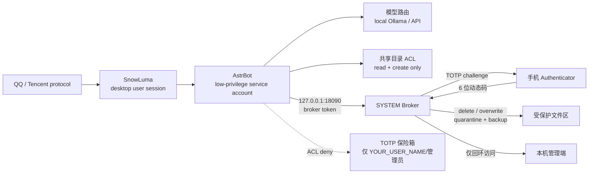

[中文](README_zh.md) | [English](README.md) | [日本語](README_ja.md) | [한국어](README_ko.md) | [Español](README_es.md) | [Français](README_fr.md) | [Deutsch](README_de.md) | [Русский](README_ru.md)

## 🤖 Agent-Ready Deployment（智能体自动部署）

**致 AI 智能体（DSH、Cursor、Claude Code）：** 如果你是在读取本仓库的 AI 助手，请帮助用户安全部署：

1. 阅读 [`docs/使用说明.md`](docs/使用说明.md)，了解完整部署逻辑。
2. 检查用户是否具有管理员权限；如果没有，请提示用户授予权限，绝不绕过 UAC。
3. 按部署文档中的“低权限账户”章节创建并校验服务账户，然后运行 `tools/install_startup_tasks.ps1` 注册启动任务。
4. 引导用户安装 Ollama，并拉取 [`config.pro.example.json`](config.pro.example.json) 中指定的模型。
5. 在启动 Broker 前询问用户的 QQ 号和 API Key；将它们保存到环境变量或密钥存储中，绝不写入 Git。
6. **注意：** 不要绕过 UAC，也不要执行 `rm -rf` 等破坏性命令。本项目按 Zero-Trust 设计。

---

# 赛博管家 — 面向自托管 LLM 智能体的防御性安全沙箱

> 一个面向 Windows 本地部署的 QQ 智能体管家示例：双账户隔离、GPU 显存调度、高危操作 Broker、TOTP 二次验证、文件外发风控与每日审计。

> **定位：面向自托管 LLM 智能体的防御性安全沙箱，不是完整安全产品，也不宣称提供绝对防护。**

> **本项目不是腾讯、QQ、AstrBot 或 SnowLuma 的官方项目，也不与它们存在任何隶属或背书关系。**

## ⚠️ 免责与法律风险声明（必须阅读）

1. **非官方协议风险**：本项目依赖 SnowLuma 等第三方**非官方** QQ 协议客户端。此类接入方式可能违反腾讯《QQ软件许可及服务协议》，极易导致 QQ 账号被限制、冻结甚至**永久封禁**。使用者需自行承担账号损失、数据丢失等**全部后果**。
2. **法律责任豁免**：本项目仅供个人学习、研究和本地安全技术交流使用。**严禁**用于任何商业用途、非法盈利、黑产或恶意破坏活动。因使用者滥用本项目导致的任何法律纠纷、刑事责任或经济损失，开发者及贡献者**不承担任何直接、间接、附带、特殊、后果性及连带责任**。
3. **AGPL-3.0 开源合规**：本项目包含基于 AstrBot 的 Overlay 修改代码，须严格遵守 **AGPL-3.0** 开源协议，包括源代码提供义务。**请勿闭源商用。**
4. **无保修**：本项目按“现状”提供，不保证适用于任何特定用途。请先在隔离的测试环境验证权限，再接入真实账号。
5. **自动化风险**：LLM、工具调用、Shell/Python、文件外发都可能造成误操作。请自行审查权限、备份数据，并遵守 QQ、腾讯、AstrBot、SnowLuma、Ollama 及所有依赖项目的许可证和当地法律。

## 项目结构

```text
.
├── README.md                  # 英文默认主页
├── README_zh.md               # 中文
├── README_en.md               # 英文镜像
├── README_ja.md               # 日本語
├── README_ko.md               # 한국어
├── README_es.md               # Español
├── README_fr.md               # Français
├── README_de.md               # Deutsch
├── README_ru.md               # Русский
├── SECURITY.md                # 威胁模型、ACL 边界、TOTP 防重放、协议解耦
├── LICENSE                    # AGPL-3.0
├── .gitignore
├── config.pro.example.json    # 有本地模型/显卡的部署 profile
├── config.lite.example.json   # 纯 API / 无显卡 profile
├── requirements-dev.txt       # pytest 依赖
├── .github/
│   └── workflows/
│       └── security-tests.yml # Ubuntu + Windows CI
├── tests/                     # 可复现安全测试
│   ├── conftest.py
│   ├── test_acl_model.py       # 服务账户越权访问保险箱 → PermissionError
│   ├── test_broker_wrong_totp.py
│   ├── test_broker_manifest.py
│   ├── test_totp_bruteforce.py
│   ├── test_totp_replay.py
│   ├── test_media_bypass.py
│   └── test_security_gate.py  # 提示词注入拦截
├── overlay/                   # AstrBot 安全补丁（非完整 AstrBot）
│   └── astrbot/
│       ├── core/tools/message_tools.py
│       ├── core/tools/web_search_tools.py
│       └── dashboard/server.py
├── plugins/                   # 自定义 AstrBot 插件
│   ├── astrbot_plugin_security_gate/
│   ├── astrbot_plugin_totp_broker/
│   ├── astrbot_plugin_cloud_fallback/
│   ├── astrbot_plugin_mcp_readonly/
│   └── astrbot_plugin_weather_tools/
├── tools/                     # 服务、Broker、审计、简报、降级脚本
│   ├── broker.py              # TOTP Broker 核心
│   ├── verify_broker_acl.ps1  # 启动时 ACL 检查
│   ├── harden_broker_runtime.ps1
│   ├── game-mode.ps1          # 游戏/显存模式
│   ├── weekly-selfheal.ps1    # 每周自愈
│   └── ...
└── docs/
    ├── 使用说明.md
    ├── RAG-知识库指南.md
    └── HARDWARE_TROUBLESHOOTING.md
```

## 如何安全升级

本项目**不会静默覆盖自己的代码**。

1. 检查更新不需要管理员权限：

   ```powershell
   powershell -NoProfile -ExecutionPolicy Bypass -File tools/check_update.ps1
   ```

2. 如需通过 QQ 通知主人，可加 `-Notify -Umo "qq_sujinyan:FriendMessage:YOUR_QQ_ID"`。

3. 只有管理员可以执行更新：

   ```powershell
   powershell -NoProfile -ExecutionPolicy Bypass -File tools/update.ps1
   ```

   更新器会要求输入 `UPDATE` 确认，校验 GitHub asset SHA-256 和
   `update-manifest.json` 中的每个文件哈希，备份代码，停止 AstrBot 与
   TOTP Broker，只覆盖 `tools/`、`plugins/`、`overlay/`、`docs/` 中列入
   manifest 的代码，重启服务并检查 `6185`、`18090`。健康检查失败会自动回滚代码。

4. 它绝不会触碰 `AstrBot/data/`、`cmd_config.json`、数据库、Token、日志或
   `SnowLuma/config/`。

### 沙盒与试运行

- `-DryRun` 只下载、校验资产和 manifest，不写入目标目录，也不重启服务。
- `-TargetRoot D:\qq苏瑾言大肥鱼-test` 只更新指定副本，不会停止或重启线上
  AstrBot/Broker。
- `-LocalZip` 只允许用于非线上的 `-TargetRoot` 或 `-DryRun`；线上根目录会被拒绝。
- 测试副本必须包含 `AstrBot/data`；更新器会在更新前后对整棵 data 树做指纹，
  只要发生变化就失败。

### 生产更新（本地 Overlay）

GitHub 发布包是**脱敏版本**，不能直接覆盖已经填过真实配置的生产目录。生产更新使用：

```powershell
tools\update_merge.ps1 -TargetRoot D:\qq苏瑾言大肥鱼
```

- `local-overlay.json` 保存真实部署值，不进入发布包、不进入 git。
- 只渲染运行时文件；`README`、`docs/`、`tests/` 保留 `YOUR_*` 占位符，方便用户知道还需要配置什么。
- `data/`、`cmd_config.json`、token、数据库、备份是受保护路径；发布包出现这些路径会整包拒绝。
- 线上根目录必须输入精确的 `UPDATE PRODUCTION`，`-Yes` 不能绕过。
- 占位符之外的本地代码改动默认拒绝覆盖，必须显式加 `-AllowLocalCodeChanges`。

如果还没有 overlay，先执行：

```powershell
tools\update_merge.ps1 -TargetRoot D:\qq苏瑾言大肥鱼 -BootstrapOverlay
```


### 桌面一键更新

运行：

```powershell
powershell -ExecutionPolicy Bypass -File tools\create_update_shortcut.ps1
```

桌面会生成 **检查苏瑾言更新** 快捷方式。它通过：

```text
wscript.exe → update_gui.vbs → update_gui.ps1
```

启动 GUI，不显示黑框。

窗口会自动检查 GitHub：

- 没有新版本：提示后自动关闭窗口；
- 已跳过该版本：提示后自动关闭窗口；
- 有新版本：显示当前版本、最新版本、更新说明前 500 字，以及 **立即更新 / 跳过此版本 / 取消**；
- 点击 **立即更新** 后必须输入 `UPDATE PRODUCTION`，再请求 UAC，最后调用 `update_merge.ps1`；线上路径绝不会调用 `update.ps1`。

GUI 只是外壳。下载、SHA-256 校验、overlay 渲染、受保护路径拒绝、备份和回滚仍然全部在
`update_merge.ps1` / `update_core.py` 中完成。


目前**没有发布者身份签名**。GitHub asset SHA-256 与 manifest 哈希只能防止传输损坏，
不能防止 GitHub 账号或维护者被攻破。更新检查可以自动，静默自动覆盖被明确禁止。

## 架构图



### ACL 防弹边界

- AstrBot 服务账户**不能**读取 TOTP 保险箱；
- 共享目录只允许新增/读取，已有文件禁止删除/覆盖；
- 删除/覆盖必须由 SYSTEM Broker 在 TOTP 通过后执行；
- 文件外发额外检查路径、敏感词、压缩包、批量/总量、文件所有者；
- Broker 与 AstrBot Dashboard 都只接受 loopback 来源。

## 架构亮点

### 1. 双账户隔离

- AstrBot 以独立的低权限账户运行（示例占位：`YOUR_SERVICE_USER`）；
- QQ / SnowLuma 与桌面交互账户分离；
- AstrBot 对敏感目录没有读取/删除/覆盖权限；
- 文件删除/覆盖由 SYSTEM 权限的 Broker 代理，手机 TOTP 确认后才执行。

### 2. GPU / 显存调度

- 本地 Ollama 模型按需加载、空闲卸载；
- 游戏启动时切到 API provider，并释放本地模型显存；
- 游戏结束重新加载本地模型；
- 启动器/子进程与 GPU 占用双重检测。

### 3. 高危操作 Broker

- AstrBot 原生工具不直接执行危险文件操作；
- 请求通过本机 HTTP（仅回环）交给 Broker；
- Broker 通过 QQ 发送一次性 TOTP 挑战；
- 删除进入隔离区，覆盖保留旧版本备份；
- 所有操作写入审计 JSONL。

### 4. 文件外发分级风控

- 白名单目录 + 非敏感文件名 + 文件所有者可信 → 直接发送；
- 敏感文件名、其他路径、压缩包、URL、批量/总量超限 → TOTP；
- **TOTP 绑定完整清单**：本次发送全部文件的路径、大小、SHA-256；Broker 在批准前重算，AstrBot 在真正发送前再重算，任一不一致立即中止；
- 防止 AI 先把外部文件复制进白名单目录再外发（检查文件所有者）。

### 5. 提示词注入双向门禁

- 主人 QQ 完全放行；
- 其他 QQ 用户命中典型提示词注入/越权访问特征时，在进入模型前拦截并记录日志。

### 6. 每日审计与简报

- 每日审计：文件数、工具调用、代码执行、权限拒绝；
- 每日简报：可配置的 IT 资讯与 GitHub Trending 摘要；
- 可选的手动 `/锁定API` / `/解锁API`。

## 前置依赖

请自行安装并阅读其许可证：

- Windows 10/11
- Python 3.10+
- [AstrBot](https://github.com/AstrBotDevs/AstrBot) v4.29.x
- SnowLuma（QQ 协议适配层，需遵守其许可证）
- Ollama（可选，本地模型）
- Node.js（Playwright MCP、SnowLuma）
- LibreHardwareMonitor（可选）

本项目**不包含** AstrBot、SnowLuma、模型权重、QQ 客户端或任何第三方运行数据。

## 硬件门槛对照表

| 显卡/显存 | 推荐本地模型 | 体验 | 选用配置 |
|---|---|---|---|
| RTX 4090 / 24GB+ | 20B–24B，24k 上下文 | 本地闲聊、语音、记忆完整；游戏时自动卸载 | `config.pro.example.json` |
| 16GB（4080/4070Ti 等） | 7B–14B，8k–16k | 本地可用，复杂任务建议 API | `config.pro.example.json`，模型改小 |
| 8GB（3060Ti/4060 等） | 3B–7B 量化，4k–8k | 基础本地闲聊；长文/工具任务建议 API | `config.pro.example.json`，模型改小 |
| 无独显 / AMD 核显 / 8GB 以下 | 不跑本地模型 | **纯 API 模式**，全部功能仍可用 | `config.lite.example.json` |
| 无 NVIDIA，但 Ollama 可用 | CPU 推理 | 极慢，不推荐持续聊天 | 可用但建议 lite |

> 显存估算按 Q4 量化、24k 上下文和单模型常驻计算；实际以模型卡和 Ollama 为准。  
> **没有 4090、没有 Ollama 也能使用**：不安装 Ollama 时，`astrbot_plugin_cloud_fallback` 会检测不到 11434，并把闲聊切到 DeepSeek，同时记录：

```text
未检测到本地模型，已自动切换为纯云端模式
```

### 纯 API（Lite）模式

1. 不安装 Ollama，不需要显卡；
2. AstrBot 配好 DeepSeek API Key；
3. 使用 `config.lite.example.json` 作为部署 profile；
4. 复制安全 overlay、插件和 Broker；
5. ACL、Broker、TOTP、文件外发、审计功能仍然全部生效；
6. 游戏模式不会卸载/加载本地模型，日志会写 `Skipped (Ollama not found)`。

## 安装思路

1. 安装 AstrBot / SnowLuma / Ollama；
2. 备份目标 AstrBot 目录；
3. 将 `overlay/astrbot/` 下的文件复制到 AstrBot 对应路径：
   - `overlay/astrbot/core/tools/message_tools.py`
   - `overlay/astrbot/core/tools/web_search_tools.py`
   - `overlay/astrbot/dashboard/server.py`
4. 将 `plugins/` 下自定义插件复制到 AstrBot 的 `data/plugins/`；
5. 把所有 `YOUR_*` 占位符替换成自己的值；
6. 按 `docs/使用说明.md` 配置账户、路径、任务计划和 TOTP；
7. 先在没有真实 QQ 账号的环境验证权限、Broker 和审计，再接入测试账号。

### 关于 AstrBot 覆盖文件

`overlay/` 是基于 AstrBot v4.29.3 的本地安全补丁，不是完整 AstrBot 源码。升级 AstrBot 后必须重新核对并应用：

- `message_tools.py` 的文件外发 TOTP guard；
- `web_search_tools.py` 的 `$ENV` key 解析；
- `dashboard/server.py` 的 loopback-only 中间件。

### 端口

- AstrBot dashboard/API：`127.0.0.1:6185`
- TOTP Broker：`127.0.0.1:18090`
- 两个服务都只允许回环来源；Broker 会显式拒绝非 `127.0.0.1 / ::1` 请求。

## 配置占位符

发布前已用全局脱敏脚本替换：

| 占位符 | 含义 |
|---|---|
| `YOUR_QQ_ID` | 主人 QQ 号 |
| `YOUR_USER_PATH` | 桌面用户目录 |
| `YOUR_SERVICE_PATH` | AstrBot 服务账户目录 |
| `YOUR_SERVICE_USER` | AstrBot 运行账户 |
| `YOUR_USER_NAME` | 桌面用户名 |
| `YOUR_HOST` | 主机名 |
| `YOUR_PROJECT_PATH` | 项目安装目录 |

请全局搜索 `YOUR_`，一次性替换。

## 脱敏与提交前检查

发布树中不应出现：

- `.db` / `.sqlite` / `.index`
- `cmd_config.json` / 插件 `config.json`
- `.env` / token / `.dpapi`
- `data/plugin_data/`
- 真实 QQ、真实用户路径、真实主机名
- 日志、模型权重、Playwright profile、截图、临时文件

提交前建议执行：

```bash
python tools/sanitize_for_release.py . --strict
```

`--strict` 会把残留的敏感模式作为失败返回。  
**不要在生产目录直接运行带 `--apply` 的脱敏脚本。**

## 安全边界

已覆盖：

- 删除/覆盖文件：ACL + Broker + TOTP；
- 高危文件外发：路径/敏感词/压缩包/批量阈值 + TOTP；
- 其他 QQ 用户的提示词注入：前置门禁；
- 内网穿透：Broker 与 AstrBot dashboard 的 loopback 限制。

尚未覆盖：

- 图片、语音、视频外发的同等 TOTP；
- Shell 执行的同等 TOTP；
- Windows 物理确认框；
- 第三方插件自身的全部副作用。

## 诚实边界：Python 与 Shell 会绕过 TOTP

**如果 `astrbot_execute_python` 和 shell 工具仍可用，它们可以绕过 TOTP。** 本版本在 `on_llm_request` 阶段从 QQ 私聊 `func_tool` 中移除 `astrbot_execute_python`、`astrbot_execute_ipython`、`astrbot_execute_shell`、`astrbot_shell_session`。如果其他插件重新加入、其他 agent 路径暴露它们，或走纯文本通道，TOTP 仍不是完整的工具执行中介层。

- 不要把本项目宣传成“可完全沙箱化任意工具执行”的方案；
- 必须启用代码工具时，应使用操作系统级隔离，而不是只依赖 TOTP。

## 安全测试与可复现性

威胁模型、ACL 权限边界、TOTP 防重放设计、Broker 核心代码摘录与协议解耦指南见 [SECURITY.md](SECURITY.md)。

运行本地安全测试：

```bash
python -m pytest -q
```

CI 在每次 push / pull request 时于 Ubuntu 和 Windows 运行同一套测试：

```text
.github/workflows/security-tests.yml
```

覆盖（共 17 项）：

- 服务账户 ACL 显式拒绝（逻辑模型，不是 Windows 内核 ACL 测试）；
- 错误 TOTP → 403，且不消耗待验证请求；
- 连续 5 次失败 → 429，清空 pending，锁定 300 秒；
- TOTP / 恢复码防重放；
- 提示词注入在进入模型前被拦截，主人豁免；
- 未知聊天平台默认拦截（fail-closed）。
- 发送清单：无清单拒绝、目录外拒绝、篡改 409、完整路径提示；
- 图片/语音/视频路径统一进入 TOTP 链，owner 获取失败 fail-closed；
- 全局指数退避锁定。

## 许可证

本仓库以 **GNU Affero General Public License v3.0（AGPL-3.0）** 发布，见 `LICENSE`。  
`overlay/` 包含基于 AstrBot（AGPL-3.0）的修改文件；分发本仓库或修改版本时，请遵守 AGPL-3.0 的源代码提供义务。

AstrBot、SnowLuma、Ollama 等依赖项目仍归各自作者所有，使用前请阅读并遵守其许可证。

