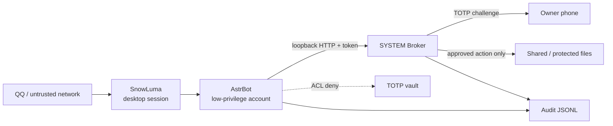

# SECURITY.md — Security Architecture & Threat Model

> Status: public-release security whitepaper  
> Scope: Windows self-hosted deployment for an AstrBot-based QQ agent  
> Revision: 2026-10-29  
> License: AGPL-3.0 (see `LICENSE`)

This document describes what the security controls are intended to protect, what they do **not** protect, and how to reproduce the automated checks.

**This is not a formal security certification and not legal advice.** A local deployment remains the responsibility of its operator.

---

## 1. Design Timeline

The security model was built around concrete Windows failure modes, not only documentation claims:

| Date | Change | Reason |
|---|---|---|
| 2026-10-28 | Separate low-privilege service account and desktop session | Limit the blast radius of the agent process |
| 2026-10-29 | SYSTEM TOTP Broker over loopback HTTP | Cross-account file exchange for TOTP state failed under Windows ACLs |
| 2026-10-29 | TOTP vault with explicit deny ACE for the service account | Prevent the agent from reading its own recovery material |
| 2026-10-29 | Owner-aware file-egress guard | Block the “copy into the whitelist, then send” bypass |
| 2026-10-29 | Public security tests and CI | Make claims reproducible instead of documentation-only |

### Windows pitfalls found during the build

1. **Cross-account file writes are not free.** The AstrBot service account could not create the Broker's TOTP state files under the desktop user's profile. The fix was a loopback-only HTTP Broker, not loosening the vault ACL.
2. **DPAPI here is machine-scoped.** `tools/setup_totp.py` uses `CRYPTPROTECT_LOCAL_MACHINE` (`0x4`), not the user profile scope. Any local principal that can read the DPAPI-wrapped secret can decrypt it; the vault ACL is therefore the primary boundary. Do not describe this layer as user-bound encryption.
3. **Explicit deny wins.** An inherited allow on a parent directory is not enough to protect the vault; the service account needs an explicit deny ACE.
4. **File ownership matters.** A benign filename does not make a file safe if the agent copied it into a whitelist. The egress guard checks the file owner, not only the path.
5. **Localhost is not the same as “safe by default.”** Bind addresses can be changed and tunnels can be added. Both the Broker and the AstrBot dashboard reject non-loopback clients.

---

## 2. Threat Model

### Assets

| Asset | Why it matters |
|---|---|
| TOTP vault (`*TOTP*.png`, recovery codes) | Full second-factor bypass if disclosed |
| Broker token | Allows requests to the local destructive-action API |
| QQ account | Identity, contacts, and platform access |
| Shared folder | Files the agent may read or send |
| Audit logs | Detection and incident reconstruction |
| AstrBot configuration and session data | Provider credentials and conversation data |

### Adversaries and trust boundaries

| Adversary | Capability | Primary controls | Residual risk |
|---|---|---|---|
| Malicious QQ sender | Sends text/media to the bot | Owner allowlist, Security Gate, pre-model blocking | A new injection phrasing may bypass regex rules |
| Stolen QQ account | Acts as the owner from QQ's perspective | TOTP for destructive actions, file-egress policy | The attacker can still chat and social-engineer; TOTP is the hard stop unless the phone is also compromised |
| TOTP brute-force client | Repeatedly posts guesses to `/verify` | Five-attempt limit, 300-second lockout, 429, audit | Attackers can still cause availability loss by forcing a lockout |
| Compromised owner phone / authenticator | Reads or generates valid TOTP codes, or approves a prompt | Device lock, separate authenticator, recovery codes kept offline | **A valid TOTP only proves possession of the secret, not that the human is the owner. This is a hard residual risk.** |
| Malicious prompt / indirect injection | Controls text read by the model | Prompt-injection gate, tool policy, egress checks | No LLM is fully immune to prompt injection |
| Local unprivileged process | Runs as the service account | Windows ACL, DPAPI, loopback-only services, token ACL | A local admin can bypass OS controls |
| Network attacker | Reaches a misbound port | Loopback checks in Broker and dashboard | A local reverse proxy can still expose the service if configured carelessly |
| Malicious plugin / dependency | Executes code inside AstrBot | Review dependencies, least privilege, audit | Third-party plugins are outside this project's trust boundary |
| File-copy bypass | Copies an external file into the whitelist | File-owner check + path/name/archive/batch policy + TOTP | A process with the same owner as a trusted file may still be treated as trusted |

### File-egress edge cases (P1)

- **Owner comparison is case-insensitive on both sides.** The ACL owner string is normalized with `casefold()` and compared with a casefolded service-account placeholder; a case-only rename must not bypass the TOTP rule.
- **Hard links force TOTP.** A file with `st_nlink > 1` is treated as a hard-link bypass attempt even when its name and path look benign.
- **Unknown chat platforms fail closed.** The Security Gate no longer returns early for an unrecognized `umo`; it logs a warning and calls `event.stop_event()` rather than allowing the event through.
- **Media components are not a bypass.** `Comp.Image`, `Comp.Record`, and `Comp.Video` are collected together with `Comp.File`; every local path goes through `_totp_path_risk` and the complete manifest.
- **Owner lookup failure is fail-closed.** An empty owner from `win32security` is treated as risky, not trusted.
- **URLs and outside-shared paths take the TOTP path.** The overlay deliberately classifies remote URLs and local files outside the shared folder as risky. `action=send` now issues a challenge for the complete manifest and displays `[OUTSIDE SHARED]` / the URL in the prompt; approval is bound to that manifest. This removes the old dead end where the overlay requested approval and the Broker always returned `403`.
- **Security Gate state is writable.** `/lockapi` and `/unlockapi` write `AstrBot/data/security-gate-api-lock.json`, not the read-only `tools/` tree.

### Send manifest binding (P0)

A TOTP approval is bound to a **complete manifest**, not one file path:

- AstrBot builds `{kind, path, size, sha256}` for every local file in the send operation (maximum 5 entries and 50MB);
- `/request` carries the manifest; the Broker displays the complete list and all SHA-256 values in the QQ challenge;
- the Broker rehashes every file before issuing the TOTP prompt and again at `/verify`; any size/hash change returns `409`, clears the pending request, and is audited;
- AstrBot rehashes once more immediately before `send_message`; a changed manifest cancels the send;
- a request with no manifest is rejected for `action=send` (fail closed).

This closes the “approve file A, replace it with file B” single-path binding gap. It does not eliminate a TOCTOU race after the final hash check; the final send is deliberately kept on AstrBot's message path.

### Code-execution tools are removed from QQ private requests

The Security Gate registers an `on_llm_request` hook that removes:

```text
astrbot_execute_python
astrbot_execute_ipython
astrbot_execute_shell
astrbot_shell_session
```

from the QQ private `func_tool` set. This is a **tool-layer denylist**, not a complete plain-text mediation layer: a different agent path, a plugin that re-adds the tools, or a plain-text exfiltration path can still bypass TOTP. The project does not claim otherwise.

### Trust boundary diagram



**Core principle:** the LLM is not trusted with direct destructive authority. It can request an action; the Broker requires a human second factor before executing it.

---

## 3. ACL Permission Boundary

The following is the intended Windows ACL model. Names are placeholders from the public release.

| Principal | TOTP vault | Shared folder | Broker token | Project source | Broker quarantine |
|---|---|---|---|---|---|
| `YOUR_USER_NAME` (owner) | FullControl | FullControl | Read | Read/Write | Read/Write |
| `YOUR_SERVICE_USER` (AstrBot) | **Explicit Deny FullControl** | Read + create only | Read | Read | **No access** |
| `SYSTEM` | FullControl | FullControl | FullControl | Read | FullControl |
| `Administrators` | FullControl | FullControl | FullControl | Read/Write | FullControl |
| `Everyone` | No access | No access | No access | No access | No access |

### Enforcement notes

- The deny ACE on the vault must be **explicit** when the service account may inherit access from a parent.
- The shared folder is deliberately not a general-purpose write target for destructive operations: existing files should not be deletable or overwritable by the service account.
- The Broker token is readable by the service account (needed for `/request` and `/verify`) but should not be readable by ordinary users.
- The Broker runs as `SYSTEM` because it must move/overwrite files outside the service account's rights, and it must read the DPAPI-protected TOTP secret.
- The ACL test is a **logic model, not a Windows kernel ACL test**; the actual Windows ACL must also be verified manually after deployment (see §6).

### 3.1 SYSTEM runtime must be read-only to low-privilege users

The Broker is a high-value execution target: it runs as `SYSTEM` and reads the DPAPI TOTP secret. If a low-privilege account can modify `tools/` or `AstrBot/.venv`, that account can replace the Broker or its dependencies and inherit SYSTEM execution.

**This is a deployment requirement, not something an in-process check can fully enforce.** Run the following from an **elevated** PowerShell after installation and after every update:

```powershell
$root = 'YOUR_PROJECT_PATH'

# 1) Set owner to Administrators and remove inherited write access.
takeown.exe /f "$root\tools" /a /r /d Y
takeown.exe /f "$root\AstrBot\.venv" /a /r /d Y

# 2) Broker runs as SYSTEM; AstrBot and the desktop user need read/execute only.
icacls.exe "$root\tools" /inheritance:r `
  /grant:r "SYSTEM:(OI)(CI)F" `
  /grant:r "*S-1-5-32-544:(OI)(CI)F" `
  /grant:r "YOUR_SERVICE_USER:(OI)(CI)RX" `
  /grant:r "YOUR_USER_NAME:(OI)(CI)RX"

icacls.exe "$root\AstrBot\.venv" /inheritance:r `
  /grant:r "SYSTEM:(OI)(CI)F" `
  /grant:r "*S-1-5-32-544:(OI)(CI)F" `
  /grant:r "YOUR_SERVICE_USER:(OI)(CI)RX" `
  /grant:r "YOUR_USER_NAME:(OI)(CI)RX"
```

The repository also provides:

- `tools/harden_broker_runtime.ps1` — applies the ACLs above;
- `tools/verify_broker_acl.ps1` — fails if the paths are owned by a non-admin principal or grant broad/service-account write access (the service account is explicitly in the denylist, not only `Users`/`Everyone`);
- `tools/broker.py` — calls the verifier at startup and **refuses to start** if it fails.

`icacls` output is localized and deployment-specific; verify the effective permissions in the GUI or with `Get-Acl`, not only by reading the command. Do not run the Broker as SYSTEM until this check passes.

---

## 4. TOTP Broker: Anti-Replay Design

### Request lifecycle

1. AstrBot calls `POST /request` with the local broker token.
2. The Broker creates a random `request_id`, stores exactly one pending request, and sends a one-time challenge over the configured chat adapter.
3. The owner enters a 6-digit TOTP or an 8-character recovery code.
4. `POST /verify` checks the code and consumes the pending request only after success.
5. The Broker executes the approved delete/overwrite/send and appends an audit record.

### Controls

| Control | Implementation |
|---|---|
| Short-lived code | `pyotp.TOTP(...).verify(code, valid_window=1)` (30-second step, ±1 window) |
| One pending action | `_pending` is guarded by a lock; overlapping requests get `409` |
| Request binding | The code is accepted only for the pending `request_id`; a mismatched ID gets `404` |
| Wrong code | `403 invalid verification code`; the pending request is **not** consumed |
| Brute-force limit | Every failure increments `_pending["attempts"]`; the 5th failure clears pending, sets a 300-second lockout, returns `429`, and writes a failure audit record |
| Global exponential backoff | `_global_failures` persists when a pending request expires; after 5 failures the lockout is 300s, then 600s, 1200s, up to 24h |
| Locked verification | `/verify` and new `/request` calls return `429` while the lockout is active |
| Expired challenge | `410`; pending state is cleared |
| TOTP replay | SHA-256 digest cache with a 120-second TTL; a consumed code returns `403` |
| Recovery replay | SHA-256 hash allowlist; successful use is appended to `used`; reused codes fail |
| Network scope | Broker binds `127.0.0.1:18090`; non-loopback clients get `403` |
| Audit | JSONL record includes timestamp, request ID, action, target, result, and code type |

### Important residual risk

The TOTP replay cache **and the verification lock state** are **in memory**. The replay cache, `_verify_locked_until`, `_global_failures`, `_global_lock_until`, and the pending request reset when the Broker restarts. A restart therefore clears a temporary lockout and can shorten the effective replay window. The one-pending-request rule and the 30-second TOTP window reduce, but do not eliminate, this risk; a future version should persist both the replay ledger and the lock/backoff state.

Recovery codes are intentionally one-time; losing both the authenticator and the recovery file means losing the ability to approve destructive actions.

### Broker core excerpt

This is a sanitized excerpt from `tools/broker.py`; the full implementation includes the HTTP handler, token/ACL checks, audit, quarantine, and timeout handling.

```python
def verify_code(code: str) -> str:
    code = code.strip().upper()
    if len(code) == 6 and code.isdigit():
        if pyotp.TOTP(secret()).verify(code, valid_window=1):
            digest = hashlib.sha256(code.encode("utf-8")).hexdigest()
            now = time.time()
            with _replay_lock:
                for old_digest, used_at in list(_used_totp.items()):
                    if now - used_at > TOTP_REPLAY_TTL:
                        _used_totp.pop(old_digest, None)
                if digest in _used_totp:
                    return ""
                _used_totp[digest] = now
            return "totp"
        return ""
    # ... one-time recovery-code path ...
    return ""

def run_verify(payload: dict) -> tuple[int, dict]:
    # ... request_id / deadline / pending checks ...
    code_type = verify_code(code)
    if not code_type:
        return 403, {"ok": False, "error": "invalid verification code"}
    # ... consume pending, execute approved action, audit ...
```

---

## 5. Protocol Decoupling: QQ Adapter Boundary

The current release uses AstrBot's `aiocqhttp`/OneBot path and SnowLuma as the QQ transport. **That transport is unofficial and remains a platform-risk decision; abstraction does not make it official or compliant.**

The security core should depend on a narrow adapter contract, not on QQ-specific fields:

```python
class ChatAdapter(Protocol):
    def parse_inbound(self, raw: dict) -> InboundEvent: ...
    async def send_text(self, target: str, text: str) -> bool: ...
    async def send_file(self, target: str, path: Path) -> bool: ...
    def sender_id(self, event: InboundEvent) -> str: ...
    def conversation_id(self, event: InboundEvent) -> str: ...
```

`InboundEvent` carries: conversation ID, sender ID, text, attachments, timestamp, and raw provider metadata.

### Replacement guide

| Layer | QQ / current | Enterprise WeChat | DingTalk | Telegram |
|---|---|---|---|---|
| Inbound | OneBot event | WeCom callback | DingTalk callback | Bot API `getUpdates`/webhook |
| Sender identity | QQ number | WeCom user ID | DingTalk staff ID | Telegram user ID |
| Outbound text | OneBot API | WeCom message API | DingTalk robot API | Telegram `sendMessage` |
| Outbound file | OneBot upload | WeCom media upload | DingTalk file API | Telegram `sendDocument` |
| Owner allowlist | `YOUR_QQ_ID` | corporate user ID | staff ID | numeric user ID |

The Broker must remain transport-agnostic:

- it accepts a `target`/`request_id` and a human approval channel;
- the adapter sends the TOTP challenge;
- the adapter never receives the TOTP secret;
- the ACL/Broker/file policy does not import QQ-specific modules.

In practice, changing the adapter must not change `verify_code`, the pending-request invariant, the ACL policy, or the audit schema. The Security Gate should continue to key on a stable `sender_id` and `conversation_id`, with the owner identity configured per deployment.

---

## 6. Reproducible Tests and CI

Run locally:

```bash
python -m pytest -q
```

The test suite includes:

- `tests/test_acl_model.py` — explicit deny wins over allow; service-account read raises `PermissionError`;
- `tests/test_broker_wrong_totp.py` — wrong code returns **403**, pending request is preserved;
- `tests/test_broker_manifest.py` — no manifest 409, outside-folder 403, tamper 409, full-path prompt;
- `tests/test_media_bypass.py` — Image/Record/Video enter the TOTP chain; owner failure is fail-closed;
- `tests/test_totp_bruteforce.py` — five failures return **429**, clear pending state, and set a lockout;
- `tests/test_totp_replay.py` — accepted TOTP and recovery codes cannot be replayed;
- `tests/test_security_gate.py` — injection from a non-owner is stopped; unknown platforms fail closed; owner and benign text pass.

CI: `.github/workflows/security-tests.yml` runs the same suite on Ubuntu and Windows for every push and pull request.

### Windows acceptance checklist

CI cannot create a real local `YOUR_SERVICE_USER` and read the production vault. On the deployment machine, verify manually:

```powershell
icacls "$env:USERPROFILE\Documents\YOUR_TOTP_VAULT"
# The service account must show an explicit (DENY) ACE.
```

Then confirm the service account cannot read a test file in the vault, and that the owner can. Do not weaken the vault ACL to make a test pass.

---

## 7. Residual Risks and Non-Goals

Not currently covered:

- TOTP for image, voice, and video egress;
- TOTP for Shell execution;
- a Windows physical-confirmation dialog;
- full mediation of third-party plugin side effects;
- persistence of the TOTP replay ledger, pending request, verification lock, and global backoff across Broker restarts;
- platform-level QQ enforcement and account-ban risk.

### 7.1 Compromised phone / hijacked TOTP: the limit of this design

This is the most important residual risk in the whole TOTP model.

If an attacker controls the owner's unlocked phone, authenticator seed, synced authenticator account, or a device with an active TOTP session, they can generate a valid code and approve a destructive Broker request. If they also control the QQ account, the two factors collapse into one compromised principal. The Broker will see a cryptographically valid TOTP and has no way to distinguish the real owner from an attacker holding the owner's device.

In that scenario, **the Broker is not a defense against physical device compromise, account takeover plus device compromise, coercive control, or a malicious authenticator app.** Its actual guarantees are narrower:

- it prevents an automated LLM/tool loop from executing destructive actions without a human-supplied code;
- it prevents accidental one-click deletion/overwrite from a prompt mistake;
- it raises the cost of a remote attacker who has stolen only the QQ account;
- it gives the owner a deliberate confirmation step and an audit trail.

It does **not** prove that the person approving is the legitimate owner. It also cannot stop an attacker who can read the TOTP secret or the recovery codes from the vault.

Practical mitigations, none of which are complete:

- use a dedicated phone/authenticator that is not the QQ device;
- enable a strong device lock, biometrics, and remote wipe;
- avoid syncing the TOTP seed to a shared cloud account;
- keep recovery codes offline, in a physically secured vault;
- treat a lost/unlocked phone as a full credential compromise: rotate the TOTP secret, recovery codes, broker token, and QQ password;
- for high-assurance deployments, add a hardware security key or an out-of-band physical approval that is not the same phone.

The Broker should therefore be described as **a human-in-the-loop gate for automation safety and account-only compromise**, not as a guarantee against a compromised human device.

**The unofficial QQ protocol risk cannot be solved by code in this repository.** The only complete mitigation is to stop using the unofficial transport and replace it with an official, contractually permitted API adapter.

## 8. Reporting a Vulnerability

Do not open a public issue containing live credentials, TOTP seeds, recovery codes, or personal paths.

Contact the maintainer at `YOUR_SECURITY_EMAIL` with:

- affected file/commit;
- reproduction steps;
- impact;
- whether the issue is already public.

Allow a reasonable disclosure window before publishing details.

### Release sanitization residual

The public tree still contains deployment-specific display literals: the platform
identifier prefix, the persona display name, and the shared-folder name. They are
not credentials, but a deployment that reuses the tree should replace them to
avoid confusing the owner or inheriting one deployment's naming. The sanitizer
now accepts `--platform`, `--agent-name`, and `--shared-folder`; these literals
were not globally rewritten here because tests and runtime UMO/path defaults
must be updated together.

## 9. Auto-Update Threat Model

The update mechanism is deliberately split:

- `tools/check_update.ps1` is a read-only GitHub API check and needs no administrator rights;
- `tools/update.ps1` is an administrator-only action and requires an explicit `UPDATE` confirmation.

**Automatic silent code replacement is forbidden.** The check may run automatically and notify the owner through QQ, but applying an update is a human-approved, privileged operation.

### Controls

- GitHub asset SHA-256 is checked before extraction.
- `update-manifest.json` binds every file to a SHA-256 and a size.
- The complete archive is pre-validated before any file is written.
- Zip path traversal, absolute paths, symlinks, data paths, config files, database files, tokens, and secret material are rejected.
- Only manifest-listed code under the allow-listed roots is replaced; user data is never touched.
- A code-only backup is made before replacement; service health failure triggers a code rollback.

### Residual risk: no publisher identity signature

This release does **not** ship a GPG or minisign publisher signature. The GitHub asset hash and manifest hashes protect against transfer corruption, but they are delivered by the same GitHub account as the release. A compromised GitHub account, a malicious maintainer, or a compromised release pipeline can replace both the asset and its manifest. In that scenario the updater cannot establish publisher identity.

Do not describe this as supply-chain provenance. A future version may add a detached minisign/GPG signature and a pinned public key in the updater.

## 10. Production Update Overlay

The public release contains placeholders (`YOUR_PROJECT_PATH`, `YOUR_QQ_ID`,
`YOUR_SERVICE_USER`, and related values). It is a sanitized distribution, not a
drop-in replacement for a customized production tree.

Production updates must use `tools/update_merge.ps1` with a local
`local-overlay.json` that is outside the release package, outside git, and ACL
restricted so `AstrBot_User` has no access.

Controls:

- Protected paths (`AstrBot/data`, `cmd_config.json`, token files, databases,
  backups) cause the entire package to be rejected.
- Rendering is limited to runtime files. README, docs, and tests retain
  placeholders intentionally.
- The live root requires the exact phrase `UPDATE PRODUCTION`; `-Yes` cannot
  bypass the prompt.
- Local code changes outside the overlay are rejected unless
  `-AllowLocalCodeChanges` is explicitly supplied.
- The updater backs up code and the overlay, verifies the data fingerprint, and
  rolls back on failure.

Residual risk: the overlay contains real deployment identifiers. Its ACL and
the administrator boundary are part of the trust boundary. There is still no
publisher identity signature; GitHub asset SHA-256 and manifest hashes are not
a substitute for one.

## 11. GUI Update Shell

`tools/cyber_butler_dashboard.ps1` contains the integrated update shell. It must
never implement or bypass download, hash verification, overlay rendering,
protected-path checks, backup, or rollback.

The dashboard GUI:

- runs unprivileged for checking and writing the local skip file;
- checks silently on startup and only shows an update modal when a new version exists;
- calls `update_merge.ps1` for production updates, never `update.ps1`;
- requires the exact phrase `UPDATE PRODUCTION` before requesting UAC;
- passes `-ConfirmationText` to `update_merge.ps1`, which validates it again;
- treats release notes as plain text, not HTML;
- is launched by `wscript.exe` + `cyber_butler_dashboard.vbs`; the standalone
  `update_gui` shortcut is deprecated and removed by the shortcut scripts.

`skip_version.json` is a user preference, not a security boundary. It can be
edited or deleted by the desktop user. It cannot disable hash verification.

## Platform Prefix Drift Warning

If you change the platform/session prefix (`qq_sujinyan` or the UMO separator),
you MUST update `astrbot_plugin_security_gate` in the same change. Its
`PRIVATE_UMO` / known-marker checks and fail-closed behavior are tied to the
prefix. A one-sided change makes the gate treat legitimate messages as an
unknown transport and block everything.
