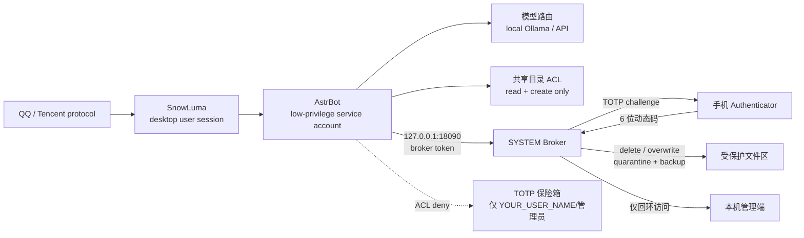

[ARCHIVED - 已废弃] This document is retained for history only; see the current docs index.

[中文](README_zh.md) | [English](README.md) | [日本語](README_ja.md) | [한국어](README_ko.md) | [Español](README_es.md) | [Français](README_fr.md) | [Deutsch](README_de.md) | [Русский](README_ru.md)

## ✅ テスト範囲 / Test Coverage

✅ **High ティア**：実機での完全なエンドツーエンド試験を完了 — インストール、サービス起動、TOTP、SCOPED、アンインストール。

⚠️ **Medium ティア**：部分試験は複数回実施済み。実用の可能性は高いが、実機での全フロー受入は未完了。

❌ **Light（最小）ティア**：実機での完全試験は未実施。リスクを自己評価してください。

本宣言は v1.6.1 に適用され、セキュリティ認証ではありません。


## v1.6.1 — セキュリティ更新

**スコープ付きトークン（30分）**: TOTP 承認後、所有者は `SCOPED 30` と返信
できます。Broker は対象ディレクトリに紐づくメモリ内トークンを 30 分間発行
し、共有または tmp ツリー内の `delete`、`overwrite`、`write_file` のみを
許可します。memory/config、TOTP 保管庫、ファイル送信には適用されません。

**Job Object によるプロセス分離**: Broker は子プロセスを作成する前に
`JOB_OBJECT_LIMIT_KILL_ON_JOB_CLOSE` を設定します。Broker が終了すると
Windows がプロセスツリーを終了します。AstrBot は別タスクのため自動的には
含まれません。

**DSH/Cordis プラグイン**: 独立した `dsh-cbs-gate` バンドルが
`tools/pre-execute`、approval-only リクエスト、状態ポーリング、スコープ付き
トークンのキャッシュを提供します。詳細: [README.md](README.md) と
[SECURITY.md](SECURITY.md)。

## 🔐 リリース署名の確認

`public-release-v<version>.zip`、`update-manifest.json`、
`update-manifest.sig` をダウンロードし、展開したリリースツリーで実行します。

```powershell
python tools/verify_release.py `
  --manifest update-manifest.json `
  --signature update-manifest.sig `
  --pubkey tools/update_pubkey.pem
```

期待値は `VALID` です。`INVALID`、署名なし、バージョン不一致の場合は
**インストールしないでください**。有効な署名は固定秘密鍵の所持を示すだけで、
マルウェアが存在しないことを保証するものではありません。

📚 [ROADMAP](ROADMAP.md) · [CONTRIBUTING](CONTRIBUTING.md) · [SECURITY](SECURITY.md) · [THREAT_MODEL](THREAT_MODEL.md) · [TEST_MATRIX](docs/TEST_MATRIX.md) · [TROUBLESHOOTING](docs/TROUBLESHOOTING.md)

## 🤖 Agent-Ready Deployment（AI エージェント向け）

**AI エージェント（DSH、Cursor、Claude Code）へ：** このリポジトリを読んでいる AI アシスタントは、ユーザーが安全にデプロイできるよう支援してください。

1. [`docs/使用说明.md`](docs/使用说明.md) を読み、デプロイの全体像を確認する。
2. ユーザーに管理者権限があるか確認する。ない場合は付与を促し、UAC を回避しない。
3. デプロイ手順の「低権限アカウント」の節に従ってサービスアカウントを作成・検証し、`START-INSTALLER.exe` で起動タスクを登録する。
4. Ollama のインストールと、[`config.pro.example.json`](config.pro.example.json) に指定されたモデルの取得を案内する。
5. Broker を起動する前に、ユーザーの QQ ID と API Key を確認する。環境変数またはシークレットストアに保存し、Git にはコミットしない。
6. **注意：** UAC を回避したり、`rm -rf` のような破壊的コマンドを実行したりしないこと。本プロジェクトは Zero-Trust に基づいて設計されています。

---

# 蘇瑾言 / サイバー・スチュワード — オープンソース自ホスト構成

> Windows 上で動作する QQ エージェント向けの自ホスト構成です。デュアルアカウント分離、GPU/VRAM スケジューリング、高危険操作 Broker、TOTP 認証、ファイル送信制御、日次監査を備えます。

> **本プロジェクトは Tencent、QQ、AstrBot、SnowLuma の公式プロジェクトではなく、いかなる提携・承認・後援関係もありません。**

## ⚠️ 免責事項および法的リスク（必ずお読みください）

1. **非公式プロトコルに伴うリスク**：本プロジェクトは、SnowLuma 等の第三者が提供する**非公式** QQ プロトコルクライアントに依存しています。当該利用は Tencent の「QQ ソフトウェア使用許諾契約およびサービス契約」に違反する可能性があり、アカウントの制限、停止、**永久凍結**を招くおそれがあります。利用者は、アカウント喪失やデータ損失を含む**すべての結果を自ら負担**するものとします。
2. **責任の免除**：本プロジェクトは、個人の学習、研究、およびローカル環境でのセキュリティ技術交流のみを目的として提供されます。商業利用、不法な利益追求、ブラックマーケット活動、悪意ある破壊行為を固く禁止します。適用法令の許容する最大限の範囲において、開発者および貢献者は、本プロジェクトの利用、誤用、利用不能に起因する直接的・間接的・偶発的・特別・結果的損害、および**連帯責任**を含む一切の責任を負いません。これには、法的紛争、刑事責任、データ損失、経済的損失が含まれます。
3. **AGPL-3.0 コンプライアンス**：本プロジェクトには AstrBot に基づく Overlay の改変コードが含まれ、**AGPL-3.0** の下で提供されます。AGPL-3.0 のソースコード提供義務を含む条件を遵守してください。**クローズドソースでの商業利用は禁止**です。
4. **無保証**：本ソフトウェアは「現状のまま（AS IS）」提供され、明示・黙示を問わずいかなる保証も行いません。実アカウント接続前に、隔離されたテスト環境で権限を確認してください。

## アーキテクチャ



### ACL 防護境界

- AstrBot サービスアカウントは TOTP 保管庫を**読み取れません**。
- 共有フォルダは新規作成と読み取りのみ許可し、既存ファイルの削除・上書きを拒否します。
- 削除・上書きは、TOTP 承認後に SYSTEM Broker のみが実行します。
- ファイル送信時は、パス、機密語、圧縮ファイル、一括件数/容量、ファイル所有者も検査します。
- Broker と AstrBot Dashboard は**ループバック接続のみ**受け付けます。

## 主な特徴

### 1. デュアルアカウント分離

- AstrBot は専用の低権限サービスアカウント（`YOUR_SERVICE_USER`）で動作します。
- QQ/SnowLuma のデスクトップセッションと AstrBot サービスアカウントを分離します。
- AstrBot は機密ディレクトリに対する読み取り・削除・上書き権限を持ちません。
- 破壊的なファイル操作は SYSTEM Broker に委任し、スマートフォンの TOTP を必須とします。

### 2. GPU / VRAM スケジューリング

- ローカル Ollama モデルを必要時に読み込み、アイドル時に解放します。
- ゲーム起動時は API プロバイダーへ切り替え、ローカル VRAM を解放します。
- ゲーム終了時にローカルモデルを再読み込みします。
- ランチャー/子プロセス検出と GPU 使用率検出を併用します。

### 3. 高危険操作 Broker

- ネイティブ AstrBot ツールは危険なファイル操作を直接実行しません。
- ローカル HTTP（ループバック限定）とトークンで Broker に要求します。
- Broker は QQ 経由でワンタイム TOTP チャレンジを送信します。
- 削除は隔離領域へ移動し、上書きは旧版をバックアップします。
- すべての操作を監査 JSONL に記録します。

### 4. ファイル送信の段階的制御

- ホワイトリストディレクトリ + 非機密ファイル名 + 信頼できる所有者 → 直接送信。
- 機密名、外部パス、圧縮ファイル、URL、一括件数/容量超過 → TOTP。
- AI が外部ファイルをホワイトリストへコピーして送信する迂回を、所有者検査で防止します。

### 5. プロンプトインジェクション門番

- オーナーの QQ は完全に信頼します。
- 他の QQ ユーザーが典型的なインジェクション/権限昇格パターンに一致した場合、モデル投入前に遮断し記録します。

### 6. 日次監査とブリーフィング

- 日次監査：ファイル数、ツール呼び出し、コード実行、権限拒否。
- 日次ブリーフィング：設定可能な IT ニュースと GitHub Trending の要約。
- 任意の `/lockapi` / `/unlockapi` 手動制御。

## ハードウェア要件

| GPU / VRAM | 推奨ローカルモデル | 体験 | プロファイル |
|---|---|---|---|
| RTX 4090 / 24GB+ | 20B–24B、24k コンテキスト | ローカル会話・音声・記憶が完全。ゲーム時は自動解放 | `config.pro.example.json` |
| 16GB（4080/4070Ti 級） | 7B–14B、8k–16k | ローカル利用可。複雑なタスクは API 推奨 | `config.pro.example.json`、モデルを縮小 |
| 8GB（3060Ti/4060 級） | 3B–7B 量子化、4k–8k | 基本的なローカル会話。長文/ツールは API 推奨 | `config.pro.example.json`、モデルを縮小 |
| 単体 GPU なし / AMD 内蔵 GPU / 8GB 未満 | ローカルなし | **API 専用モード。分離機能はすべて利用可能** | `config.lite.example.json` |
| NVIDIA なし、Ollama の CPU 実行 | CPU 推論 | 非常に遅い。常時会話には非推奨 | 利用可能だが lite 推奨 |

> VRAM は Q4 量子化、24k コンテキスト、単一モデル常駐を前提とした目安です。実際の要件はモデルカードと Ollama に依存します。

**RTX 4090 も Ollama も不要な lite モードがあります。** `astrbot_plugin_cloud_fallback` がポート `11434` を検出し、ローカルモデルが使えない場合は会話を DeepSeek に切り替え、次の警告を記録します。

```text
未检测到本地模型，已自动切换为纯云端模式
```

### Lite / API 専用モード

1. Ollama をインストールしない。GPU 不要。
2. AstrBot に DeepSeek API キーを設定。
3. `config.lite.example.json` をデプロイプロファイルとして使用。
4. セキュリティ Overlay、プラグイン、Broker をコピー。
5. ACL、Broker、TOTP、ファイル送信制御、監査はすべて有効。
6. ゲームモードはローカルモデルの解放/再読込をスキップし、`Skipped (Ollama not found)` と記録。

## 前提条件

各依存関係をインストールし、ライセンスを確認してください。

- Windows 10/11
- Python 3.10+
- [AstrBot](https://github.com/AstrBotDevs/AstrBot) v4.29.x
- SnowLuma（非公式 QQ プロトコルアダプター。ライセンス遵守）
- Ollama（任意。ローカルモデル用）
- Node.js（Playwright MCP、SnowLuma）
- LibreHardwareMonitor（任意）

本リポジトリには AstrBot、SnowLuma、モデル重み、QQ クライアント、第三者ランタイムデータは**含まれません**。

## インストール概要

1. AstrBot / SnowLuma / Ollama（任意）をインストール。
2. 対象の AstrBot ディレクトリをバックアップ。
3. `overlay/astrbot/` 配下のファイルを対応する AstrBot パスへコピー：
   - `overlay/astrbot/core/tools/message_tools.py`
   - `overlay/astrbot/core/tools/web_search_tools.py`
   - `overlay/astrbot/dashboard/server.py`
4. `plugins/` 配下のカスタムプラグインを AstrBot の `data/plugins/` へコピー。
5. すべての `YOUR_*` プレースホルダーを自分の値に置換。
6. `docs/使用説明.md`（中国語の導入ガイド）に従い、アカウント、パス、タスク、TOTP を設定。
7. 実際の QQ アカウントを接続する前に、権限、Broker、監査をテスト環境で検証。

### AstrBot Overlay に関する注意

`overlay/` は AstrBot v4.29.3 向けのローカルセキュリティパッチであり、AstrBot の完全なソースではありません。アップグレード後は次を再確認・再適用してください。

- `message_tools.py` のファイル送信 TOTP ガード；
- `web_search_tools.py` の `$ENV` キー解決；
- `dashboard/server.py` の loopback-only ミドルウェア。

### ポート

- AstrBot dashboard/API：`127.0.0.1:6185`
- TOTP Broker：`127.0.0.1:18090`
- 両サービスはループバックのみ受け付けます。Broker は `127.0.0.1`/`::1` 以外を明示的に拒否します。

## プレースホルダー

| プレースホルダー | 意味 |
|---|---|
| `YOUR_QQ_ID` | オーナーの QQ 番号 |
| `YOUR_USER_PATH` | デスクトップユーザーのプロファイルパス |
| `YOUR_SERVICE_PATH` | AstrBot サービスアカウントのプロファイルパス |
| `YOUR_SERVICE_USER` | AstrBot 実行アカウント |
| `YOUR_USER_NAME` | デスクトップユーザー名 |
| `YOUR_HOST` | ホスト名 |
| `YOUR_PROJECT_PATH` | プロジェクトのインストールパス |

`YOUR_` を検索し、デプロイ前にすべて置換してください。

## セキュリティ境界

対応済み：

- 削除/上書き：ACL + Broker + TOTP。
- 高危険ファイル送信：パス/機密名/圧縮/一括ポリシー + TOTP。
- 他の QQ ユーザーからのプロンプトインジェクション：モデル前段の門番。
- ネットワーク露出：Broker と AstrBot dashboard の loopback 制限。

未対応：

- 画像・音声・動画送信の同等 TOTP。
- Shell 実行の同等 TOTP。
- Windows の物理確認ダイアログ。
- サードパーティプラグイン自体のすべての副作用。

## ライセンス

本リポジトリは **GNU Affero General Public License v3.0（AGPL-3.0）** で提供されます。`LICENSE` を参照してください。

`overlay/` には AstrBot（AGPL-3.0）に基づく改変ファイルが含まれます。本リポジトリまたは改変版を配布する場合は、ソースコード提供義務を含む AGPL-3.0 を遵守してください。

AstrBot、SnowLuma、Ollama などの依存プロジェクトは各作者に帰属します。利用前に各ライセンスを確認してください。

Status and non-guarantees: [docs/STATUS_v1.6.1.md](docs/STATUS_v1.6.1.md).

### v1.6.1 の主要機能

- **WPF インストーラー**: High/Medium/Light、パス、API Key、Owner QQ、進捗/ETA、コピー可能な状態ウィンドウ。
- **8 言語 UI**: メイン画面、ダイアログ、状態、アンインストール、ヘルプ。
- **ネイティブ起動**: `START-INSTALLER.exe` / `CyberButlerLauncher.exe`。VBS/wscript/CMD なし。
- **Job Object**: `KILL_ON_JOB_CLOSE` で Broker 終了時にプロセスツリーを終了。
- **Approval-only**: TOTP は承認のみ。DSH が元のツールを実行し、二重実行しない。
- **SCOPED 30**: 現在の作業ディレクトリに 30 分のトークン。delete/overwrite/write_file のみ。
- **DSH/Cordis**: `tools/pre-execute`、状態ポーリング、scoped token キャッシュ。`edit`/shell は拒否。
- **テスト**: 144 Pester + 95 pytest。

### v1.6.1 の状態と非保証

**完了**: Scoped Token、Broker の Job Object、approval-only API、DSH/Cordis
ブリッジ、ネイティブインストーラー、ダッシュボードのハッシュ保護。

**未完了**: AstrBot 子プロセスの Job 収容、AppContainer/システムコール
サンドボックス、shell/edit の承認仲介、メディア TOTP、コード署名、第三者
監査、クリーン VM での完全検証。

**保証しないこと**: CBS は絶対的な安全性、回避不能性、すべてのツール/
プラグイン/shell/Python/GUI の覆盖、AV の誤検知防止、侵害された QQ/
デスクトップ/管理者アカウントからの保護を保証しません。

## v1.6.1 トラブルシューティング

`QQ challenge send failed` または 6199 が `Established` にならない場合は、先に QQ
へログインし、`SnowLuma Startup` を使います（`SNOWLUMA_HOOK_AUTOLOAD=true`）。
`SnowLuma\logs\startup-snowluma.out.log` を確認してください。TOTP が
`pending` のままなら、主人 QQ を bot QQ と別にし、300 秒以内に
`<コード> SCOPED 30` と返信します。`Bot not found ... qq_sujinyan` は AstrBot の
実際の platform id（通常 `QQ`）を使ってください。Security Gate は小文字 `qq`
が必要なので `__pycache__` を削除して再起動します。`YOUR_QQ_ID` は
`tools\broker.py` と AstrBot プラグインで置換します。6185 競合時は全 `main.py`
を終了して一度だけ起動します。`tools` に書き込み権限を与えず、ログは
`SnowLuma\logs` に置きます。詳細：[docs/TROUBLESHOOTING.md](docs/TROUBLESHOOTING.md)。

## Community Credits

This project is shaped by the community. Special thanks to u/Auten, u/Reid Marlow, u/QuanTradin, u/Practical-Craft4967, u/More-Ad7285, and u/HeartMaleficent35 from r/AI_Agents for their architectural feedback and security audits.

**初回必須設定**：インストーラーで WebUI 管理者メールと SMTP 認証コードを入力します。CBS WebUI `8765` はメール OTP、AstrBot `6185` はユーザー名/パスワードです。メール未設定時は赤いバナーが表示されます。

## WebUI メールと SMTP（初回設定）

CBS WebUI（`http://127.0.0.1:8765`）は**メール OTP**、AstrBot
（`http://127.0.0.1:6185`）はユーザー名/パスワードを使います。

| 項目 | 意味 |
|---|---|
| **WebUI email** | ログイン、TOTP 承認、アラートを受け取る管理者メール。ボット QQ ではありません。 |
| **SMTP host** | 送信サーバー。例：`smtp.163.com`、`smtp.gmail.com`。 |
| **SMTP port** | SSL ポート。このビルドは暗黙 SSL なので `465`。`587`/STARTTLS は未対応。 |
| **SMTP auth code** | プロバイダーのアプリパスワード/認証コード。ログインパスワードではありません。DPAPI で暗号化。 |
| **SMTP user** | 通常は WebUI email と同じアドレス。 |

未設定の場合：ログイン OTP と TOTP メールが送れず、Broker は HTTP 503、
Dashboard は赤いバナーを表示します。保存先：
`webui\config.json`（`admin_email`）、`C:\ProgramData\CyberButler\email_secret.json`
（DPAPI）、`webui\data\approval-contact.json`（WebUI フォールバック）。WebUI は
`tools\broker_config.json` を書きません。High では `tools` は読み取り専用です。

> Gmail/Outlook は個別の SMTP/IMAP 設定が必要な場合があります。この版の
> メール承認の IMAP は既定で 163 です。

## High 分離: Windows サービス (SCM)

v1.6.2 以降、High の AstrBot は S4U スケジュール タスクではなく、ネイティブ Windows サービスとして動作します。ローカル非ドメイン アカウントでは Task Scheduler が S4U 登録を拒否する場合があり、SYSTEM ランチャーで回避すると権限昇格の面を作ります。AstrBot は `CyberButlerAstrBot` として SCM 配下で `CyberButlerSvc` アカウントにより実行されます。バイナリ ACL は `CyberButlerSvc:RX`、`SYSTEM:F`、`Administrators:F` で、`SeDenyInteractiveLogonRight` を復元します。絶対パス、固定作業ディレクトリ、GUI なしの Session 0、`AstrBot\data\logs\service-astrbot.log` への stdout/stderr 統合ログ、子プロセス ツリー全体の Job Object を使用します。


 6199 は Cyber-Butler/AstrBot のシステム サービスではありません。AstrBot の OneBot アダプターを設定・有効化した後に動的に開かれるポートです。
