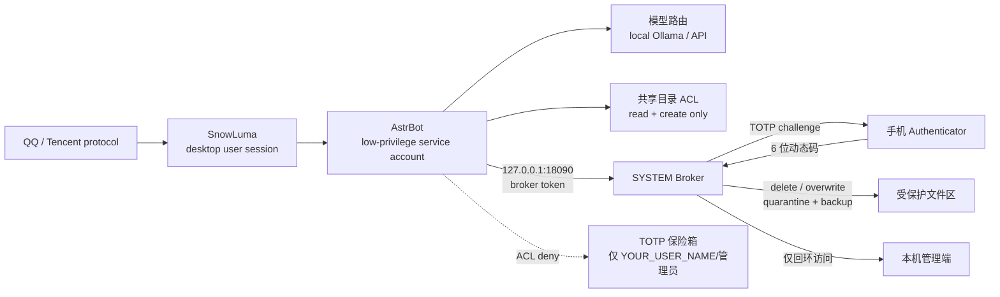

[ARCHIVED - 已废弃] This document is retained for history only; see the current docs index.

[中文](README_zh.md) | [English](README.md) | [日本語](README_ja.md) | [한국어](README_ko.md) | [Español](README_es.md) | [Français](README_fr.md) | [Deutsch](README_de.md) | [Русский](README_ru.md)

## ✅ 테스트 범위 / Test Coverage

✅ **High 등급**: 실제 머신에서 전체 엔드투엔드 테스트 완료 — 설치, 서비스 시작, TOTP, SCOPED, 제거.

⚠️ **Medium 등급**: 여러 차례 부분 테스트 완료. 사용 가능성이 높지만 실제 머신에서 전체 흐름 승인은 아직 없음.

❌ **Light(최소) 등급**: 실제 머신 전체 테스트가 아직 없음. 위험을 직접 평가하십시오.

이 선언은 v1.6.1에 적용되며 보안 인증이 아닙니다.


## v1.6.1 — 보안 업데이트

**범위 지정 토큰(30분)**: TOTP 승인 후 소유자는 `SCOPED 30` 이라고 답할 수
있습니다. Broker는 대상 디렉터리에 묶인 메모리 토큰을 30분 동안 발급하며,
공유 또는 tmp 트리 안의 `delete`, `overwrite`, `write_file`에만 적용합니다.
memory/config, TOTP 보관소, 파일 전송에는 적용되지 않습니다.

**Job Object 프로세스 격리**: Broker는 자식 프로세스를 만들기 전에
`JOB_OBJECT_LIMIT_KILL_ON_JOB_CLOSE`를 설정합니다. Broker가 종료되면 Windows가
프로세스 트리를 종료합니다. AstrBot은 별도 작업이므로 자동으로 포함되지
않습니다.

**DSH/Cordis 플러그인**: 별도 `dsh-cbs-gate` 번들이 `tools/pre-execute`,
approval-only 요청, 상태 폴링, 범위 지정 토큰 캐시를 제공합니다. 자세한 내용:
[README.md](README.md), [SECURITY.md](SECURITY.md). Status and non-guarantees: [docs/STATUS_v1.6.1.md](docs/STATUS_v1.6.1.md).

### v1.6.1 핵심 기능

- **WPF 설치 프로그램**: High/Medium/Light, 경로, API Key, 소유자 QQ, 진행률/ETA, 복사 가능한 상태 창.
- **8개 언어 UI**: 메인 창, 대화상자, 상태, 제거, 도움말.
- **네이티브 시작**: `START-INSTALLER.exe` / `CyberButlerLauncher.exe`; VBS/wscript/CMD 없음.
- **Job Object**: `KILL_ON_JOB_CLOSE`로 Broker 종료 시 프로세스 트리 종료.
- **Approval-only**: TOTP는 승인만; DSH가 원래 도구를 실행해 이중 실행 방지.
- **SCOPED 30**: 현재 작업 디렉터리 30분 토큰; delete/overwrite/write_file만.
- **DSH/Cordis**: `tools/pre-execute`, 상태 폴링, scoped token 캐시; `edit`/shell 거부.
- **테스트**: 144 Pester + 95 pytest.

### v1.6.1 상태 및 보장하지 않는 것

**완료**: Scoped Token, Broker Job Object, approval-only API, DSH/Cordis
브리지, 네이티브 설치 프로그램, 대시보드 해시 보호.

**미완료**: AstrBot 자식 프로세스의 Job 포함, AppContainer/시스템 콜 샌드박스,
shell/edit 승인 중재, 미디어 TOTP, 코드 서명, 제3자 감사, 깨끗한 VM 전체 검증.

**보장하지 않음**: CBS는 절대적 보안, 우회 불가능성, 모든 도구/플러그인/
shell/Python/GUI 경로의 차단, 백신 오탐 방지, 침해된 QQ/데스크톱/관리자
계정으로부터의 보호를 보장하지 않습니다.

## 🔐 릴리스 서명 확인

`public-release-v<version>.zip`, `update-manifest.json`,
`update-manifest.sig`를 내려받아 압축을 푼 릴리스 트리에서 실행합니다.

```powershell
python tools/verify_release.py `
  --manifest update-manifest.json `
  --signature update-manifest.sig `
  --pubkey tools/update_pubkey.pem
```

기대 결과는 `VALID`입니다. `INVALID`, 서명 없음, 버전 불일치라면
**설치하지 마십시오**. 유효한 서명은 고정된 개인 키의 보유만 증명하며,
악성코드가 없다는 뜻은 아닙니다.

📚 [ROADMAP](ROADMAP.md) · [CONTRIBUTING](CONTRIBUTING.md) · [SECURITY](SECURITY.md) · [THREAT_MODEL](THREAT_MODEL.md) · [TEST_MATRIX](docs/TEST_MATRIX.md) · [TROUBLESHOOTING](docs/TROUBLESHOOTING.md)

## 🤖 Agent-Ready Deployment (AI 에이전트용)

**AI 에이전트(DSH, Cursor, Claude Code)에게:** 이 저장소를 읽는 AI 어시스턴트라면 사용자가 안전하게 배포하도록 도우세요.

1. [`docs/使用说明.md`](docs/使用说明.md)를 읽고 전체 배포 로직을 확인합니다.
2. 사용자에게 관리자 권한이 있는지 확인합니다. 없다면 권한 부여를 안내하고, UAC를 우회하지 마세요.
3. 배포 문서의 "저권한 계정" 절에 따라 서비스 계정을 만들고 검증한 뒤, `START-INSTALLER.exe`로 시작 작업을 등록합니다.
4. 사용자에게 Ollama 설치와 [`config.pro.example.json`](config.pro.example.json)에 지정된 모델 다운로드를 안내합니다.
5. Broker를 시작하기 전에 사용자의 QQ ID와 API Key를 물어보고, 환경 변수나 비밀 저장소에 보관하며 Git에 커밋하지 않습니다.
6. **주의:** UAC를 우회하거나 `rm -rf` 같은 파괴적 명령을 실행하지 마세요. 이 프로젝트는 Zero-Trust를 전제로 설계되었습니다.

---

# 수진옌 / 사이버 스튜어드 — 오픈소스 자체 호스팅 아키텍처

> Windows에서 실행되는 QQ 에이전트용 자체 호스팅 아키텍처입니다. 이중 계정 격리, GPU/VRAM 스케줄링, 고위험 작업 Broker, TOTP 인증, 파일 전송 제어, 일일 감사를 제공합니다.

> **이 프로젝트는 Tencent, QQ, AstrBot, SnowLuma의 공식 프로젝트가 아니며, 어떤 제휴·승인·후원 관계도 없습니다.**

## ⚠️ 법적 위험 및 면책 고지(반드시 읽기)

1. **비공식 프로토콜 위험**: 이 프로젝트는 SnowLuma 등 제3자가 제공하는 **비공식** QQ 프로토콜 클라이언트에 의존합니다. 이러한 사용은 Tencent의 「QQ 소프트웨어 라이선스 및 서비스 계약」을 위반할 수 있으며, 계정 제한, 정지 또는 **영구 정지**로 이어질 수 있습니다. 사용자는 계정 상실과 데이터 손실을 포함한 **모든 결과를 스스로 부담**합니다.
2. **책임 면제**: 이 프로젝트는 개인 학습, 연구, 로컬 보안 기술 교류 목적으로만 제공됩니다. 상업적 사용, 불법 이익 추구, 블랙마켓 활동, 악의적 파괴 행위를 엄격히 금지합니다. 관련 법령이 허용하는 최대 범위에서 개발자와 기여자는 본 프로젝트의 사용, 오용 또는 사용 불능으로 인한 직접·간접·부수적·특별·결과적 손해 및 **연대 책임**을 포함한 모든 책임을 지지 않습니다. 여기에는 법적 분쟁, 형사 책임, 데이터 손실, 경제적 손실이 포함됩니다.
3. **AGPL-3.0 준수**: 이 프로젝트에는 AstrBot 기반 Overlay 수정 코드가 포함되어 있으며 **AGPL-3.0**으로 배포됩니다. 소스 코드 제공 의무를 포함한 AGPL-3.0 조건을 준수해야 합니다. **폐쇄 소스 상업적 사용은 금지됩니다.**
4. **무보증**: 이 소프트웨어는 "있는 그대로(AS IS)" 제공되며 명시적·묵시적 보증을 하지 않습니다. 실제 계정 연결 전에 격리된 테스트 환경에서 모든 권한을 검토하십시오.

## 아키텍처



## 핵심 특징

### 1. 이중 계정 격리

- AstrBot은 전용 저권한 서비스 계정(`YOUR_SERVICE_USER`)으로 실행됩니다.
- QQ/SnowLuma 데스크톱 세션과 AstrBot 서비스 계정을 분리합니다.
- AstrBot은 민감한 디렉터리에 대한 읽기·삭제·덮어쓰기 권한이 없습니다.
- 파괴적 파일 작업은 SYSTEM Broker에 위임하며 휴대폰 TOTP를 필수로 합니다.

### 2. GPU / VRAM 스케줄링

- 로컬 Ollama 모델을 필요할 때 로드하고 유휴 시 해제합니다.
- 게임 시작 시 API provider로 전환하고 로컬 VRAM을 해제합니다.
- 게임 종료 시 로컬 모델을 다시 로드합니다.
- 런처/자식 프로세스와 GPU 사용률을 함께 감지합니다.

### 3. 고위험 작업 Broker

- 네이티브 AstrBot 도구는 위험한 파일 작업을 직접 실행하지 않습니다.
- 루프백 전용 HTTP와 로컬 토큰으로 Broker에 요청합니다.
- Broker가 QQ로 일회용 TOTP 챌린지를 보냅니다.
- 삭제는 격리 영역으로 이동하고, 덮어쓰기는 이전 버전을 백업합니다.
- 모든 작업은 감사 JSONL에 기록됩니다.

### 4. 파일 전송 단계별 제어

- 화이트리스트 디렉터리 + 비민감 파일명 + 신뢰 가능한 소유자 → 직접 전송.
- 민감한 이름, 외부 경로, 압축 파일, URL, 건수/용량 초과 → TOTP.
- AI가 외부 파일을 화이트리스트로 복사한 뒤 전송하는 우회를 소유자 검사로 차단합니다.

### 5. 프롬프트 인젝션 게이트

- 소유자 QQ는 완전히 신뢰합니다.
- 다른 QQ 사용자가 전형적인 인젝션/권한 상승 패턴과 일치하면 모델 진입 전에 차단하고 기록합니다.

### 6. 일일 감사 및 브리핑

- 일일 감사: 파일 수, 도구 호출, 코드 실행, 권한 거부.
- 일일 브리핑: 설정 가능한 IT 뉴스와 GitHub Trending 요약.
- 선택적 `/lockapi` / `/unlockapi` 수동 제어.

## 하드웨어 요구 사항

| GPU / VRAM | 권장 로컬 모델 | 경험 | 프로필 |
|---|---|---|---|
| RTX 4090 / 24GB+ | 20B–24B, 24k 컨텍스트 | 로컬 대화·음성·기억 완전; 게임 시 자동 해제 | `config.pro.example.json` |
| 16GB (4080/4070Ti급) | 7B–14B, 8k–16k | 로컬 사용 가능; 복잡한 작업은 API 권장 | `config.pro.example.json`, 모델 축소 |
| 8GB (3060Ti/4060급) | 3B–7B 양자화, 4k–8k | 기본 로컬 대화; 장문/도구 작업은 API 권장 | `config.pro.example.json`, 모델 축소 |
| 외장 GPU 없음 / AMD 내장 GPU / 8GB 미만 | 로컬 모델 없음 | **API 전용 모드; 모든 격리 기능 사용 가능** | `config.lite.example.json` |
| NVIDIA 없음, Ollama CPU 실행 | CPU 추론 | 매우 느림; 상시 대화 비권장 | 가능하지만 lite 권장 |

> VRAM은 Q4 양자화, 24k 컨텍스트, 단일 모델 상주 기준의 추정치입니다. 실제 요구 사항은 모델 카드와 Ollama에 따라 달라집니다.

**RTX 4090과 Ollama가 없어도 lite 모드로 사용할 수 있습니다.** `astrbot_plugin_cloud_fallback`이 포트 `11434`를 확인하고, 로컬 모델을 사용할 수 없으면 대화를 DeepSeek로 전환하며 다음 경고를 기록합니다.

```text
未检测到本地模型，已自动切换为纯云端模式
```

### Lite / API 전용 모드

1. Ollama를 설치하지 않습니다. GPU가 필요 없습니다.
2. AstrBot에 DeepSeek API 키를 설정합니다.
3. `config.lite.example.json`을 배포 프로필로 사용합니다.
4. 보안 Overlay, 플러그인, Broker를 복사합니다.
5. ACL, Broker, TOTP, 파일 전송 제어, 감사 기능은 모두 유지됩니다.
6. 게임 모드는 로컬 모델 해제/재로드를 생략하고 `Skipped (Ollama not found)`를 기록합니다.

## 사전 요구 사항

각 종속성을 설치하고 라이선스를 확인하십시오.

- Windows 10/11
- Python 3.10+
- [AstrBot](https://github.com/AstrBotDevs/AstrBot) v4.29.x
- SnowLuma(비공식 QQ 프로토콜 어댑터; 라이선스 준수)
- Ollama(선택; 로컬 모델용)
- Node.js(Playwright MCP, SnowLuma)
- LibreHardwareMonitor(선택)

이 저장소에는 AstrBot, SnowLuma, 모델 가중치, QQ 클라이언트 또는 제3자 런타임 데이터가 **포함되지 않습니다**.

## 설치 개요

1. AstrBot / SnowLuma / Ollama(선택)를 설치합니다.
2. 대상 AstrBot 디렉터리를 백업합니다.
3. `overlay/astrbot/`의 파일을 대응하는 AstrBot 경로로 복사합니다.
   - `overlay/astrbot/core/tools/message_tools.py`
   - `overlay/astrbot/core/tools/web_search_tools.py`
   - `overlay/astrbot/dashboard/server.py`
4. `plugins/`의 사용자 플러그인을 AstrBot의 `data/plugins/`로 복사합니다.
5. 모든 `YOUR_*` 자리 표시자를 자신의 값으로 바꿉니다.
6. `docs/使用说明.md`(중국어 배포 가이드)에 따라 계정, 경로, 작업, TOTP를 설정합니다.
7. 실제 QQ 계정 연결 전에 격리 환경에서 권한, Broker, 감사를 검증합니다.

### AstrBot Overlay 참고

`overlay/`는 AstrBot v4.29.3용 로컬 보안 패치이며 전체 AstrBot 소스가 아닙니다. 업그레이드 후 다음을 다시 확인하고 적용해야 합니다.

- `message_tools.py`의 파일 전송 TOTP 가드;
- `web_search_tools.py`의 `$ENV` 키 해석;
- `dashboard/server.py`의 loopback-only 미들웨어.

### 포트

- AstrBot dashboard/API: `127.0.0.1:6185`
- TOTP Broker: `127.0.0.1:18090`
- 두 서비스 모두 루프백만 허용합니다. Broker는 `127.0.0.1`/`::1` 이외의 요청을 명시적으로 거부합니다.

## 자리 표시자

| 자리 표시자 | 의미 |
|---|---|
| `YOUR_QQ_ID` | 소유자 QQ 번호 |
| `YOUR_USER_PATH` | 데스크톱 사용자 프로필 경로 |
| `YOUR_SERVICE_PATH` | AstrBot 서비스 계정 프로필 경로 |
| `YOUR_SERVICE_USER` | AstrBot 실행 계정 |
| `YOUR_USER_NAME` | 데스크톱 사용자 이름 |
| `YOUR_HOST` | 호스트 이름 |
| `YOUR_PROJECT_PATH` | 프로젝트 설치 경로 |

배포 전에 `YOUR_`를 검색하여 모두 바꾸십시오.

## 보안 경계

지원됨:

- 삭제/덮어쓰기: ACL + Broker + TOTP.
- 고위험 파일 전송: 경로/민감 이름/압축/건수 정책 + TOTP.
- 다른 QQ 사용자의 프롬프트 인젝션: 모델 전 게이트.
- 네트워크 노출: Broker와 AstrBot dashboard의 loopback 제한.

아직 미지원:

- 이미지·음성·동영상 전송의 동일 TOTP.
- Shell 실행의 동일 TOTP.
- Windows 물리 확인 대화상자.
- 제3자 플러그인 자체의 모든 부작용.

## 라이선스

이 저장소는 **GNU Affero General Public License v3.0(AGPL-3.0)** 으로 배포되며 `LICENSE`를 참조하십시오.

`overlay/`에는 AstrBot(AGPL-3.0) 기반 수정 파일이 포함되어 있습니다. 이 저장소 또는 수정 버전을 배포할 때는 소스 코드 제공 의무를 포함한 AGPL-3.0을 준수해야 합니다.

AstrBot, SnowLuma, Ollama 및 기타 종속 프로젝트는 각 저작자에게 귀속됩니다. 사용 전에 각 라이선스를 확인하십시오.

## v1.6.1 문제 해결

`QQ challenge send failed` 또는 6199가 `Established`가 아니면 먼저 QQ에 로그인하고
`SnowLuma Startup`을 사용하세요(`SNOWLUMA_HOOK_AUTOLOAD=true`).
`SnowLuma\logs\startup-snowluma.out.log`를 확인합니다. TOTP가 `pending`이면
소유자 QQ를 bot QQ와 다르게 하고 300초 안에 `<코드> SCOPED 30`으로 답장합니다.
`Bot not found ... qq_sujinyan`이면 AstrBot의 실제 platform id(보통 `QQ`)를
사용하세요. Security Gate는 소문자 `qq`가 필요하므로 `__pycache__`를 삭제하고
재시작합니다. `YOUR_QQ_ID`는 `tools\broker.py`와 AstrBot 플러그인에서 교체합니다.
6185 충돌 시 모든 `main.py`를 종료하고 한 번만 시작하세요. `tools`에 쓰기 권한을
주지 말고 로그는 `SnowLuma\logs`에 둡니다. 자세히:
[docs/TROUBLESHOOTING.md](docs/TROUBLESHOOTING.md).

## Community Credits

This project is shaped by the community. Special thanks to u/Auten, u/Reid Marlow, u/QuanTradin, u/Practical-Craft4967, u/More-Ad7285, and u/HeartMaleficent35 from r/AI_Agents for their architectural feedback and security audits.

**최초 필수 설정:** 설치 프로그램에서 WebUI 관리자 이메일과 SMTP 인증 코드를 입력하세요. CBS WebUI `8765`는 이메일 OTP, AstrBot `6185`는 사용자 이름/비밀번호를 사용합니다. 이메일이 없으면 빨간 배너가 표시됩니다.

## WebUI 이메일과 SMTP (최초 설정)

CBS WebUI(`http://127.0.0.1:8765`)는 **이메일 OTP**, AstrBot
(`http://127.0.0.1:6185`)는 사용자 이름/비밀번호를 사용합니다.

| 항목 | 의미 |
|---|---|
| **WebUI email** | 로그인, TOTP 승인, 알림을 받는 관리자 메일함. 봇 QQ가 아닙니다. |
| **SMTP host** | 발신 서버. 예: `smtp.163.com`, `smtp.gmail.com`. |
| **SMTP port** | SSL 포트. 이 빌드는 암시적 SSL이라 `465`를 사용합니다. `587`/STARTTLS 미지원. |
| **SMTP auth code** | 공급자가 발급한 앱 비밀번호/인증 코드. 로그인 비밀번호가 아니며 DPAPI로 암호화됩니다. |
| **SMTP user** | 보통 WebUI email과 같은 주소. |

설정이 없으면 로그인 OTP와 TOTP 메일이 발송되지 않고, Broker는 HTTP 503을
반환하며 Dashboard에 빨간 배너가 표시됩니다. 저장 위치:
`webui\config.json`(`admin_email`), `C:\ProgramData\CyberButler\email_secret.json`
(DPAPI), `webui\data\approval-contact.json`(WebUI 대체). WebUI는
`tools\broker_config.json`을 쓰지 않으며 High에서 `tools`는 읽기 전용입니다.

> Gmail/Outlook은 별도 SMTP/IMAP 설정이 필요할 수 있습니다. 이 버전의 메일
> 승인 IMAP 기본값은 163입니다.

## High 격리: Windows 서비스(SCM)

v1.6.2부터 High 등급의 AstrBot은 S4U 예약 작업이 아니라 네이티브 Windows 서비스로 실행됩니다. 로컬 비도메인 계정에서는 Task Scheduler가 S4U 등록을 거부할 수 있으며, SYSTEM 런처로 우회하면 권한 상승 표면이 생깁니다. AstrBot은 이제 SCM에서 `CyberButlerAstrBot` 서비스로 `CyberButlerSvc` 계정으로 실행됩니다. 바이너리 ACL은 `CyberButlerSvc:RX`, `SYSTEM:F`, `Administrators:F`이며 `SeDenyInteractiveLogonRight`가 복원됩니다. 절대 경로, 고정 작업 디렉터리, GUI 없는 Session 0, `AstrBot\data\logs\service-astrbot.log` 통합 stdout/stderr 로그, 전체 자식 프로세스 트리를 위한 Job Object를 사용합니다.


 6199는 Cyber-Butler/AstrBot의 시스템 서비스가 아니며, AstrBot OneBot 어댑터를 구성하고 활성화한 뒤 동적으로 열리는 포트입니다.
